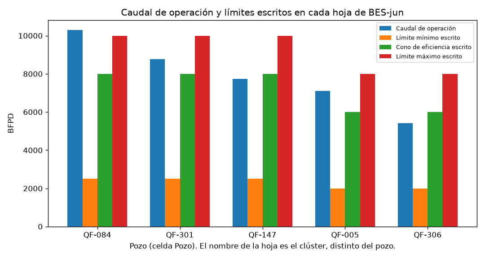
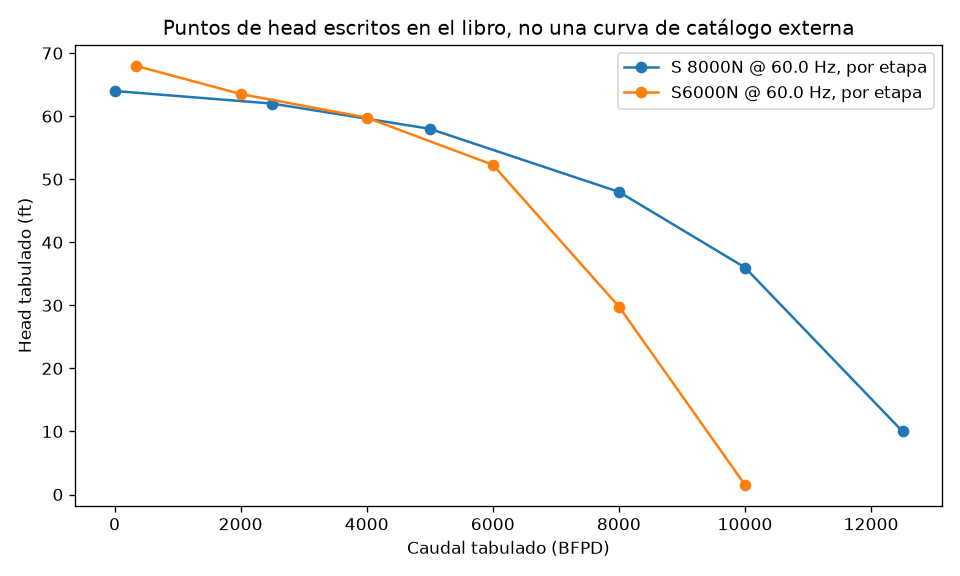

# Análisis preliminar · BES-jun

**Documento histórico.** Borrador del 2026-10-17. El informe vigente es `informe_analisis_BES-jun.md`. Las figuras `caudal_y_limites.png` y `head_tabulado.png` que cita este borrador siguen en `reports/figuras/` porque el cuaderno de inventario y `docs/matriz_requerimientos_estudio.md` las referencian; no forman parte de las figuras que produce el código actual.

Fecha: 2026-10-17. Libro: `Copia de FINAL BES-jun.xlsx`. Copia leída: `entrada/BES_jun.xlsx`. SHA-256 `ccb5a738baea13321993e8b6eccefd6cac90ecda86b1c4b9181f897fcfa83f85`. Expediente: `datasets/en_uso/BES-jun`. Estado: Listo para revisión.

Este informe no valida un modelo. Reproduce cuentas que el propio libro ya guarda y las separa de lo que no se puede afirmar.

## Resumen

El libro tiene cinco hojas. En cada una, `Cluster:` coincide con el nombre de la hoja y `Pozo:` trae otro código: QF-084, QF-301, QF-147, QF-005 y QF-306. El libro no dice cuál de los dos identifica el pozo. No es `RB-1521-PY-121120.xls` ni `RB-IA-2191-Data.xlsx`.

En cada hoja hay un punto de operación, una tabla de bomba a 60 Hz y un survey con MD y TVD. La cadena que las celdas calculan —gravedad, gradiente, PIP en pies desde la presión de sensor, fricción y THD— se rehízo en Python y coincide con el valor cacheado de las cinco hojas. Esa coincidencia comprueba la transcripción.

No hay serie de días. No hay pronóstico. El PIP en pies sale de la presión de sensor; no es una estimación sin sensor ni una predicción contrastada con otra medición.

## Estructura y calidad

Cinco hojas visibles, sin nombres definidos. Hay fórmulas y valores cacheados. El archivo se leyó dos veces en memoria y no se guardó. En `QF-549HST` la caché tiene 13 `#DIV/0!` en la columna D, en promedios de celdas vacías del bloque eléctrico y en fórmulas que las citan. Esas celdas no entran en la cadena de PIP y THD. Las otras cuatro hojas no muestran ese error. El detalle está en `data_procesados/calidad.md`.

Cuatro hojas tienen `=TODAY()` en la fecha. El valor cacheado es 2026-10-17, el día del cálculo guardado, no una fecha de prueba. QF-549HST tiene escrita la fecha 2017-09-06.

BS&W está rotulado «%» y la fórmula de densidad lo usa como fracción. API es 12 °API, la presión de yacimiento 1100 psi y la presión de burbuja 130 psi en las cinco hojas. Esos tres números repetidos no se interpretaron como un mismo yacimiento: faltaría una fuente que lo diga.

QF-005 tiene caudal de prueba 7094.4 BFPD (`295.6*24`) y caudal de operación 7116 BFPD (`296.5*24`). El factor 24 no está definido en otra celda.

## Pozos

El libro no declara una llave única. Junto a `Cluster:` el texto coincide con el nombre de la hoja. Junto a `Pozo:` hay otro código. Cada hoja se calculó aparte. No se unieron hojas. En la tabla, la columna Pozo es el texto de esa celda y la columna Clúster es el de la otra.

| Pozo | Clúster | Bomba | Etapas | Hz | Caudal BFPD | Presión de sensor psi | THP psi | Límite máx. BFPD | PIP en ft (cache = cálculo) | THD ft |
|---|---|---|---:|---:|---:|---:|---:|---:|---:|---:|
| QF-084 | QF-554H | S 8000N | 53 | 63 | 10301 | 732 | 183 | 10000 | 1714.50 | 2083.22 |
| QF-301 | QF-545H | S 8000N | 50 | 57 | 8767 | 667 | 210 | 10000 | 1558.04 | 1971.96 |
| QF-147 | QF-500H | S 8000N | 36 | 56 | 7728 | 821 | 194 | 10000 | 1920.73 | 1517.21 |
| QF-005 | QF-378HST | S6000N | 31 | 67 | 7116 | 810 | 145 | 8000 | 1891.21 | 1592.46 |
| QF-306 | QF-549HST | S6000N | 31 | 62 | 5419 | 607 | 177 | 8000 | 1422.32 | 1814.51 |

Los PIP y THD de la tabla son los de la fórmula de la hoja, confirmados por `pytest` (8 pruebas). No son una estimación independiente.

## Variables

Unidades tomadas del rótulo de la celda: Hz, BFPD, psi, ft, inch, °API, °F, °C, HP. Pendientes: BS&W («%» frente a fracción), el rótulo `psi*ft` del gradiente, el rótulo Kg/Lt sobre una densidad calculada en lb/gal, y la columna EFF de la tabla (valores hasta 7.6 con rótulo «%», mientras el cociente de potencias de la misma hoja queda cerca de 0.81 en QF-084).

## Ecuaciones

Se transcribieron F-01 y las celdas de densidad, gradiente, PIP en ft, THP en ft, Hazen-Williams y THD. El detalle y las diferencias con E1, con el XLSM y con el PDF están en el catálogo común `../../../../docs/trazabilidad_ecuaciones.md`.

El modelo de E1 que resuelve el caudal desde la potencia no se aplicó: faltan coeficientes que el DOCX nombra y el libro no trae. El artículo SensorLess no aporta mediciones de estos pozos. Su desviación mediana de 4.3 % no se usa como resultado.

## Alcance predictivo

No hay pronóstico. Para hablar de predicción harían falta una variable objetivo, tiempos de operación y una medición de referencia distinta de las entradas. Aquí la presión de sensor es entrada del PIP en pies. Compararla con ese PIP sería circular.

Lo que sí se puede decir, como cálculo del libro: a la frecuencia escrita, el caudal de QF-084 está 301 BFPD por encima del límite máximo escrito en su hoja. Los otros cuatro caudales caen entre el mínimo y el máximo escritos en la suya. Esos límites son celdas del archivo, no un rango de fabricante verificado.

## Figuras

El gráfico compara cuatro números de la misma hoja. No dice por qué el caudal está donde está.

Son los seis puntos escritos para cada referencia, en ft de head por el valor de la columna Head. No es una curva de catálogo escaneada. S 8000N y S6000N no se dibujaron como si fueran la misma bomba.

## Limitaciones

- El signo de «PIP en (ft)» no se reconcilió con F-12. Se dejó el de la celda.
- El exponente de Hazen-Williams de la hoja es 4.8566; el del PDF es 4.8655.
- La fricción usa la TVD de descarga como longitud.
- La columna Vertical del survey está guardada como valor. No se rehizo el cálculo direccional.
- D1 y D2 no entran en estas cifras.

## Preguntas

1. ¿BS&W 0.9755 es fracción o por ciento?
2. ¿El signo de PIP en ft es el que se quiere conservar?
3. ¿La tabla de 6 puntos es la curva del fabricante o un esquema de la hoja?
4. ¿P-14 del plan: BES-jun pasa a ser un dataset del tablero, delante de D1?
