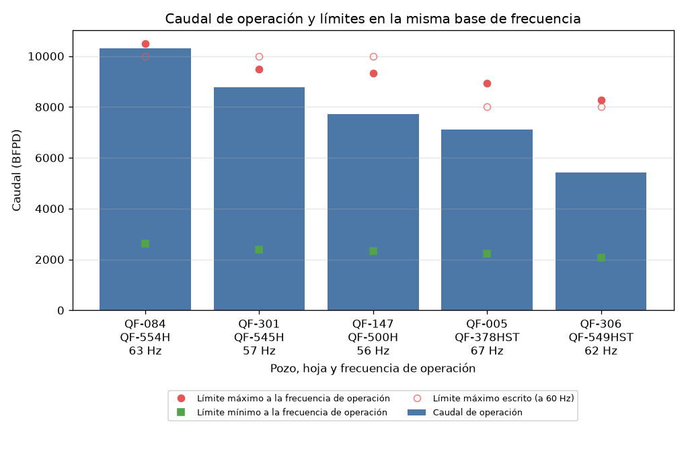
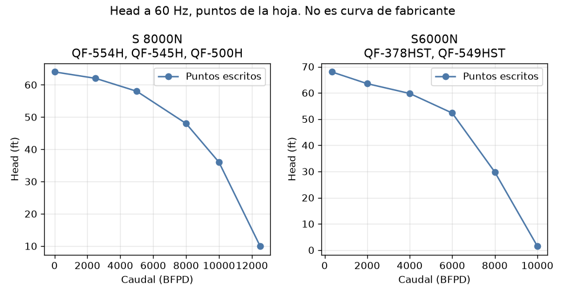
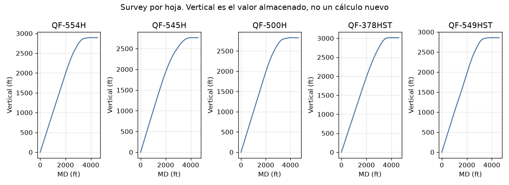
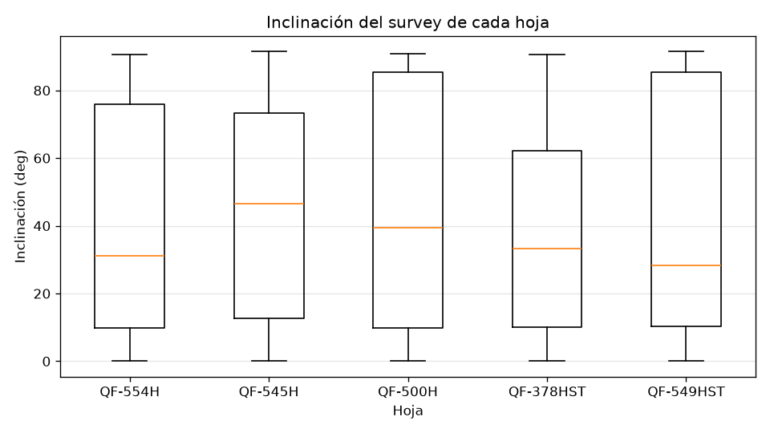
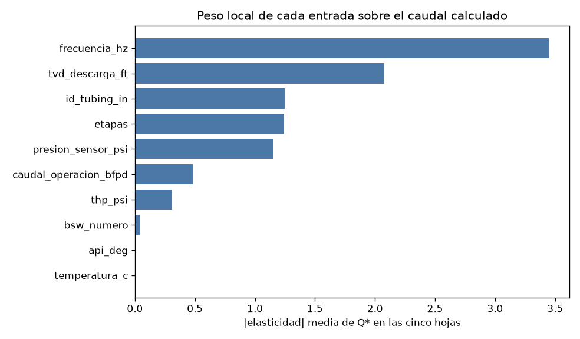

# Informe de análisis · BES-jun

Estado del expediente: **Listo para revisión**.

## Objetivo y alcance

Este informe describe el único Excel en `datasets/en_uso/`: `Copia de FINAL BES-jun.xlsx`.
La copia de trabajo es `entrada/BES_jun.xlsx`.
El cuaderno de inventario imprime la ruta, el tamaño en bytes y el SHA-256 de la copia de trabajo, de `fuentes/originales/` y del archivo recibido en la raíz del proyecto.
Los tres valen `ccb5a738baea13321993e8b6eccefd6cac90ecda86b1c4b9181f897fcfa83f85` y 329308 bytes.
Esa coincidencia es identidad de bytes. No califica las mediciones ni las fórmulas.
No se abrieron RB-1521 ni RB-IA-2191. No se construyó un motor para otros archivos. No se instaló un GLM.

## Fuentes y fórmulas

El catálogo común está en `../../../docs/trazabilidad_ecuaciones.md`.
En este libro se usaron solo las expresiones que la propia hoja escribe y que el código contrasta con la caché.

| ID | Estado | Aplicación en este Excel |
|---|---|---|
| F-01 | utilizable | gravedad específica a 60 °F desde API |
| B98-temperatura | utilizable con reserva | corrección de temperatura de la gravedad; el gradiente de la hoja la usa |
| B100-B102 | utilizable con reserva | densidad y gradiente tal como los escribe la hoja |
| G96-PIP | utilizable con reserva | cálculo directo desde la presión de sensor, no estimación sin sensor |
| G98-THP | utilizable | THP en psi dividido por el gradiente |
| G100-Hazen | utilizable con reserva | fricción de la hoja, exponente 4.8566, C = 120 dentro de la fórmula, longitud = TVD de descarga |
| G102-THD | utilizable con reserva | THD de la hoja = TVD descarga + fricción + THP − PIP |
| F-26-afinidad | utilizable con reserva | la hoja escala Q con f/f_curva, head con (f/f_curva)^2 por etapas, y los límites con f/60 |
| Q-interseccion | utilizable con reserva | intersección de la THD con la curva de bomba a velocidad actual (MATCH/INDEX, interpolación lineal) |
| F-02-F-03 | fuera del alcance actual | gradiente 0.433 del XLSM; la hoja usa 0.052 por densidad |
| Potencia-motor-cable | fuera del alcance actual | cadena eléctrica y de potencia de la hoja, con constantes (0.0000018134, 119.826368, 0.746, 0.241...) sin documentar |
| F-36-F-40 | fuera del alcance actual | Método B y observador de E1 |
| F-41-J64 | fuera del alcance actual | cadena del XLSM, incluido el signo de J64 |

La corrección de temperatura y el signo del PIP frente a F-12 quedan en aclaración.
Eso no detiene el cálculo directo de la celda: la fuente de la aritmética es la propia celda.
El Método B, el observador y la cadena del XLSM quedan fuera de este análisis.

## Estructura y calidad

Cinco hojas, todas visibles. Ninguna oculta. Cada hoja tiene un punto de operación, una tabla de seis puntos a 60 Hz y un survey `Measured`.
El libro no declara si la llave es el nombre de la hoja, el rótulo Cluster o el rótulo Pozo.
Cada hoja se analizó sola.
Cuatro fechas son `=TODAY()`; el valor cacheado 2026-10-17 es la fecha de cálculo del libro.
QF-549HST tiene escrita 2017-09-06. No hay serie de días ni periodos que interpolar.
En QF-549HST hay 13 cachés `#DIV/0!` en promedios del bloque eléctrico. No entran en PIP ni en THD.
No se imputó ningún valor. El registro está en `data_procesados/transformaciones.md`.

## Pozos

La columna Pozo es el texto de esa celda. La columna Hoja es el nombre de la hoja.

| Hoja | Pozo | Bomba | Hz | Caudal BFPD | PIP ft | THD ft | Regla candidata |
|---|---|---|---:|---:|---:|---:|---|
| QF-554H | QF-084 | S 8000N | 63 | 10301 | 1714.50 | 2083.22 | RC-BES-03 dentro_de_los_limites_escritos |
| QF-545H | QF-301 | S 8000N | 57 | 8767 | 1558.04 | 1971.96 | RC-BES-03 dentro_de_los_limites_escritos |
| QF-500H | QF-147 | S 8000N | 56 | 7728 | 1920.73 | 1517.21 | RC-BES-03 dentro_de_los_limites_escritos |
| QF-378HST | QF-005 | S6000N | 67 | 7116 | 1891.21 | 1592.46 | RC-BES-03 dentro_de_los_limites_escritos |
| QF-549HST | QF-306 | S6000N | 62 | 5419 | 1422.32 | 1814.51 | RC-BES-03 dentro_de_los_limites_escritos |

## Estadísticas

El punto de operación es uno por hoja. Con n = 1, mínimo, máximo, media y mediana coinciden con ese valor y la desviación estándar no se calcula.
El archivo no se resume como un solo pozo.
El survey sí tiene varias estaciones. Las cifras están en `data_procesados/estadisticas_survey.csv`.

| Hoja | Estaciones | MD mínimo ft | MD máximo ft | Inclinación máxima deg |
|---|---:|---:|---:|---:|
| QF-554H | 56 | 0 | 4530 | 90.7 |
| QF-545H | 68 | 0 | 4576 | 91.5 |
| QF-500H | 71 | 0 | 4637 | 90.8 |
| QF-378HST | 59 | 0 | 4598 | 90.5 |
| QF-549HST | 67 | 0 | 4592 | 91.5 |

No hay frecuencia de muestreo en el tiempo. El paso entre estaciones es de profundidad medida, no de días.
No se armó una matriz de correlación: cinco puntos de operación de hojas distintas no estiman una relación causal, y mezclarlos sería tratarlos como un mismo pozo.

## Gráficos

Los círculos llenos son el máximo y el mínimo llevados a la frecuencia de operación (Q · f / 60). El círculo hueco es el máximo tal como está escrito a 60 Hz. QF-084 (QF-554H, 63 Hz): caudal 10301 BFPD, máximo a esa frecuencia 10500 BFPD, clasificación preliminar RC-BES-03. QF-301 (QF-545H, 57 Hz): caudal 8767 BFPD, máximo a esa frecuencia 9500 BFPD, clasificación preliminar RC-BES-03. QF-147 (QF-500H, 56 Hz): caudal 7728 BFPD, máximo a esa frecuencia 9333 BFPD, clasificación preliminar RC-BES-03. QF-005 (QF-378HST, 67 Hz): caudal 7116 BFPD, máximo a esa frecuencia 8933 BFPD, clasificación preliminar RC-BES-03. QF-306 (QF-549HST, 62 Hz): caudal 5419 BFPD, máximo a esa frecuencia 8267 BFPD, clasificación preliminar RC-BES-03. En QF-084 el máximo escrito a 60 Hz es 10000 BFPD y el caudal es 10301 BFPD a 63 Hz. Escalado, el máximo es 10500 BFPD (10000 × 63 / 60). El caudal queda dentro. Compararlo con el número de 60 Hz mezcla dos frecuencias y no es la clasificación vigente. El escalamiento no valida el límite del fabricante ni la afinidad (CT-08).

Son los seis puntos escritos en la hoja. No se dibujó una curva de fabricante ni se marcó un BEP.

Vertical es el número almacenado. No se recalculó la trayectoria.

La inclinación llega a valores cercanos a 90 grados en las cinco hojas. Cada caja es el survey de esa hoja.

## Resultados de los cálculos

En las cinco hojas el fluido y el balance quedan en estado calculable y el PIP y el THD coinciden con la caché.
Eso comprueba la transcripción. La presión de sensor es una entrada, así que el PIP en pies no es una estimación sin sensor.
No hay residual contra otra medición de PIP.

## Capacidad predictiva

Cálculo directo: gravedad, densidad, gradiente, PIP en pies, THP en pies, fricción y THD, con las fórmulas de la hoja.
Estimación con parámetros no medidos en este libro: no se hizo. Faltan los coeficientes del Método B.
Predicción de comportamiento futuro: no hay serie temporal ni variable objetivo de un instante posterior. No existe predicción validada.
Sensibilidad local: sí se calculó, como derivada alrededor del punto escrito, no como un escenario de operación. Está más abajo.
Simulación de un cambio de consigna: no se hizo y no se recomienda.

## Pregunta

Qué se puede afirmar, con las cinco hojas, sobre el punto de operación escrito, y qué de eso puede consumir un evaluador de reglas sin tratarlo como una orden de operación.

## Los cinco puntos

Cada hoja es un solo punto de operación. No hay serie temporal y las estaciones del survey no son ensayos de la bomba. Con cinco puntos heterogéneos no se estima una correlación ni un modelo estadístico.

| Pozo | Hoja | Bomba escrita | Etapas | Hz | Caudal BFPD | P sensor psi | THP psi | ID in | TVD descarga ft |
|---|---|---|---:|---:|---:|---:|---:|---:|---:|
| QF-084 | QF-554H | S 8000N | 53 | 63 | 10301 | 732 | 183 | 2.996 | 2645 |
| QF-301 | QF-545H | S 8000N | 50 | 57 | 8767 | 667 | 210 | 2.996 | 2527 |
| QF-147 | QF-500H | S 8000N | 36 | 56 | 7728 | 821 | 194 | 2.996 | 2572 |
| QF-005 | QF-378HST | S6000N | 31 | 67 | 7116 | 810 | 145 | 2.996 | 2764 |
| QF-306 | QF-549HST | S6000N | 31 | 62 | 5419 | 607 | 177 | 2.996 | 2608 |

Hay dos textos de bomba, no cinco curvas distintas: S 8000N en QF-084, QF-301, QF-147; S6000N en QF-005, QF-306. La frecuencia va de 56 a 67 Hz y el caudal de 5419 a 10301 BFPD. El diámetro interno escrito es el mismo en las cinco hojas.

°API toma 1 valor distinto en las cinco hojas (12). Eso no prueba que el fluido sea el mismo en los cinco pozos: es la consulta CT-10.
Cada curva tabulada tiene seis puntos a 60 Hz. No son mediciones de la bomba en operación.

## Qué relaciona el modelo

El PIP en pies sale de la presión del sensor, las profundidades y el gradiente. No es una estimación sin sensor, y el signo es el de la celda (CT-03). Con el sensor más profundo que el intake, esa fórmula y una corrección hidrostática simple tienen signos opuestos; la transcripción no se reemplaza. En las cinco hojas el sensor está más profundo que el intake y la diferencia es el doble de esa separación: QF-084 51.3 ft, QF-301 38.6 ft, QF-147 51.1 ft, QF-005 41.2 ft, QF-306 41.1 ft. La caché coincide con la celda. La fricción de Hazen-Williams usa el caudal medido, el diámetro y la TVD de descarga como longitud, con el exponente 4.8566 de la hoja (CT-05). La THD suma esa fricción, la TVD de descarga y el THP en pies, y resta el PIP. Q* es el caudal en el que la altura de la bomba, llevada a la frecuencia de operación con las leyes de afinidad de la hoja y multiplicada por las etapas, iguala esa THD. Reproducir la caché de Excel demuestra la transcripción. No demuestra que el pozo vaya a producir Q*.

## Caudal calculado y caudal medido

Q* es el caudal en el que la altura de la bomba, a la frecuencia de la hoja, iguala la THD. La THD usa el caudal medido en la fricción, así que el cálculo no es autoconsistente. La diferencia describe el contraste; no dice que el pozo pierda o gane producción.

| Hoja | Pozo | Q medido BFPD | Q* BFPD | Diferencia relativa |
|---|---|---:|---:|---:|
| QF-554H | QF-084 | 10301 | 10535 | 2.3% |
| QF-545H | QF-301 | 8767 | 8281 | -5.5% |
| QF-500H | QF-147 | 7728 | 7360 | -4.8% |
| QF-378HST | QF-005 | 7116 | 7803 | 9.6% |
| QF-549HST | QF-306 | 5419 | 5503 | 1.6% |

## Sensibilidad local

La elasticidad es (ΔQ*/Q*) / (Δx/x), con diferencia central y un paso del 1 % en la entrada. Cada perturbación vuelve a calcular fluido, balance e intersección. El signo positivo quiere decir que, en este punto, Q* sube cuando sube esa entrada. La magnitud dice cuánto pesa la entrada aquí. No es una incertidumbre, no es un intervalo de confianza y no se extrapola a otra frecuencia o a otro pozo.

| Entrada | QF-084 | QF-301 | QF-147 | QF-005 | QF-306 |
|---|---:|---:|---:|---:|---:|
| api_deg | 0.00 | 0.00 | 0.01 | 0.00 | 0.01 |
| temperatura_c | 0.00 | 0.00 | 0.00 | 0.00 | 0.00 |
| bsw_numero | -0.01 | -0.02 | -0.08 | -0.02 | -0.07 |
| presion_sensor_psi | 0.28 | 0.65 | 2.11 | 0.62 | 2.13 |
| thp_psi | -0.07 | -0.21 | -0.54 | -0.11 | -0.62 |
| caudal_operacion_bfpd | -0.22 | -0.41 | -0.94 | -0.23 | -0.62 |
| id_tubing_in | 0.68 | 1.07 | 2.25 | 0.62 | 1.62 |
| tvd_descarga_ft | -0.63 | -1.29 | -3.14 | -1.04 | -4.29 |
| frecuencia_hz | 1.81 | 2.67 | 4.19 | 2.05 | 6.51 |
| etapas | 0.35 | 0.84 | 1.76 | 0.52 | 2.75 |

En las cinco hojas la entrada de mayor |elasticidad| media es `frecuencia_hz` (3.45), seguida de `tvd_descarga_ft` (2.08) y `id_tubing_in` (1.25). La frecuencia mueve Q* más que el caudal medido, el THP o el °API en este entorno. Eso describe el modelo transcrito. No autoriza a cambiar la frecuencia.

Derivada de Q* respecto de la profundidad vertical de los equipos, en BFPD por pie, con un paso de 1 ft:

| Pozo | tvd_descarga_ft | tvd_intake_ft | tvd_sensor_ft |
|---|---:|---:|---:|
| QF-084 | -2.21 | -1.73 | 1.73 |
| QF-301 | -4.23 | -3.51 | 3.51 |
| QF-147 | -10.38 | -8.93 | 8.93 |
| QF-005 | -2.93 | -2.57 | 2.57 |
| QF-306 | -9.05 | -8.35 | 8.35 |

Un pie más de profundidad no pesa igual en la descarga, en el intake y en el sensor, porque cada uno entra en un término distinto de la THD o del PIP.

A 80 Hz, fuera del rango observado (56–67 Hz), la misma cadena sobre QF-554H devuelve estado `calculable` y 15114 BFPD con alertas ninguna. El modelo no avisa de esa extrapolación. El evaluador del expediente sí la marca, sin cambiar la ecuación.

## Reglas candidatas

Con los límites en la misma base de frecuencia, las cinco hojas dan 5 veces RC-BES-03, 0 veces RC-BES-01 y 0 veces RC-BES-02. RC-BES-04 no se evalúa: no hay curva de fabricante ni una columna EFF de significado confirmado. Su consulta es CT-06. CT-09 es otra pregunta: qué diferencia entre Q* y el caudal medido se aceptaría, y no fundamenta el BEP.
Ninguna regla está aprobada. El detalle está en `docs/reglas_candidatas.md` y el resultado estructurado sale de `evaluacion.motor.evaluar`.
Una versión anterior de este informe decía que RC-BES-01 se activaba en QF-084. Eso correspondía a comparar el caudal a la frecuencia de operación con el máximo escrito a 60 Hz. Esa frase queda retirada. La comparación sin escalar se conserva en el código solo como control del artefacto.

## Hallazgos

Cinco puntos no alcanzan para una correlación. Lo que sí se puede decir, y lo que no:

- Hay dos textos de bomba, no cinco curvas de fabricante. Compartir el rótulo S 8000N o S6000N no demuestra que la máquina sea la misma.
- En la misma base de frecuencia, el caudal escrito queda entre el mínimo y el máximo escalados en las cinco hojas. La clasificación preliminar es RC-BES-03. Eso es coherencia con los números de la hoja, no un aval de operación.
- Q* y el caudal medido no coinciden. El caudal medido entra en la fricción, así que el contraste no es una validación predictiva independiente.
- La elasticidad local de mayor |media| es la frecuencia. Describe el modelo transcrito alrededor de cada punto. No es una incertidumbre y no autoriza a mover la frecuencia.
- RC-BES-04 no se evalúa. La columna EFF no tiene un significado físico confirmado. La consulta que lo bloquea es CT-06, no la tolerancia entre Q* y el caudal medido.

## Qué puede usar la aplicación

Los resultados que pueden alimentar una regla son los que el motor ya calcula y deja en evidencia: caudal de operación, frecuencia, límites escritos, límites escalados con Q ∝ f, PIP, THD y Q*. Los modelos implementados, versión de transcripción, son `M-BES-FLUIDO`, `M-BES-BALANCE`, `M-BES-INTERSECCION`. Para evaluar una hoja hacen falta las variables de fluido, de balance y de la curva: °API, temperatura, BS&W, presión de sensor, THP, las tres TVD, caudal, diámetro, frecuencia, etapas y los límites a 60 Hz, cada una con su unidad.

Reglas formuladas: RC-BES-01, RC-BES-02, RC-BES-03, RC-BES-04. Ejecutables como evaluación preliminar, todavía sin aprobación: RC-BES-01, RC-BES-02, RC-BES-03. Bloqueadas: RC-BES-04 (CT-06). CT-06 impide tratar la tabla EFF como curva de fabricante. CT-08 impide aprobar el escalamiento de los límites. CT-09 impide llamar validación al contraste entre Q* y el caudal medido.

La aplicación envía mediciones, no la ficha: los límites, las etapas y la curva no se sustituyen en el modo operacional. Una variable repetida se rechaza. Reproducir la caché de Excel demuestra la transcripción de las fórmulas, no su validez física. La aplicación debe conservar el identificador y la versión de cada regla, el identificador de cada modelo, la evidencia numérica, las limitaciones y el estado `recomendacion_operacional_autorizada`. Un modelo de lenguaje, más adelante, solo podrá redactar ese resultado. No calcula, no aprueba reglas y no indica cambios de frecuencia.

## Conclusiones

El código reproduce la cadena escrita en las cinco hojas y distingue un caudal dentro de los límites escalados de una comparación entre frecuencias distintas. La diferencia entre el PIP de la celda y la corrección hidrostática simple está cuantificada en las cinco hojas y no se corrigió la fórmula. El catastro de fórmulas, con las cantidades contadas desde el inventario, está en docs/catastro_maestro_formulas_BES-jun.md. Una curva de simulación tiene que traer el caudal estrictamente creciente en el orden enviado; no se reordena. No queda validada la física de esas fórmulas: el signo del PIP, el exponente de Hazen-Williams, la unidad de BS&W, la identidad Cluster/Pozo y el origen de los límites siguen abiertos. Por eso el expediente permanece en `en_uso`, en estado de validación pendiente, y ninguna salida de este informe es una instrucción de operación.

## Pendientes

- Quién confirma si la llave es Cluster o Pozo.
- Unidad de BS&W y origen de las constantes de temperatura, de 0.052, de C = 120 y del exponente 4.8566.
- Signo del PIP frente a F-12.
- Si la tabla de seis puntos es de fabricante.
- P-14, que no cambia este expediente y sigue sin respuesta.

El expediente no pasa a `datasets/procesadas/` hasta que el usuario lo apruebe.
