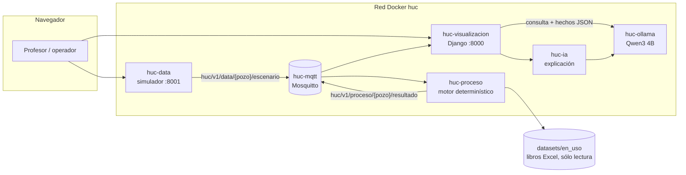

# HUC — Plataforma de evaluación de pozos con bombeo electrosumergible (ESP/BES)

HUC es una plataforma local, contenedorizada, que **evalúa pozos petroleros con bomba electrosumergible** a partir de expedientes de datos reales (libros Excel), mediante **motores determinísticos** con fórmulas trazables. Además ofrece un **asistente en lenguaje natural** (modelo Qwen3 4B ejecutado localmente con Ollama) que consulta y explica esos resultados sin reemplazar el cálculo.

> **Principio de diseño.** El modelo determinístico **calcula**. El modelo lingüístico **comprende, consulta, interpreta y explica** resultados ya calculados. La web **presenta**.
> (Ver [ADR-001](docs/plataforma/adr/ADR-001-separacion-deterministico-llm.md).)

Repositorio: <https://github.com/antonioavezon/ESP-DataScience> · Versión empaquetada: `HUC-1.0.0`

---

## Índice

1. [Presentación](#1-presentación)
2. [Arquitectura](#2-arquitectura)
3. [Requisitos previos](#3-requisitos-previos)
4. [Clonación](#4-clonación)
5. [Configuración](#5-configuración)
6. [Instalación y ejecución](#6-instalación-y-ejecución)
7. [Guía rápida para profesores](#7-guía-rápida-para-profesores)
8. [Pruebas automatizadas](#8-pruebas-automatizadas)
9. [Documentación y datasets](#9-documentación-y-datasets)
10. [Solución de problemas](#10-solución-de-problemas)
11. [Información académica](#11-información-académica)

---

## 1. Presentación

### Objetivo general

Construir un prototipo reproducible que permita comprender cómo opera un sistema de bombeo electrosumergible, aplicar sus ecuaciones físicas a datos de pozos mediante un núcleo determinístico, y explicar los resultados a un operador en lenguaje claro sin que el modelo de lenguaje invente cifras, fórmulas ni maniobras.

### Objetivos específicos

1. Inventariar y trazar las fuentes (libros Excel, set de ecuaciones, material de referencia) sin alterar los originales.
2. Perfilar, limpiar y adaptar **cada** libro Excel por separado (BES-jun, RB-1521, RB-IA-2191), sin mezclar filas de libros distintos.
3. Implementar motores determinísticos con fórmulas catalogadas y reglas explícitas (p. ej. PIP, THD, caudal de intersección con la curva, gradiente, partición de caudal).
4. Desacoplar captura, cálculo y presentación mediante mensajería MQTT.
5. Permitir **simulación** de escenarios (frecuencia, caudal) aislada de los datos originales, con retorno garantizado a la hoja.
6. Integrar un asistente lingüístico local que recupere magnitudes del motor y las explique con validación de cifras, unidades y pozo.
7. Verificar el sistema con pruebas automatizadas y documentar su alcance y limitaciones.

### Alcance

- Evaluación por pozo y por dataset de 7 pozos en 3 expedientes.
- Consola web, simulador de escenarios, asistente conversacional y explicación de resultados.
- Despliegue completo con Docker Compose, sin GPU obligatoria.

### Limitaciones (resumen; detalle en [§11](#11-información-académica))

- Es un **prototipo académico**. No es un sistema de control, no escribe setpoints y no autoriza maniobras (`recomendacion_operacional_autorizada` siempre es `false`).
- Las fórmulas tienen consistencia matemática comprobada, pero **no tienen validación física de campo** (estado `validacion_pendiente`).
- RB-1521 y RB-IA-2191 sólo admiten los cálculos que el propio libro respalda (partición de caudal, `BOPD = BFPD − BWPD`). No tienen curva de bomba ni regla de clasificación, por lo que su estado es `SIN_DATOS / REGISTRO`.
- Las respuestas del modelo de lenguaje pueden variar en redacción. Si no superan las guardas de hechos se sustituyen por el texto determinístico.

### Tecnologías

| Capa | Tecnología |
|---|---|
| Lenguaje | Python 3.14 |
| Web / API | Django 6.0.9, Gunicorn, WhiteNoise |
| Mensajería | Eclipse Mosquitto 2.0.22 (MQTT), paho-mqtt 2.1 |
| Datos | pandas 3, numpy 2, openpyxl, xlrd 1.2 (`.xls`) |
| Modelo de lenguaje | Ollama 0.12.6 + `qwen3:4b-instruct-2507-q4_K_M` |
| Contenedores | Docker Compose v2 |
| Análisis | Jupyter, matplotlib (cuadernos de cada expediente) |
| CI | GitHub Actions ([docs](docs/plataforma/12_integracion_continua.md)) |

---

## 2. Arquitectura

### Componentes (servicios Docker)

| Servicio | Código fuente | Función | Puerto |
|---|---|---|---|
| `huc-visualizacion` | [`web/`](web/) | Consola ESP, datasets, pozos, asistente IA (Django) | **8000** (publicado) |
| `huc-data` | [`data/`](data/) | Simulador: el operador modifica frecuencia/caudal y publica escenarios | **8001** (publicado) |
| `huc-proceso` | [`proceso/`](proceso/) | Recibe escenarios por MQTT, ejecuta el motor del dataset y publica resultados | interno |
| `huc-ia` | [`modelos_ia/`](modelos_ia/) | Servicio HTTP de explicación de un resultado ya calculado | interno (8002) |
| `huc-mqtt` | [`HUC-1.0.0/infraestructura/mosquitto`](HUC-1.0.0/infraestructura/mosquitto/) | Broker MQTT | interno (1883) |
| `huc-ollama` | imagen oficial | Ejecuta el modelo de lenguaje local | interno (11434) |

Los **motores determinísticos** viven dentro de cada expediente: [`datasets/en_uso/BES-jun/src`](datasets/en_uso/BES-jun/src), [`datasets/en_uso/RB-1521/src`](datasets/en_uso/RB-1521/src) y [`datasets/en_uso/RB-IA-2191/src`](datasets/en_uso/RB-IA-2191/src).

### Flujo



Texto equivalente:

```
Simulador (8001) --escenario MQTT--> PROCESO --lee--> datasets (sin escribir)
                                       |
                                       +--resultado MQTT--> Visualización (8000) --> Navegador
Visualización: pregunta del usuario -> intención -> herramienta (motor) -> hechos tipificados
               -> Ollama sólo redacta -> guardas (cifras, unidades, pozo, rótulo) -> respuesta
```

### Responsabilidades de los modelos

| Tarea | Responsable |
|---|---|
| PIP, THD, caudal de intersección, gradiente, partición de caudal, clasificación NORMAL/CRÍTICO… | Motor determinístico del dataset |
| Interpretar la pregunta, elegir pozo/dataset, mantener el contexto conversacional | Orquestador del asistente (reglas en `web/services/chat_*`) |
| Redactar la explicación | LLM (Qwen3) — sólo sobre hechos ya calculados |
| Validar que la redacción no introduce cifras, rótulos ni pozos ajenos | Guardas determinísticas (`web/services/chat_dedupe.py`, `modelos_ia/redaccion.py`, `web/services/mensajes_operador.py`) |

Documentación técnica completa: [docs/plataforma/00_indice.md](docs/plataforma/00_indice.md) (arquitectura, flujos, contratos MQTT/HTTP/JSON, reglas, pruebas, ADR).

---

## 3. Requisitos previos

| Requisito | Detalle |
|---|---|
| Git | Cualquier versión reciente. **No** se necesita Git LFS (ningún archivo supera 3 MB). |
| Docker Engine + Docker Compose v2 | Comando `docker compose` (no `docker-compose`). En Linux, el usuario debe poder ejecutar `docker` (grupo `docker`) o usar `sudo`. |
| Sistema | Probado en Linux x86-64 (Fedora). Las imágenes base son multiarquitectura, pero otras plataformas (macOS, Windows/WSL2, ARM) **no se han probado**. |
| Memoria | **8 GiB o más**. El modelo ocupa ~3,5 GiB de RAM en CPU (medido con `ollama ps`); Compose limita Ollama a 8 GiB. |
| CPU / GPU | Funciona **sólo con CPU** (configuración probada). GPU NVIDIA opcional con NVIDIA Container Toolkit. |
| Disco | ~10 GB libres: imagen Ollama 3,45 GB + 4 imágenes HUC (~310 MB, comparten capas) + modelo 2,5 GB + Mosquitto. |
| Red | Internet en la primera instalación (imágenes Docker, paquetes pip y modelo de Ollama). Después funciona sin conexión. |
| Puertos libres | 8000 y 8001 (configurables, ver [§5](#5-configuración)). |

---

## 4. Clonación

```bash
git clone https://github.com/antonioavezon/ESP-DataScience.git
cd ESP-DataScience
```

No se requieren credenciales ni Git LFS. Para comprobar que los datos originales llegaron íntegros:

```bash
sha256sum -c datasets/SHA256SUMS
```

---

## 5. Configuración

Toda la configuración de ejecución está en `HUC-1.0.0/.env`. **Este archivo no se versiona** porque contiene claves.

**Opción A (recomendada):** `./instalar.sh` lo crea automáticamente con un `DJANGO_SECRET_KEY` y una clave de simulador aleatorios.

**Opción B (manual):**

```bash
cd HUC-1.0.0
cp .env.example .env
# Edite .env y complete DJANGO_SECRET_KEY y HUC_SIM_CLAVE, por ejemplo:
#   DJANGO_SECRET_KEY=$(openssl rand -base64 32)
#   HUC_SIM_CLAVE=una-clave-propia
```

| Variable | Uso | Valor por defecto |
|---|---|---|
| `COMPOSE_PROJECT_NAME` | Prefijo de contenedores, red y volúmenes | `huc` |
| `DJANGO_SECRET_KEY` | Secreto de Django (obligatorio) | — |
| `DJANGO_ALLOWED_HOSTS` | Nombres/IP desde los que se accede | `localhost,127.0.0.1` |
| `CSRF_TRUSTED_ORIGINS` | Orígenes autorizados para formularios; deben incluir los puertos publicados | `http://localhost:8000,…:8001` |
| `HUC_SIM_USUARIO` / `HUC_SIM_CLAVE` | Credenciales del simulador (puerto DATA) | `operador` / — |
| `OLLAMA_MODEL` | Modelo de lenguaje | `qwen3:4b-instruct-2507-q4_K_M` |
| `HUC_BIND` | Interfaz donde se publican los puertos (`127.0.0.1` = sólo este equipo) | `0.0.0.0` |
| `HUC_PUERTO_WEB` / `HUC_PUERTO_DATA` | Puertos publicados en el anfitrión | `8000` / `8001` |
| `HUC_MQTT_*`, `HUC_IA_URL`, `OLLAMA_BASE_URL` | Direcciones internas de la red Docker | no modificar |

Si cambia los puertos, actualice también `CSRF_TRUSTED_ORIGINS` (`./instalar.sh` lo hace solo si exporta `HUC_PUERTO_WEB`/`HUC_PUERTO_DATA` antes de ejecutarlo).

---

## 6. Instalación y ejecución

Todos los comandos se ejecutan dentro de `HUC-1.0.0/`.

### 6.1 Construir e iniciar (primera vez)

```bash
cd HUC-1.0.0
./instalar.sh            # CPU (no requiere GPU)
# ./instalar.sh gpu      # alternativa con GPU NVIDIA
```

El script: verifica Docker, crea `.env` si no existe, construye las 4 imágenes de HUC (`docker compose build`) y levanta los 6 servicios (`docker compose up -d`).

Equivalente manual (tras crear `.env` según la Opción B):

```bash
docker compose build
docker compose up -d
```

### 6.2 Obtener el modelo lingüístico

No hay que hacer nada: en el primer arranque, el contenedor `huc-ollama` descarga automáticamente `qwen3:4b-instruct-2507-q4_K_M` (~2,5 GB). Para seguir la descarga:

```bash
docker compose logs -f huc-ollama          # Ctrl+C para salir
docker compose exec huc-ollama ollama list # el modelo aparece al terminar
```

Mientras se descarga, `huc-ollama` figura como `starting`/`unhealthy`. La consola y los cálculos ya funcionan, pero el asistente responde sólo con texto determinístico.

### 6.3 Comprobar el estado

```bash
./verificar.sh
```

Salida esperada (resumida):

```
== Modelo lingüístico
  [OK] qwen3:4b-instruct-2507-q4_K_M descargado
== HTTP y motor determinístico
  [OK] http://127.0.0.1:8000/ -> 200
  [OK] http://127.0.0.1:8000/asistente/ -> 200
  [OK] http://huc-data:8001/ -> 200
  [OK] QF-084 (BES-jun): estado NORMAL, PIP 1714.5 ft
HUC operativo.
```

Otros comandos: `./estado.sh` (equivale a `docker compose ps`) y `docker compose logs --tail 100`.

### 6.4 Acceder

| Interfaz | URL | Acceso |
|---|---|---|
| Consola, datasets y asistente | <http://localhost:8000> | libre |
| Simulador (DATA) | <http://localhost:8001> | usuario `operador`; clave en `HUC-1.0.0/.env` → `grep HUC_SIM_CLAVE .env` |

### 6.5 Detener, reiniciar, desinstalar

```bash
./detener.sh            # detiene y elimina contenedores; conserva volúmenes (modelo descargado)
./iniciar.sh            # vuelve a arrancar (CPU)
./iniciar.sh gpu        # vuelve a arrancar con GPU
docker compose down -v  # desinstalación completa: borra también los volúmenes (incluido el modelo)
```

### 6.6 Herramientas adicionales

```bash
docker compose exec huc-proceso python /app/proceso/formulas.py list   # catálogo de fórmulas del motor
```

> **Nota para desarrolladores.** `HUC-1.0.0/codigo/` es un espejo versionado de `web/`, `data/`, `proceso/`, `modelos_ia/` y `datasets/` que se usa como contexto de construcción de Docker ([ADR-002](docs/plataforma/adr/ADR-002-espejo-codigo-compose.md)). Si modifica el código de la raíz, `./instalar.sh` resincroniza el espejo con `rsync` antes de reconstruir.

---

## 7. Guía rápida para profesores

Recorrido de unos 15 minutos con la aplicación en marcha (`./verificar.sh` en verde). Los valores citados son los que entrega el motor con los datos del repositorio.

1. **Ingresar.** Abra <http://localhost:8000>. La **Consola ESP** muestra el *ESTADO DE POZOS* de los 7 pozos (QF-084, QF-301, QF-147, QF-005, QF-306, RB-1521, RB-IA-2191).
2. **Seleccionar dataset.** Menú **Datasets** → elija `BES-jun` → **Usar este dataset**. Revise la ficha: variables, reglas, advertencias científicas y archivos de integración.
3. **Seleccionar pozo.** En la ficha del dataset, abra el pozo **QF-084**.
4. **Revisar información.** Observe el **Resultado determinístico existente**: estado `NORMAL` (regla RC-BES-03: el caudal está entre el mínimo y el máximo escritos), PIP **1714.5 ft**, THD **2083.22 ft**, caudal calculado **10535.17 BFPD**, gradiente **0.43 psi/ft**. Cada magnitud muestra su unidad y su nota de origen.
5. **Consulta técnica al asistente.** Menú **Asistente IA** → Dataset `BES-jun`, Pozo `QF-084` → escriba:
   - `¿Cuál es la PIP del pozo QF-084?`
6. **Observar el resultado determinístico.** La respuesta cita **1714.5 ft**, la misma cifra del paso 4, porque el asistente la recupera del motor y no la calcula.
7. **Leer la explicación.** El modelo añade una explicación en lenguaje natural (p. ej., que el valor proviene de la hoja y que la posición del sensor no está confirmada). Continúe la conversación para comprobar que mantiene el contexto:
   - `¿Y el caudal calculado?` → cita 10.535,17 BFPD y lo distingue del caudal registrado (10.301 BFPD).
   - Cambie Pozo a *Todos los pozos* y pregunte `Compara la PIP de QF-084 y QF-301` → tabla con 1714.5 ft y 1558.04 ft.
   - Dataset `RB-1521`: `¿Cómo están los pozos del dataset RB-1521?`
   - Dataset `Todos`: `¿Qué es la PIP?` (pregunta conceptual) y, con QF-084, `¿Por qué el pozo QF-084 está en ese estado?`
8. **Ejecutar un escenario.** Abra <http://localhost:8001>, ingrese con `operador` y la clave de `.env`. Elija **QF-084**, cambie la frecuencia de 63 a **60 Hz** y pulse **Aplicar escenario**. En la consola (puerto 8000) el pozo pasa a origen *simulado* y PROCESO recalcula: el caudal calculado baja de 10535.17 a **9449.00 BFPD** y el estado pasa a **INCIPIENTE** (la PIP de la hoja no cambia). Opcional: **Iniciar secuencia** (intervalo, duración y semilla) para ver una serie automática.
9. **Regresar a los datos originales.** Pulse **Restaurar valores**. **Cerrar sesión** también republica la base de todos los pozos simulados. La consola vuelve a origen *hoja*, con exactamente los mismos valores del paso 4. Los libros Excel nunca se modifican: puede comprobarlo con `sha256sum -c datasets/SHA256SUMS`.

Tiempos observados en CPU (28 hilos, sin GPU): las respuestas que usan el LLM tardan entre 7 y 20 s (la primera incluye la carga del modelo en memoria); las conceptuales o de estado, menos de 1 s.

---

## 8. Pruebas automatizadas

### 8.1 Suites unitarias y de integración (sin Docker)

Requieren Python 3.14 o superior:

```bash
python3 -m venv .venv-pruebas
. .venv-pruebas/bin/activate
pip install -r requirements-ci.txt
export DJANGO_DEBUG=1 DJANGO_SECRET_KEY=solo-pruebas DJANGO_ALLOWED_HOSTS=testserver,localhost,127.0.0.1 MPLBACKEND=Agg
./scripts/ci/run-suites.sh all
```

| Suite | Contenido | Resultado de referencia |
|---|---|---|
| `syntax` | Compilación de todos los módulos | OK |
| `servicios` | PROCESO (fronteras), DATA (valores en uso, cierre de sesión), MODELOS_IA (contrato, guarda de unidades) | 16 pruebas |
| `web` | Django: consola, datasets, asistente, contratos JSON, unidades, guardas del LLM (con cliente simulado) | 123 pruebas |
| `motores` | BES-jun (fórmulas, robustez, adversariales), RB-1521, RB-IA-2191 | 194 pruebas |
| `compose` | Validación de `compose.yaml` | OK |

El script termina con `OK suite=…` y código 0 si todo aprueba. Cualquier fallo se muestra con el nombre de la prueba y un *traceback* corto. Las pruebas adversariales de BES-jun añaden entradas al registro versionado `datasets/en_uso/BES-jun/logs/incidentes.jsonl`; para dejar el clon como estaba: `git checkout -- datasets/en_uso/BES-jun/logs/incidentes.jsonl`. Las mismas suites corren en GitHub Actions en cada *push* y *pull request* ([ci.yml](.github/workflows/ci.yml)).

### 8.2 Verificación de la aplicación en ejecución

`HUC-1.0.0/verificar.sh` (ver [§6.3](#63-comprobar-el-estado)) comprueba los contenedores, el modelo, las interfaces HTTP y un resultado determinístico real.

Las pruebas que requieren Ollama real y MQTT de extremo a extremo (categoría C) se describen en [docs/plataforma/06_estrategia_pruebas.md](docs/plataforma/06_estrategia_pruebas.md) y [docs/plataforma/matriz_pruebas_ci.md](docs/plataforma/matriz_pruebas_ci.md).

---

## 9. Documentación y datasets

### 9.1 Estructura del repositorio

| Ruta | Contenido |
|---|---|
| [`HUC-1.0.0/`](HUC-1.0.0/) | Paquete de despliegue: Compose, Dockerfile, scripts, espejo `codigo/` |
| [`web/`](web/), [`data/`](data/), [`proceso/`](proceso/), [`modelos_ia/`](modelos_ia/) | Código fuente de los servicios (con sus pruebas) |
| [`datasets/en_uso/`](datasets/en_uso/) | Expedientes: entrada, motor (`src/`), pruebas, cuadernos, informes y PDF |
| [`fuentes/originales/`](fuentes/originales/) | Copias íntegras, de sólo lectura, de todo el material recibido |
| [`docs/`](docs/) | Documentación de estudio (decisiones, ecuaciones, bloqueos) y de plataforma |
| [`asesor-esp/`](asesor-esp/) | Base de conocimiento ESP: conceptos, fórmulas, validaciones |
| [`archive/esp-datascience-lab/`](archive/esp-datascience-lab/) | Laboratorio previo de ciencia de datos (histórico, fuera del runtime) |
| [`specs/`](specs/), [`.specify/`](.specify/) | Especificaciones (Spec-Driven Development) |
| [`analisis.md`](analisis.md) | Análisis maestro del proyecto |
| [`logs/`](logs/) | Bitácora de trabajo |

### 9.2 Datasets

| Dataset | Original | Pozos | Motor | Documentación |
|---|---|---|---|---|
| **BES-jun** | `Copia de FINAL BES-jun.xlsx` | QF-084, QF-301, QF-147, QF-005, QF-306 | PIP, THD, caudal de intersección con curva de bomba, gradiente, reglas RC-BES | [dataset.md](datasets/en_uso/BES-jun/dataset.md), [docs/](datasets/en_uso/BES-jun/docs/), [cuadernos](datasets/en_uso/BES-jun/notebooks/), [PDF](datasets/en_uso/BES-jun/pdf/) |
| **RB-1521** | `RB-1521-PY-121120.xls` | RB-1521 | Partición de caudal (identidad del propio libro) | [dataset.md](datasets/en_uso/RB-1521/dataset.md), [cuadernos](datasets/en_uso/RB-1521/notebooks/) |
| **RB-IA-2191** | `RB-IA-2191-Data.xlsx` | RB-IA-2191 | `BOPD = BFPD − BWPD` y valores almacenados | [dataset.md](datasets/en_uso/RB-IA-2191/dataset.md), [cuadernos](datasets/en_uso/RB-IA-2191/notebooks/) |

- Los originales están en [`fuentes/originales/`](fuentes/originales/). Las copias de trabajo `datasets/en_uso/*/entrada/` son idénticas byte a byte, como lo verifica [`datasets/SHA256SUMS`](datasets/SHA256SUMS).
- Guía de procesamiento: [docs/guia_procesamiento_datasets.md](docs/guia_procesamiento_datasets.md). Trazabilidad de ecuaciones: [docs/trazabilidad_ecuaciones.md](docs/trazabilidad_ecuaciones.md).
- Los cuadernos Jupyter se pueden abrir con `pip install -r requirements.txt` y `jupyter lab`. Sus versiones exportadas (HTML/PDF) están en `datasets/en_uso/*/pdf/`.

### 9.3 Documentos principales

| Documento | Tema |
|---|---|
| [docs/plataforma/00_indice.md](docs/plataforma/00_indice.md) | Índice de documentación de plataforma |
| [docs/plataforma/01_contexto_alcance.md](docs/plataforma/01_contexto_alcance.md) | Objetivos, actores, límites |
| [docs/plataforma/02_arquitectura_tecnica.md](docs/plataforma/02_arquitectura_tecnica.md) | Componentes |
| [docs/plataforma/03_flujos_operacionales.md](docs/plataforma/03_flujos_operacionales.md) | Simulación, asistente, restauración |
| [docs/plataforma/04_contratos_interfaces.md](docs/plataforma/04_contratos_interfaces.md) | Contratos HTTP, MQTT y JSON |
| [docs/plataforma/05_reglas_funcionales.md](docs/plataforma/05_reglas_funcionales.md) | Invariantes |
| [docs/plataforma/06_estrategia_pruebas.md](docs/plataforma/06_estrategia_pruebas.md) | Estrategia de pruebas |
| [docs/plataforma/07_despliegue_operacion.md](docs/plataforma/07_despliegue_operacion.md) | Despliegue y operación |
| [docs/trazabilidad_ecuaciones.md](docs/trazabilidad_ecuaciones.md) | Ecuaciones y su origen |
| [datasets/en_uso/BES-jun/docs/catastro_maestro_formulas_BES-jun.md](datasets/en_uso/BES-jun/docs/catastro_maestro_formulas_BES-jun.md) | Catastro de fórmulas del motor BES |
| [datasets/en_uso/BES-jun/docs/informe_validacion_integral_BES-jun.md](datasets/en_uso/BES-jun/docs/informe_validacion_integral_BES-jun.md) | Validación integral BES-jun |
| [datasets/en_uso/BES-jun/docs/discrepancias_cientificas.md](datasets/en_uso/BES-jun/docs/discrepancias_cientificas.md) | Discrepancias científicas abiertas |
| [web/DESARROLLO.md](web/DESARROLLO.md) | Desarrollo de la aplicación web |
| [docs/bloqueos.md](docs/bloqueos.md), [docs/decisiones_pendientes.md](docs/decisiones_pendientes.md) | Bloqueos y decisiones abiertas |

> Algunos informes históricos (`datasets/en_uso/*/docs/informe_*`, `logs/`, `analisis.md`) registran rutas del equipo de desarrollo (`/home/...`) porque describen el entorno en que se generaron. Son evidencia fechada; la aplicación no depende de esas rutas.

---

## 10. Solución de problemas

| Síntoma | Causa probable | Solución |
|---|---|---|
| `docker: command not found` / `Cannot connect to the Docker daemon` | Docker no instalado o detenido | Instale Docker Engine y arránquelo (`sudo systemctl start docker`). Añada su usuario al grupo `docker` o use `sudo`. |
| `docker compose` no existe | Compose v1 o sin plugin | Instale el plugin Docker Compose v2. |
| `Bind for 0.0.0.0:8000 failed: port is already allocated` | Puerto ocupado | Defina `HUC_PUERTO_WEB` / `HUC_PUERTO_DATA` en `.env` (y agréguelos a `CSRF_TRUSTED_ORIGINS`), luego `docker compose up -d`. |
| `Conflict. The container name "/huc-…" is already in use` | Otra copia de HUC en el mismo equipo | Cambie `COMPOSE_PROJECT_NAME` en `.env` (p. ej. `huc2`), o detenga la otra copia. |
| `huc-ollama` en `starting`/`unhealthy` durante varios minutos | Descargando el modelo (~2,5 GB) | `docker compose logs -f huc-ollama`. Espere a que `ollama list` muestre el modelo. |
| El asistente responde sin explicación del modelo | Modelo no descargado, o la redacción no superó las guardas | Compruebe `./verificar.sh`. El texto determinístico de respaldo es el comportamiento previsto cuando el LLM no está disponible o propone cifras/rótulos no respaldados. |
| Respuestas muy lentas o contenedor `huc-ollama` reiniciado | Memoria insuficiente | Cierre otras aplicaciones; se recomiendan 8 GiB o más. Con GPU NVIDIA: `./iniciar.sh gpu`. |
| `CSRF verification failed` o `Bad Request (400)` | Acceso por una IP o puerto no declarado | Añada la IP a `DJANGO_ALLOWED_HOSTS` y `http://IP:PUERTO` a `CSRF_TRUSTED_ORIGINS`; luego `docker compose up -d`. |
| Simulador: `Usuario o clave incorrectos` | Clave distinta a `.env` | `grep HUC_SIM_CLAVE HUC-1.0.0/.env`. |
| Un servicio queda `unhealthy` | Error de arranque o de comunicación | `docker compose logs <servicio>`; `docker compose restart <servicio>`. `huc-proceso` necesita `huc-mqtt` sano. |
| `No está el código de ejecución en codigo/` | Clon incompleto | Vuelva a clonar el repositorio; `HUC-1.0.0/codigo/` está versionado. |
| Dataset no encontrado / pozo `404` | Identificador mal escrito | Use exactamente `QF-084`, `QF-301`, `QF-147`, `QF-005`, `QF-306`, `RB-1521`, `RB-IA-2191`. |
| `permission denied` al ejecutar `./instalar.sh` | Permiso de ejecución perdido (p. ej. al copiar desde Windows) | `chmod +x HUC-1.0.0/*.sh` o `sh instalar.sh`. |

---

## 11. Información académica

**Naturaleza.** Proyecto académico y pedagógico de ciencia de datos aplicada a la ingeniería de producción petrolera. Su propósito es aprender el funcionamiento del bombeo electrosumergible y demostrar una arquitectura en la que un modelo de lenguaje **explica** pero no **calcula**.

**Fuentes de datos y material.** Libros Excel de pozos (BES-jun, RB-1521, RB-IA-2191), un set de ecuaciones para el cálculo *sensorless* de PIP (`Modelo_Sensorless_PIP_ESP_Set_Ecuaciones.docx` y planilla `.xlsm`), un borrador de artículo sobre el enfoque *sensorless* (`paper_sensorless - v2.docx`, M. Sánchez Medina) y el documento de referencia *Basic ESP design* (M. Hirschfeldt, Oilproduction.net, 2002), entregados para el proyecto y conservados en [`fuentes/originales/`](fuentes/originales/). Inventario y procedencia: [docs/inventario_fuentes.md](docs/inventario_fuentes.md). Los derechos de los documentos de terceros pertenecen a sus autores; se incluyen únicamente con fines de evaluación académica. El repositorio no declara una licencia de software.

**Supuestos.** Las fórmulas se aplican tal como están escritas en las fuentes; las discrepancias se documentan en lugar de corregirse por conveniencia ([discrepancias_cientificas.md](datasets/en_uso/BES-jun/docs/discrepancias_cientificas.md)). Los identificadores de pozo en BES-jun son provisionales (la hoja usa otro rótulo). El artículo *sensorless* se usa como contexto: no se afirma reproducir un sistema propietario.

**Límites de aplicación.** No debe usarse para operar pozos reales. Las clasificaciones y explicaciones son de apoyo al aprendizaje y requieren revisión humana.

**Alcance de la validación.** Hay validación computacional (consistencia matemática, pruebas de frontera, pruebas adversariales, reproducción de las celdas de la hoja) y de integración (servicios, MQTT, simulación/restauración, asistente con LLM real). **No** existe validación física de campo ni certificación industrial.

**Herramientas de apoyo.** Parte del desarrollo y la documentación se realizó con asistentes de programación basados en IA (Cursor, Claude Code), bajo revisión del autor.

**Autor.** Antonio Avezon.
