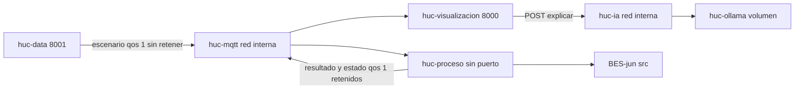
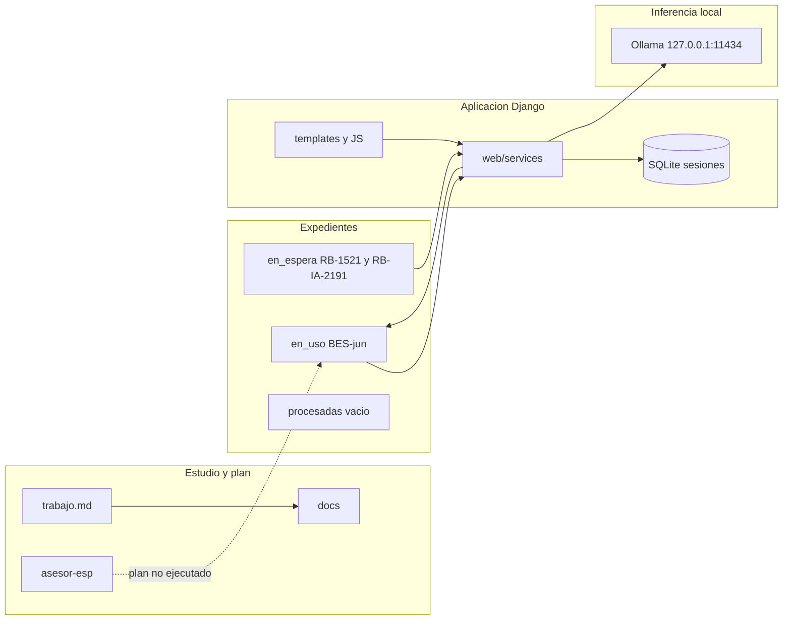
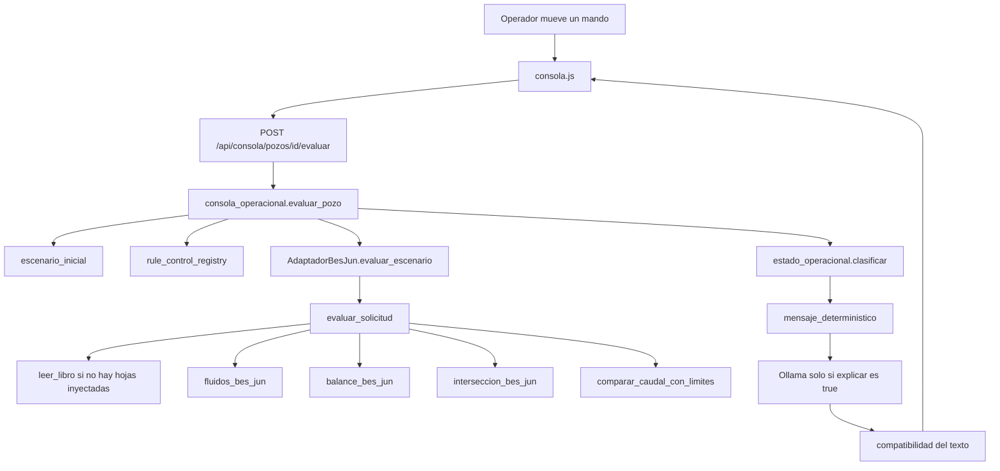
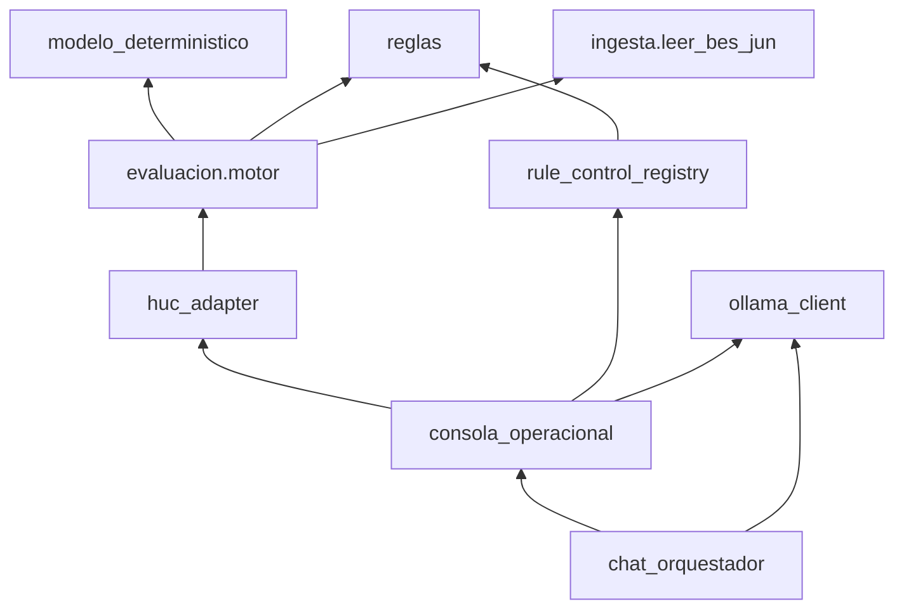
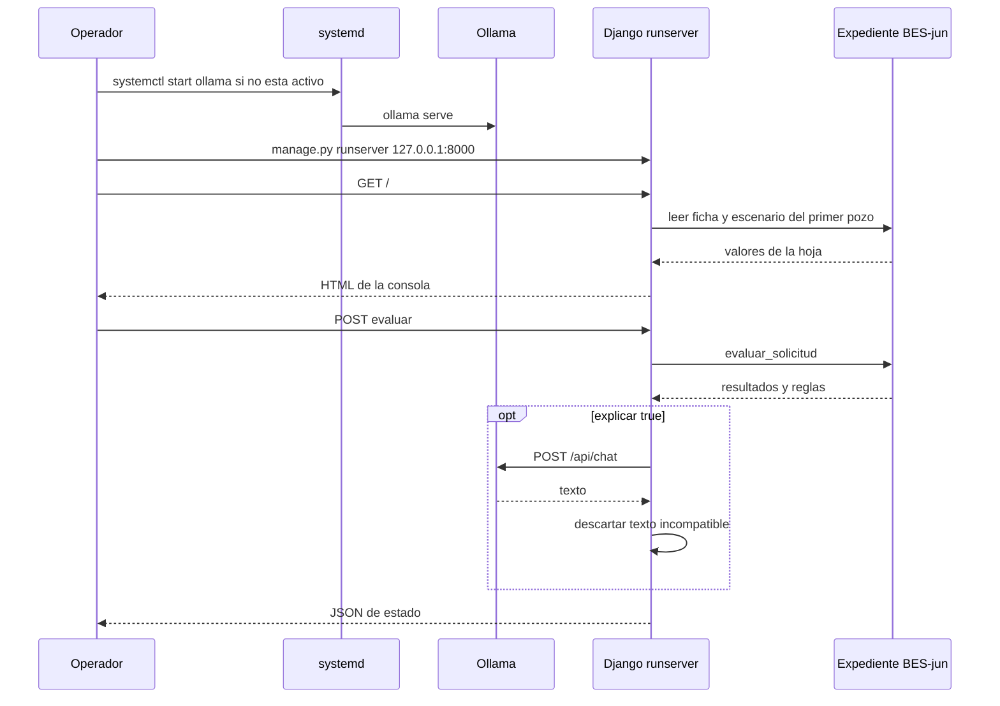

# Análisis maestro de HUC

## 1. Portada técnica y metadatos

| Campo | Valor |
|---|---|
| Documento | `analisis.md` |
| Proyecto | HUC |
| Ruta | `/home/antonio/projects/HUC` |
| Tipo | Auditoría de arquitectura y funcionamiento. Solo documentación. |
| Fecha de esta auditoría | 2026-10-28 |
| Auditor | Sesión de análisis en Cursor 3.27.22 (`b1aa50cb6db84fd3e8c808259cb172ea73425c10`) |
| Alcance | Aplicación existente: expediente BES-jun, aplicación Django en `web/` y plan `asesor-esp`. |
| Fuera de alcance | Implementar la separación en cuatro dominios, MQTT, cambios de código, commits. |
| Repositorio Git | No existe `.git` en esta raíz. El historial reconstruible es documental, no de commits. |
| Estado científico | BES-jun en validación pendiente. Ninguna regla aprobada para operación. Motor general bloqueado. |
| Estado de ejecución observado | Ollama activo en `127.0.0.1:11434`, sin modelo cargado. Django no escuchaba en el puerto 8000. |

Leyenda usada en todo el documento:

| Marca | Significado |
|---|---|
| Comprobado | Observado en esta auditoría con un comando de solo lectura o con lectura directa del código. |
| Código | Identificado leyendo la implementación. No se reejecutó el caso. |
| Documentado | Escrito en un markdown, manifiesto o bitácora. No se reejecutó aquí. |
| Planificado | Previsto en un plan y ausente como implementación. |
| No determinado | No hay evidencia suficiente. |

Este archivo no sustituye a `trabajo.md` ni a `datasets/en_uso/BES-jun/integracion/manifiesto_version.json`. Cuando esos documentos y el código discrepen, este análisis lo dice de forma explícita.

---

## Índice

1. [Portada técnica y metadatos](#1-portada-técnica-y-metadatos)
2. [Resumen ejecutivo](#2-resumen-ejecutivo)
3. [Objetivo y alcance de la aplicación](#3-objetivo-y-alcance-de-la-aplicación)
4. [Estado actual del proyecto](#4-estado-actual-del-proyecto)
5. [Inventario tecnológico](#5-inventario-tecnológico)
6. [Entorno de desarrollo](#6-entorno-de-desarrollo)
7. [Características de la máquina](#7-características-de-la-máquina)
8. [Arquitectura actual](#8-arquitectura-actual)
9. [Estructura del repositorio](#9-estructura-del-repositorio)
10. [Componentes y responsabilidades](#10-componentes-y-responsabilidades)
11. [Inventario de datos](#11-inventario-de-datos)
12. [Procesamiento y modelos determinísticos](#12-procesamiento-y-modelos-determinísticos)
13. [Modelos lingüísticos e inteligencia artificial](#13-modelos-lingüísticos-e-inteligencia-artificial)
14. [Interfaz y visualización](#14-interfaz-y-visualización)
15. [Comunicaciones y MQTT](#15-comunicaciones-y-mqtt)
16. [Flujos completos de ejecución](#16-flujos-completos-de-ejecución)
17. [Entornos y procesos de producción](#17-entornos-y-procesos-de-producción)
18. [Historial de desarrollo](#18-historial-de-desarrollo)
19. [Pruebas y validaciones existentes](#19-pruebas-y-validaciones-existentes)
20. [Evaluación de calidad y deuda técnica](#20-evaluación-de-calidad-y-deuda-técnica)
21. [Dependencias y riesgos](#21-dependencias-y-riesgos)
22. [Visión futura de cuatro dominios](#22-visión-futura-de-cuatro-dominios)
23. [Matriz de migración arquitectónica](#23-matriz-de-migración-arquitectónica)
24. [Recomendaciones para la segunda etapa](#24-recomendaciones-para-la-segunda-etapa)
25. [Decisiones pendientes](#25-decisiones-pendientes)
26. [Registro cronológico de cambios](#26-registro-cronológico-de-cambios)
27. [Glosario técnico](#27-glosario-técnico)
28. [Anexos y referencias](#28-anexos-y-referencias)

---

## 2. Resumen ejecutivo

HUC es un prototipo local de apoyo a la lectura de bombas electrosumergibles (ESP/BES). Hoy hace tres cosas distintas, y no conviene tratarlas como un solo producto terminado.

La primera es un estudio del libro `Copia de FINAL BES-jun.xlsx`. El expediente `datasets/en_uso/BES-jun/` lee cinco hojas, transcribe sus fórmulas de fluido, balance e intersección, compara el caudal con límites escalados por frecuencia y expone el resultado por `evaluacion.motor.evaluar_solicitud`. El manifiesto `integracion/manifiesto_version.json` declara software 0.4.2, contrato 1.3.0, catálogo de reglas 1.1.0, 182 pruebas aprobadas el 2026-10-21 y `aprobacion_operacional: false`. Esas pruebas contrastan la transcripción con la caché de Excel y con oráculos algebraicos. No son una validación física ni industrial.

La segunda es la aplicación en cuatro módulos. DATA (`data/interfaces`, puerto 8001) publica escenarios. PROCESO (`proceso/servicio.py`) ejecuta el motor ya escrito en el expediente y no tiene interfaz web. VISUALIZACIÓN (`web/`, puerto 8000) muestra el último resultado y no modifica entradas. MODELOS IA (`modelos_ia/servicio.py`, puerto 8002) pide una redacción a Ollama y la descarta si contradice el estado o trae una cifra que no está en el resultado. El cálculo sigue en `datasets/en_uso/BES-jun/src`. `web/services/huc_adapter.py` sigue siendo el puente de importación; lo llama PROCESO, no la vista.

La tercera es el plan `asesor-esp/` y `trabajo.md`: un motor determinístico común, en unidades coherentes, aplicable a varios libros, y después una capa de lenguaje. Ese motor común está bloqueado. La pregunta P-14 no tiene respuesta y la puerta de fórmulas no está aprobada. `RB-1521-PY-121120.xls` está en `datasets/en_uso/RB-1521/` con copia de trabajo y motor de partición \(Q_{agua}=Q\\times BSW\). `RB-IA-2191-Data.xlsx` está en `datasets/en_uso/RB-IA-2191/` con copia de trabajo y motor de identidad \(BOPD=BFPD-BWPD\); no reutiliza la partición de RB-1521 porque BSW no cierra con BWPD/BFPD.

El transporte entre DATA, PROCESO y VISUALIZACIÓN es MQTT en `127.0.0.1:1883`, con el broker Mosquitto de la imagen `eclipse-mosquitto:2` publicada solo hacia loopback. No hay autenticación de Django, ni modelos ORM de negocio, ni servidor de producción. Ollama sigue en systemd, en `127.0.0.1:11434`. La reorganización no cambia `aprobacion_operacional: false` ni cierra P-14, CT-03 ni la puerta de fórmulas.

---

## 3. Objetivo y alcance de la aplicación

### Problema

Un operador o un analista recibe planillas de diseño y operación de BES con fórmulas ya escritas, unidades heterogéneas y reglas todavía no aprobadas. El proyecto busca poder decir, con trazabilidad, qué se puede calcular a partir de esas fuentes, qué resultado produce la misma aritmética que la planilla y qué explicación cabe dar sin inventar un setpoint ni una autorización de maniobra.

### Usuarios previstos

No hay cuentas ni roles. Código: `INSTALLED_APPS` no incluye `django.contrib.auth`. El uso implícito, descrito en `web/README.md` y `trabajo.md`, es un operador o técnico en la misma máquina, más el equipo que mantiene el estudio. No se ha comprobado un despliegue para varios usuarios.

### Qué está implementado

| Capacidad | Evidencia |
|---|---|
| Lectura de BES-jun sin guardar el libro | Código: `datasets/en_uso/BES-jun/src/ingesta/leer_bes_jun.py` |
| Transcripción de fluido, balance e intersección | Código: `src/modelo_deterministico/` |
| Reglas candidatas RC-BES-01 a 04 | Código: `src/reglas/catalogo.py` |
| API interna `evaluar` / `evaluar_solicitud` con contrato JSON | Código: `src/evaluacion/motor.py`, esquemas en `integracion/` |
| Consola, inventario, evaluación y chat | Código: `web/apps/` |
| Explicación local con Ollama, subordinada al cálculo | Código: `web/services/chat_orquestador.py`, `mensajes_operador.py` |
| Distinción entre escenario inicial y simulación | Código: `consola_operacional.py` pone `modo: "simulacion"` y una leyenda que dice que no se escribió el dataset |

### Qué está parcial

- La consola clasifica estados operacionales a partir de reglas que el catálogo marca `pendiente_validacion` o `no_evaluable`. La interfaz muestra un estado; el catálogo no autoriza una recomendación operacional.
- `web/services/controles_fisicos.py` declara mandos de frecuencia, TVD, potencia y head. Ningún módulo Python lo importa. La consola usa `rule_control_registry.py`. `web/DESARROLLO.md` todavía describe el archivo huérfano.
- `docs/estado_proyecto.md` dice, con fecha interna 2026-10-20, que la aplicación gráfica y la integración con un modelo de lenguaje no empezaron. El código de `web/` existe y su `manage.py` tiene fecha de sistema 2026-10-21. Ese documento de estado está desactualizado.
- Hay dos caminos de lenguaje: el chat y la consola, más una prueba técnica en la configuración que usa `technical_context.py`. `web/docs/02_arquitectura_web.md` no describe los tres por igual.

### Qué está planificado y no existe

- Motor determinístico general y adaptadores para D1 y D2. Planificado en `trabajo.md`. Bloqueado por P-14 y por la puerta de fórmulas (`docs/decisiones_pendientes.md`, `docs/bloqueos.md`).
- Aprobación operacional de reglas. El manifiesto trae `reglas_aprobadas: []`.
- Capa GLM de la etapa 7 como producto elegido. En el plan, «GLM» es el nombre del equipo para esa capa; la familia no está cerrada. El modelo que usa la web es Qwen3, no un modelo de la familia GLM.
- Series temporales en la interfaz, catálogo de pozos de más de un dataset y promoción de BES-jun a `datasets/procesadas/`. MQTT local de escenarios y resultados sí está implementado; no es telemetría industrial.
- El esqueleto `asesor-esp/` prevé tareas T4 y T7. No es el código que ejecuta la consola.

### Qué no se pudo determinar

- Si las 182 pruebas del manifiesto siguen pasando el 2026-10-28. Esta auditoría no ejecutó pytest, para no reescribir cachés ni el reporte de AutoTest.
- El consumo de RAM o GPU de una inferencia real. `/api/ps` devolvió `{"models":[]}`. No se llamó a `/api/generate` ni a `/api/chat`.
- Quién creó la carpeta vacía `datasets/en_uso/p/` (fecha de sistema 2026-10-23). No tiene `dataset.md`. El registro la ignora si no hay ficha.
- El autor y el diff de la capa web. No hay commits.

---

## 4. Estado actual del proyecto

| Pieza | Estado | Base |
|---|---|---|
| Expediente BES-jun | En uso. Manifiesto: `validacion_pendiente`, cierre técnico de software verdadero, aprobación operacional falsa | `integracion/manifiesto_version.json` |
| Reglas RC-BES-01, 02, 03 | `pendiente_validacion`, no aprobadas | `src/reglas/catalogo.py` |
| RC-BES-04 | `no_evaluable` | mismo archivo |
| RC-BES-00 | Se emite en ejecución si faltan datos o los límites son incoherentes | `src/reglas/candidatas_bes_jun.py` |
| Motor general | Bloqueado | Documentado: `trabajo.md`, `docs/bloqueos.md` |
| P-14 | Pregunta abierta, respuesta vacía | Documentado: `docs/decisiones_pendientes.md` |
| RB-1521 | En uso. Copia de trabajo y motor de partición. Sin regla de caudal | Comprobado el 2026-10-28: pytest del expediente, MQTT y consola en `127.0.0.1:8000` |
| RB-IA-2191 | En uso. Copia de trabajo y motor BOPD=BFPD−BWPD. Sin regla de caudal. Un pozo | Comprobado el 2026-10-28: pytest 6/6; adaptador; notebooks+PDF |
| `datasets/procesadas/` | Vacía | Comprobado |
| Aplicación | HUC 1.0.0 en Docker Compose. Visualización en `0.0.0.0:8000` y simulador en `0.0.0.0:8001` | Comprobado el 2026-10-28: `docker compose ps` y curl a `127.0.0.1` y a `192.168.1.205` |
| Ollama del stack | Contenedor `huc-ollama`, sin puerto publicado. Modelo `qwen3:4b-instruct-2507-q4_K_M` en el volumen | Comprobado: `docker exec huc-ollama ollama list` |
| Ollama del anfitrión | El unit systemd sigue activo. HUC 1.0.0 no lo usa | Comprobado: no se detuvo el unit |
| Git | No inicializado | Comprobado: `git rev-parse` |

`ciclo.promocion.promover` no mueve el expediente a `procesadas`. Código: el flujo de promoción deja `movido` en falso mientras el cierre científico no está concedido.

---

## 5. Inventario tecnológico

### Lenguajes y marcos

| Pieza | Versión comprobada | Dónde |
|---|---|---|
| Python del sistema y del `.venv` | 3.14.8 | `python3 --version` y `.venv/bin/python` |
| Django | 6.0.9 | import y `web/requirements.txt` |
| httpx | 0.28.1 | import y `web/requirements.txt` |
| pandas | 3.0.6 | import y `requirements.txt` |
| numpy | 2.5.4 | import |
| openpyxl | 3.1.5 | import |
| scikit-learn | 1.9.1 | import. El `requirements.txt` de la raíz dice que no entra en el cálculo determinístico |
| pytest | 9.1.1 | `.venv/bin/pytest`. No está en el `PATH` del shell |
| scipy, matplotlib, seaborn, jupyterlab, python-docx, pypdf, pymupdf, xlrd 1.2.0 | Declarados en `requirements.txt` | No se reimportaron uno por uno en esta auditoría |
| JavaScript | Sin bundler ni `package.json` de aplicación | Archivos sueltos en `web/static/js/` |
| Node | v20.19.5 en nvm | Comprobado `command -v node`. La aplicación HUC no lo usa como runtime |

No hay `pyproject.toml` en la raíz. Hay tres `requirements.txt`: raíz (análisis), `web/requirements.txt` (Django y httpx) y `datasets/en_uso/BES-jun/requirements.txt`. `asesor-esp/requirements.txt` es otro entorno previsto, no el que importa la consola.

### Servicios externos e internos

| Servicio | Papel | Esta auditoría |
|---|---|---|
| Ollama `ollama serve` | Inferencia local HTTP | Activo. Unit `/etc/systemd/system/ollama.service`, `User=ollama`, `Restart=always` |
| Django `runserver` | Interfaz | No estaba en escucha |
| SQLite `web/db.sqlite3` | Sesiones Django | Tablas `django_session` y `django_migrations`. No hay `models.py` de negocio |
| Chrome / Pandoc | Exportación PDF e informe, según bitácora | No se invocaron |

No hay Dockerfile, Compose, gunicorn ni nginx en el repositorio. Docker y Podman están instalados en la máquina; el proyecto no los usa.

### Modelos de lenguaje instalados en Ollama

Consulta `GET http://127.0.0.1:11434/api/tags` el 2026-10-28. Tamaños aproximados del artefacto, no de la VRAM en uso.

| Nombre | Familia | Parámetros | Cuantización | Tamaño |
|---|---|---|---|---|
| `qwen3:4b-instruct-2507-q4_K_M` | qwen3 | 4.0B | Q4_K_M | 2.33 GiB |
| `qwen3-huc:4b` | qwen3 | 4.0B | Q4_K_M | 2.33 GiB |
| `qwen3-huc-direct:4b` | qwen3 | 4.0B | Q4_K_M | 2.33 GiB |
| `qwen3:4b` | qwen3 | 4.0B | Q4_K_M | 2.33 GiB |
| `devstral-small-2:latest` | mistral3 | 24.0B | Q4_K_M | 14.14 GiB |
| `qwen3-coder:30b` | qwen3moe | 30.5B | Q4_K_M | 17.28 GiB |

El default de la aplicación es el primero: `os.environ.get("OLLAMA_MODEL", "qwen3:4b-instruct-2507-q4_K_M")` en `web/services/ollama_client.py`. Los Modelfiles de las variantes `qwen3-huc` están en `ollama/`. No se comprobó si la interfaz los tiene seleccionados en alguna sesión.

Los modelos de 24B y 30B caben mal en los 8188 MiB de la GPU de este portátil si se cargan enteros en VRAM. No se midió en qué dispositivo los ejecutaría Ollama.

---

## 6. Entorno de desarrollo

### Sistema

Comprobado el 2026-10-28:

| Dato | Valor |
|---|---|
| Distribución | Fedora Linux 43 (Workstation Edition), `VERSION_ID=43` |
| Kernel | `7.2.11-100.fc43.x86_64`, SMP PREEMPT_DYNAMIC |
| Arquitectura | x86_64 |
| Shell de la sesión | bash 5.3.0(1)-release |
| Soporte de la versión de Fedora | `SUPPORT_END=2026-12-02` en `/etc/os-release` |

Herramientas presentes en `PATH`: `git`, `pip`, `node`, `npm`, `docker`, `podman`, `systemctl`, `ollama` (`/usr/local/bin/ollama`), `curl`, `sqlite3`, `cursor`. `pytest` solo dentro de `.venv/bin`.

### Entorno Python

- Virtualenv: `/home/antonio/projects/HUC/.venv` (789M en disco).
- El `requirements.txt` de la raíz indica instalación el 2026-10-17 y ausencia de PyTorch.
- `xlrd==1.2.0` está fijado porque la serie 2 no lee `.xls`. Documentado en el propio requirements y en `logs/bitacora.md`. No se abrió `RB-1521-PY-121120.xls` en esta auditoría.

### Variables de entorno

Nombres y defaults. No se lee ni se copia un `.env` real. Referencia: `web/.env.example` y `web/config/settings.py`.

| Variable | Default en código si falta |
|---|---|
| `DJANGO_SECRET_KEY` | Una clave fija de desarrollo. Si `DJANGO_DEBUG` no es `1`, Django se niega a arrancar con esa clave |
| `DJANGO_DEBUG` | `"1"` |
| `DJANGO_ALLOWED_HOSTS` | `127.0.0.1,localhost` |
| `OLLAMA_BASE_URL` | `http://127.0.0.1:11434` |
| `OLLAMA_MODEL` | `qwen3:4b-instruct-2507-q4_K_M` |
| `OLLAMA_TIMEOUT_S` | 60, acotado entre 5 y 120 |
| `OLLAMA_NUM_PREDICT` | 512, acotado entre 32 y 1024 |

La sesión del asistente puede guardar `modelo`, `timeout_s` y `num_predict` sin tocar el entorno del proceso. Código: `web/apps/asistente_ia/views.py`.

### Rutas

| Ruta | Uso |
|---|---|
| `/home/antonio/projects/HUC` | Raíz |
| `/home/antonio/projects/HUC/.venv` | Intérprete del proyecto |
| `/home/antonio/projects/HUC/web` | Django. `manage.py` |
| `/home/antonio/projects/HUC/datasets/en_uso/BES-jun` | Único expediente con motor |
| `/home/antonio/projects/HUC/datasets/en_uso/BES-jun/entrada/BES_jun.xlsx` | Copia de trabajo, 322K en el listado |

### Puertos observados

| Puerto | Estado el 2026-10-28 |
|---|---|
| `127.0.0.1:11434` | En escucha. Ollama |
| `127.0.0.1:8000` | Visualización, cuando está arrancada |
| `127.0.0.1:8001` | Simuladores DATA, cuando están arrancados |
| `127.0.0.1:8002` | Servicio lingüístico, cuando está arrancado |
| `127.0.0.1:1883` | Mosquitto local, cuando el contenedor está arrancado |

### Comandos de operación

Estos comandos están escritos en `inicio.md`, `datasets/inicio.md` y `web/README.md`. Esta auditoría ejecutó solo las comprobaciones de lectura indicadas en la portada. No arrancó Django ni cargó un modelo.

Preparar el entorno, si el `.venv` ya existe y las dependencias ya están instaladas: usar `/home/antonio/projects/HUC/.venv/bin/python`. No se repitió `pip install` y no se documenta aquí un comando de instalación nuevo.

Dejar el modelo cargado, según `inicio.md` (no ejecutado aquí):

```bash
sudo systemctl start ollama
curl -s http://127.0.0.1:11434/api/generate -d '{"model":"qwen3:4b-instruct-2507-q4_K_M","prompt":"","keep_alive":-1}'
```

El unit ya estaba `enabled`. `start` no hizo falta para listar modelos. El `curl` de `generate` sí cargaría el modelo y no se lanzó.

Arrancar la aplicación, según `web/README.md` (no ejecutado aquí):

```bash
cd /home/antonio/projects/HUC/web
/home/antonio/projects/HUC/.venv/bin/python manage.py runserver 127.0.0.1:8000
```

Pruebas del expediente, según la bitácora (no ejecutadas aquí):

```bash
cd /home/antonio/projects/HUC/datasets/en_uso/BES-jun
PYTHONPATH=src /home/antonio/projects/HUC/.venv/bin/python -m pytest -q
```

Pruebas de la web: los archivos están en `web/tests/`. El comando exacto de invocación que usa el equipo no se releyó de un script de CI, porque no hay CI. `web/DESARROLLO.md` documenta la suite; esta auditoría no la lanzó.

Detener Django de desarrollo: no hay unit. El proceso se detiene en la terminal donde se lanzó `runserver`. No había proceso que detener.

Detener Ollama: `sudo systemctl stop ollama` es la operación de systemd correspondiente al unit observado. No se ejecutó. Pararlo afecta a cualquier otro cliente local del servicio.

Registros:

| Fuente | Cómo consultarla | Esta auditoría |
|---|---|---|
| Ollama | `journalctl -u ollama` | No se volcó el journal |
| Django de desarrollo | Salida estándar del `runserver` | No había proceso |
| Incidentes del motor | `datasets/en_uso/BES-jun/logs/incidentes.jsonl` | El archivo existe. No se reprodujo su contenido en este documento |
| Bitácora del estudio | `logs/bitacora.md` | Leída |
| AutoTest | `datasets/en_uso/BES-jun/logs/autotest_reporte.md` y el manifiesto | El manifiesto se leyó. El reporte largo no se copió |

Diagnosticar Ollama sin inferencia: `systemctl is-active ollama`, `curl -s http://127.0.0.1:11434/api/tags`, `curl -s http://127.0.0.1:11434/api/ps`. Esos tres sí se ejecutaron.

---

## 7. Características de la máquina

Comprobado el 2026-10-28. Son cifras de un instante, no una capacidad garantizada.

| Recurso | Medición |
|---|---|
| Procesador | Intel Core i7-14700HX |
| CPUs en línea | 28 (0–27) |
| Lo que imprimió `lscpu` | 1 socket, 20 cores por socket, 2 hilos por core, máximo 5500 MHz, mínimo 800 MHz |
| RAM | 15 GiB totales, unos 6.6 GiB disponibles en el momento de `free` |
| Swap | 8.0 GiB, 835 MiB usados |
| Disco | btrfs en `/dev/nvme0n1p3`, 953G, 711G usados, 213G libres, 77 %. `/` y `/home` son el mismo sistema de archivos |
| GPU dedicada | NVIDIA GeForce RTX 4060 Laptop, 8188 MiB, 133 MiB en uso, driver 580.178.04 |
| GPU integrada | Intel Raptor Lake-S UHD Graphics, vista por `lspci` |
| Proyecto sin `.venv` | del orden de decenas de MB (`datasets` 21M, `web` 844K, `fuentes` 1.1M) |
| `.venv` | 789M |

`lscpu` resume «2 hilos por core» para un i7-14700HX. Ese modelo es híbrido y no todos los núcleos tienen el mismo número de hilos. Aquí se registra la salida de la herramienta, no una descomposición P-core/E-core medida núcleo a núcleo.

Para los modelos de 4B cuantizados a Q4 (unos 2.33 GiB de artefacto) la GPU tiene margen de VRAM. Para `devstral-small-2` (14 GiB) y `qwen3-coder:30b` (17 GiB) el artefacto supera los 8188 MiB. Dónde los ejecutaría Ollama no se midió. En el instante de la auditoría ningún modelo estaba cargado y la VRAM usada era 133 MiB.

---

## 8. Arquitectura actual

Desde la reestructuración del 2026-10-28 hay cuatro módulos de ejecución y el expediente, que sigue siendo la única implementación de las fórmulas.



Esa figura es la ejecución de HUC 1.0.0. Los puertos 8000 y 8001 se publican en `0.0.0.0`. MQTT y Ollama permanecen en la red Compose `huc`. El diagrama de procesos locales que había aquí quedó sustituido por este; el antecedente de la auditoría sigue debajo.

DATA admite las entradas declaradas en `integracion/controles.json` del expediente evaluable. BES-jun sigue con `frecuencia_hz` y `caudal_operacion_bfpd`. RB-1521 admite `caudal_fluidos` y `bsw`. No escribe el Excel. PROCESO valida el mensaje, llama a `consola_operacional.evaluar_pozo` y publica el estado que ya clasificaba `estado_operacional.clasificar`. La vista pinta ese estado. El servicio lingüístico no recalcula.

Los diagramas siguientes describen el proceso único anterior a esa separación. Se conservan como antecedente de la auditoría.

Hay tres planos que convivían y no estaban unificados.



El plano `asesor-esp` no es una dependencia de importación de la consola. El plano que sí se ejecuta es `web` → `datasets/en_uso/BES-jun/src`.

### Flujo anterior de una evaluación en consola



### Dependencias principales



`rule_control_registry` importa símbolos de `reglas.catalogo` y `reglas.candidatas_bes_jun` después de alterar `sys.path`. La web conoce identificadores RC-BES. Eso acopla la interfaz al expediente concreto.

No se encontró un ciclo de imports Python en el que el expediente importe `web`. El acoplamiento es de la web hacia el expediente, más rutas absolutas de máquina dentro de scripts de informe y de construcción del paquete (`/home/antonio/projects/HUC/.venv/bin/python` citado en módulos de `src/integracion` y cuadernos, según lectura de esos módulos).

### Secuencia de arranque anterior a la separación



Esa secuencia es la del código y de la documentación de arranque. El 2026-10-28 solo el tramo de Ollama estaba en marcha, y sin modelo residente.

### Acoplamientos que ya se ven

1. Un adaptador por identificador de carpeta (`BES-jun`) dentro de `huc_adapter.py`, con `sys.path` dinámico.
2. Política de lámpara y dominios de slider en `web/services`, no en el motor.
3. Tres redactores de prompt (`chat_orquestador`, `mensajes_operador`, `technical_context`).
4. `controles_fisicos.py` duplica la idea de mandos y no participa.
5. `formato_numero.py` y `consola.js` redondean por separado a dos decimales visibles.
6. Cachés de proceso (`_ESTADOS_INICIALES`, caché corta del estado de Ollama). Con un solo `runserver` alcanzan. Con varios workers quedarían inconsistentes. No hay despliegue multiworker que lo demuestre.
7. El chat fija el nombre de dataset `BES-jun` cuando la herramienta responde bien, aunque el registro sepa listar otros expedientes.

---

## 9. Estructura del repositorio

Primer nivel comprobado por listado. Se omite `.venv`.

| Ruta | Contenido |
|---|---|
| `trabajo.md`, `trabajo2.md` | Plan rector. `trabajo2.md` y `asesor-esp/trabajo.md` se documentan como el mismo MD5 |
| `inicio.md` | Arranque de Ollama y de Django |
| `requirements.txt`, `pytest.ini` | Dependencias del análisis. El ini no fija `pythonpath` ni `testpaths`; excluye `.venv`, `asesor-esp` y `datasets` de la recursión y comenta el comando del expediente |
| `docs/` | Gobierno del estudio: decisiones, bloqueos, trazabilidad, estado |
| `datasets/` | Ciclo `en_espera`, `en_uso`, `procesadas` |
| `web/` | Aplicación Django |
| `asesor-esp/` | Plan y reglas Cursor de otro tablero. No es el runtime de la consola |
| `ollama/` | Modelfiles `qwen3-huc` y `qwen3-huc-direct` |
| `fuentes/originales/` | Copias de los originales |
| `logs/` | Bitácora y notas. `pip_freeze.txt` |
| Raíz | Originales sueltos: BES-jun xlsx, RB-1521 xls, RB-IA-2191 xlsx, XLSM de ecuaciones, DOCX, PDF, `kit_asesor_esp_cursor.zip` |

`pytest.ini` de la raíz, leído en esta auditoría, contiene el comentario de que las pruebas de cada Excel viven en su expediente y el ejemplo `.venv/bin/python -m pytest datasets/en_uso/BES-jun`. `norecursedirs` incluye `.venv`, `asesor-esp` y `datasets`. Una recolección sin argumentos desde la raíz no entra en el expediente. El comando comentado en el propio ini sí apunta al expediente. No se lanzó pytest para observar la recolección.

Dentro de BES-jun, el código vivo está en `src/`: `ingesta`, `modelo_deterministico`, `reglas`, `evaluacion`, `analisis`, `catalogo`, `informes`, `integracion`, `ciclo`. Los resultados publicados para la web están en `integracion/*.json` y en CSV de reportes. Hay doce notebooks activos, HTML y PDF.

---

## 10. Componentes y responsabilidades

### Aplicación web

`web/config/settings.py` instala `staticfiles`, `sessions`, `messages` y las cuatro apps. No instala `admin`, `auth` ni `contenttypes`. `DEBUG` sale de `DJANGO_DEBUG` con default verdadero. La base es SQLite. Límite de subida 256 KiB. Cookies de sesión y CSRF `HttpOnly`. `X_FRAME_OPTIONS = DENY`. Idioma `es`, zona `UTC`.

| Módulo | Recibe | Hace | Entrega |
|---|---|---|---|
| `apps.core.views.inicio` | GET `/` | Arma la consola con pozos y estado inicial | HTML |
| `apps.core.views.administracion` | GET `/administracion/` | Inventario de fichas y avisos | HTML |
| `apps.core.api_consola` | GET estados, pozos, escenario; POST evaluar | Traduce JSON de mandos a `evaluar_pozo` | JSON o 400/404/409 |
| `apps.datasets.views` | Rutas `/datasets/` | Lista fichas, detalle, selección en sesión, ficha de pozo | HTML |
| `apps.evaluaciones.views` | `/evaluaciones/` | Formulario y `adaptador.evaluar` | HTML y `session["ultima_evaluacion"]` |
| `apps.asistente_ia.views` | `/asistente/` | Chat, borrado de contexto, elección de modelo y prueba de conexión | HTML |
| `services.dataset_registry` | Árbol `datasets/{ciclo}` | Construye `FichaDataset` si hay `dataset.md` | Ficha con pozos, variables, reglas, CSV y `puede_evaluar` |
| `services.huc_adapter.AdaptadorBesJun` | Identificador `BES-jun` y mediciones o escenario | Importa `evaluar_solicitud` | Dict del motor o error contenido |
| `services.huc_adapter.AdaptadorSinMotor` | Cualquier otro expediente | No calcula | Respuesta `no_disponible` |
| `services.escenario_inicial` | Id de pozo | Localiza la ficha y lee el punto escrito en la hoja | Escenario inicial |
| `services.rule_control_registry` | Ficha y frecuencia | Dominios de mandos a partir de las reglas del expediente | Definición de sliders |
| `services.consola_operacional.evaluar_pozo` | Controles, ids de escenario y flag de explicación | Encadena motor, clasificación y texto | Tupla estado HTTP y cuerpo |
| `services.estado_operacional.clasificar` | Salida del motor | Mapea RC-BES a un rótulo de lámpara | Dict de clasificación |
| `services.chat_intencion.interpretar` | Texto libre | Heurística por expresiones, sin LLM | Intención, pozos, cambios |
| `services.chat_herramientas.ejecutar` | Decisión | Llama a `evaluar_pozo` con explicación apagada | Filas ya calculadas |
| `services.chat_orquestador.responder` | Consulta, `dataset_id`, ámbito y `alcance` | Estructura determinística (`chat_presentacion`) y, después, redacción | Contexto, inferencia y estructura |
| `services.chat_presentacion` | Filas del motor y alcance | Título, resumen, tablas (legado interno) | Dict previo al contrato |
| `services.chat_contrato` | Estructura determinística + aporte lingüístico | Contrato JSON `schema_version=1.0` con bloques tipados; validación y HTML escapado | Dict validado; el modelo solo aporta `resumen`/`explicacion` |
| `services.ollama_client.ClienteOllama` | Mensajes y tope de tokens | `GET /api/tags`, `POST /api/chat` con `think: false` y `stream: false` | `Inferencia` |
| `services.technical_context` | Ficha y pozo | Arma el prompt de la prueba técnica de configuración | Mensajes. No es el camino del chat principal |
| `services.controles_fisicos` | Nada en runtime | Declara mandos que la consola no usa | No lo consume ningún import |

Claves de sesión escritas por el código: `dataset_id` (consola/datasets), `asistente_dataset_id` (`ALL` o id de expediente), `asistente_pozo_id` (vacío = todos; puede ser `dataset::pozo`), `ultima_evaluacion`, `ultima_inferencia`, `historial_asistente`, `contexto_chat`, `modelo`, `timeout_s`, `num_predict`, `prueba_conexion`. El selector de datasets de la consola **no** sustituye el contexto del asistente. El navegador guarda además `sessionStorage` con la clave `huc.escenarios` para las luces del menú. Eso no sobrevive a otro navegador ni es una base de resultados.

### Expediente BES-jun

| Paquete | Responsabilidad |
|---|---|
| `ingesta` | Abrir el xlsx dos veces (`data_only` falso y verdadero), anclar celdas por rótulo, leer survey, comprobar integridad. Cierra sin guardar |
| `modelo_deterministico` | Funciones puras de la transcripción y el tipo `Resultado` |
| `reglas` | Catálogo declarativo y la única aritmética de límites |
| `evaluacion` | Contrato, motor, autotest. Contiene excepciones: el incidente va a `logs/incidentes.jsonl` y la respuesta pública no lleva traceback |
| `analisis` | Cadena, sensibilidad local, calidad del survey, gráficos de cuadernos |
| `catalogo` | Variables y catastro de fórmulas E-* |
| `informes` | Markdown, HTML y PDF. `exportar_pdf.exportar` puede negarse a regenerar, según la bitácora del 2026-10-20 |
| `integracion` | Emite el paquete JSON que describe el expediente |
| `ciclo` | Comprueba condiciones de cierre y no mueve la carpeta |

La hipótesis CT-03 está en `modelo_deterministico/hipotesis_ct03.py`. El docstring indica que `evaluar` no la llama. El PIP que ve la interfaz es el de la celda.

---

## 11. Inventario de datos

No se copian aquí series ni valores operativos de pozo. Los identificadores de hoja ya están en la documentación del propio repositorio.

### Originales en la raíz y en `fuentes/originales/`

| Nombre | Formato | Papel | Tratamiento |
|---|---|---|---|
| `Copia de FINAL BES-jun.xlsx` | xlsx | Primera fuente analizada | SHA-256 documentado `ccb5a738baea13321993e8b6eccefd6cac90ecda86b1c4b9181f897fcfa83f85`, 329308 bytes. La copia de trabajo declara el mismo hash en el manifiesto. Esta auditoría no recalculó el hash |
| `RB-1521-PY-121120.xls` | xls | D1 del tablero | Original intacto. Copia en `datasets/en_uso/RB-1521/entrada/`. SHA-256 `3c5043da6255c36c2c4270e465b4ee20dd7e6de534e58b8e84b42d350edf8808`. PROCESO lee esa copia |
| `RB-IA-2191-Data.xlsx` | xlsx | D2 | En uso. Copia `datasets/en_uso/RB-IA-2191/entrada/`. SHA-256 `908149f26e7560dc6bce75dc0268560e93a05d88b685218856b738dea39d9f08` |
| `Copia de Copia de Ecuaciones  _.xlsm` | xlsm | Fórmulas de referencia | Inspección estática prevista. La bitácora dice que no se ejecutó VBA |
| DOCX de ecuaciones, cuatro nombres | docx | Fuente algebraica | La bitácora del 2026-10-17 dice que comparten SHA-256 |
| `004-ESPdesign.pdf`, `paper_sensorless - v2.docx` | pdf, docx | Contexto | No son el modelo implementado |

### Copia de trabajo

`datasets/en_uso/BES-jun/entrada/BES_jun.xlsx`, 322K en `ls`. Cinco hojas visibles, una por clúster. La celda Pozo no es el nombre de la hoja. Documentado y usado por el lector:

| Hoja | Pozo en la documentación del expediente |
|---|---|
| QF-554H | QF-084 |
| QF-545H | QF-301 |
| QF-500H | QF-147 |
| QF-378HST | QF-005 |
| QF-549HST | QF-306 |

Volumen: cinco puntos de operación, no una serie diaria. Cada hoja trae una curva de bomba de seis puntos a 60 Hz y un survey. Campos que el lector busca por rótulo: clúster, pozo, bomba, etapas, diámetro interno, frecuencia, caudal, presión de sensor, THP, API, BS&W, presiones de burbuja y de yacimiento cuando están, temperatura, densidad de agua, límites de caudal, profundidades TVD y MD, cachés de PIP, fricción, THD y caudal de intersección.

Calidad ya registrada, no recontada en esta auditoría:

- 13 errores `#DIV/0!` en la columna D de `QF-549HST`. La bitácora dice que no entran en el balance de PIP y THD.
- El rótulo del gradiente dice `psi*ft` y la aritmética usa psi/ft. No se reescribe el rótulo.
- BS&W se toma como fracción aunque el rótulo diga porcentaje. Si el número no está en [0, 1], el fluido avisa.
- La identidad clúster/pozo no está definida por el libro como llave única de un histórico. Cada hoja se evalúa aparte.
- CT-01 a CT-10 siguen abiertas según el manifiesto.

### Derivados

| Artefacto | Qué es | Quién lo consume |
|---|---|---|
| `integracion/manifiesto.json` y `manifiesto_version.json` | Identidad, versiones, hashes, conteo de pruebas | Registro web y documentación |
| `integracion/pozos.json`, `variables.json`, `modelos.json`, `reglas.json` | Descripción del expediente | Ficha de datasets |
| `integracion/contrato_entrada.schema.json`, `contrato_salida.schema.json` | JSON Schema  | `evaluacion/contratos.py` |
| CSV de reportes del expediente | Resultados ya calculados | Vista de pozo, si el registro los encuentra |
| Notebooks, HTML y PDF | Estudio reproducible según la bitácora del 2026-10-20 | Lectura humana. La consola no los ejecuta |
| `web/db.sqlite3` | Sesiones | Django |

### Simulado frente a registrado

El motor distingue `modo` `operacional` y `simulacion`. En simulación exige `escenario_id` de texto y la respuesta advierte que no actualiza la ficha ni autoriza una recomendación. La consola, si el operador cambió un mando, llama con `simular=True` y añade la leyenda «Simulación. Los valores modificados no se escribieron en el dataset.» El origen de una magnitud puede marcarse `operador` frente al valor de la hoja. No existe un generador de escenarios por rangos, ni un archivo de datos sintéticos separado.

### Controles de integridad presentes

- El lector no guarda el libro.
- El contrato rechaza tipos, claves repetidas, versión incompatible y campos desconocidos antes de calcular. Versiones en código: contrato 1.3.0, motor 0.4.2.
- El manifiesto guarda SHA-256 del Excel y de artefactos, y declara que no incluye su propio hash.
- No hay Git, así que no hay versión de código asociada a ese manifiesto más que la fecha `fecha_construccion`: `2026-10-21T17:09:07+00:00`.
- La promoción de carpeta está bloqueada en código.

---

## 12. Procesamiento y modelos determinísticos

Los tres modelos publicados en el manifiesto son transcripciones, versión `transcripcion-1`: `M-BES-FLUIDO`, `M-BES-BALANCE`, `M-BES-INTERSECCION`. Objetivo común: repetir la aritmética escrita en la hoja, con la unidad y el signo de esa hoja, y devolver un `Resultado` `calculable` o `no_calculable` con motivo. No estiman un valor de campo distinto del que la planilla ya define.

### M-BES-FLUIDO

Archivo: `datasets/en_uso/BES-jun/src/modelo_deterministico/fluidos_bes_jun.py`.

| Función | Entrada | Relación escrita en el código | Salida |
|---|---|---|---|
| `gravedad_especifica_api` | °API | `141.5 / (131.5 + API)` | adimensional, identificada como F-01 |
| `gravedad_oil_a_temperatura` | sg a 60 °F y °C | `sg60 - 0.00066·Δ + 3e-7·Δ²`, `Δ = T - 15.556` | adimensional |
| `densidad_lb_por_galon` | BSW como fracción, densidad de agua lb/gal, sg a T | `8.33 * ((BSW·ρw/8.33) + (1-BSW)·sgT)` | lb/gal |
| `gradiente_psi_por_ft` | lb/gal | `densidad * 0.052` | psi/ft |
| `evaluar_fluido` | las anteriores | Encadena y corta si falta un dato o si API ≤ -131.5 | `Resultado` |

El exponente y las constantes son los de la hoja, no una correlación elegida en esta auditoría. Si BSW cae fuera de [0, 1] hay alerta y el cálculo puede seguir: eso está en la función, no es una corrección del dato.

### M-BES-BALANCE

Archivo: `balance_bes_jun.py`.

| Función | Relación | Unidades de trabajo |
|---|---|---|
| `pip_en_ft` | `(P_sensor - (TVD_intake - TVD_sensor) · G) / G` | psi, ft, psi/ft → ft |
| `thp_en_ft` | `THP / G` | psi → ft |
| `friccion_hazen_williams_ft` | Hazen-Williams con `C=120` y exponente de diámetro `4.8566` | BFPD, in, ft → ft |
| `thd_total_ft` | `TVD_descarga + fricción + THP_ft - PIP_ft` | ft |
| `evaluar_balance` | Corta si falta un dato, si G es 0, si el diámetro es ≤ 0, si Q es negativo o si una TVD es negativa | `Resultado` |

El código deja constancia de que un PDF de diseño cita el exponente 4.8655 y de que BES-jun usa 4.8566. No están unificados. Documentado además como bloqueo de la puerta de fórmulas. La auditoría de PIP del 2026-10-21 concluyó que, en las cinco hojas, el sensor está más profundo que la admisión y la celda suma esa columna. La diferencia frente a una hidrostática de signo opuesto quedó cuantificada en el informe de validación integral (del orden de decenas de pies, cinco valores en `logs/bitacora.md`). La fórmula de la celda no se cambió. Eso es una discrepancia de transcripción contra otra hipótesis, no una validación con sensor independiente.

### M-BES-INTERSECCION

Archivo: `interseccion_bes_jun.py`.

- `curva_a_velocidad` escala caudal con `Q60 · f / f_curva` y head con `H60 · (f / f_curva)² · etapas`.
- `caudal_a_producir` busca el caudal cuya head escalada iguala el THD, por interpolación lineal sobre la curva. Rechaza frecuencia o etapas no positivas, una curva cuyo head no desciende, y un THD fuera de rango.

`analisis.cadena.calcular_hoja` ordena fluido, luego balance, luego intersección. La sensibilidad local deriva esa cadena por diferencias; no es un modelo nuevo.

### Reglas

Archivo de aritmética: `reglas/candidatas_bes_jun.py`. Archivo declarativo: `reglas/catalogo.py`, versión 1.1.0.

El límite escrito a 60 Hz se lleva a la frecuencia de operación con `Q(f) = Q(60) · f / f_base`, con base 60 Hz si la hoja no dice otra. Comparar sin escalar mezcla la curva de catálogo con el punto de operación. Esa decisión de escalar está implementada y marcada pendiente (CT-08 en la documentación del expediente). No está aprobada como ley de operación.

| Id | Condición | Estado en catálogo | Uso operacional |
|---|---|---|---|
| RC-BES-01 | Caudal mayor que el máximo escalado | `pendiente_validacion` | No |
| RC-BES-02 | Caudal menor que el mínimo escalado | `pendiente_validacion` | No |
| RC-BES-03 | Caudal entre ambos, inclusive | `pendiente_validacion` | No |
| RC-BES-04 | Cono de eficiencia / BEP | `no_evaluable`, sin condición ejecutable | No |
| RC-BES-00 | Datos insuficientes o mínimo mayor que máximo | Se produce al evaluar | No autoriza maniobra |

`disposicion()` solo devuelve `operacional` si el estado es `aprobada` y el flag de uso operacional es verdadero. Hoy ninguna regla cumple eso.

### Motor

`evaluar(dataset_id, pozo_id, entradas=None, fecha_referencia=None, hojas=None, modo="operacional", escenario_id=None)`.

`evaluar_solicitud(solicitud, hojas=None)` valida el contrato y, si pasa, calcula. `evaluar_json` parte de un texto. Una entrada inválida no llega a las fórmulas. Una excepción imprevista se registra y la respuesta no incluye la traza.

Secuencia cuando la solicitud es válida: resolver la hoja del pozo, partir de los valores leídos, sustituir solo las entradas que el modo permite, evaluar fluido y balance, calcular el caudal de intersección, comparar con los límites escalados, armar el JSON de salida con versiones de contrato, motor, catálogo y software.

En modo operacional el código no sustituye límites, curva ni etapas por valores enviados desde fuera. Eso quedó cerrado en el motor 0.3.0 según la bitácora.

### Qué clase de evidencia hay

| Clase | Hay evidencia | No hay evidencia |
|---|---|---|
| Implementación matemática de la celda | Tests que comparan con la caché y docstrings de fórmula | — |
| Interpretación física | Consultas CT abiertas, sobre todo el signo del PIP y la unidad de BS&W | Cierre de esas consultas |
| Prueba de software | Manifiesto 182/182 el 2026-10-21; tests de contrato y adversariales en el árbol | Reejecución el día de esta auditoría |
| Validación contra la propia planilla | Coincidencia con caché, documentada | — |
| Validación física o industrial | — | Sensor independiente, banco o fabricante. El manifiesto lo dice: la reproducción del Excel no es validación física |

### Qué podría ser un servicio de proceso más adelante

El núcleo puro es `modelo_deterministico` más `reglas/candidatas_bes_jun.py` más la validación de `evaluacion/contratos.py`, si las hojas llegan ya leídas. Hoy `evaluar` llama a `leer_libro()` cuando no le inyectan hojas, y las rutas salen de `dataset.md` junto a `entrada/`. Separarlo no exige cuatro procesos. Exige un contrato de entrada ya existente (`integracion/contrato_entrada.schema.json`) y dejar de descubrir el código por `sys.path`.

---

## 13. Modelos lingüísticos e inteligencia artificial

### Qué modelo usa la aplicación

Motor de inferencia: Ollama, HTTP local, no un proveedor en la nube. Modelo por defecto: `qwen3:4b-instruct-2507-q4_K_M` (Qwen, 4B, Q4_K_M). No pertenece a la familia GLM de Zhipu. En `trabajo.md`, «GLM» es el nombre interno de la etapa 7, todavía sin familia elegida. `asesor-esp/trabajo.md` deja abierta la pregunta P-05 sobre si esa etapa se refiere a la familia GLM.

Cliente: `web/services/ollama_client.py`. Recorta la entrada a 4000 caracteres de control propio (`ENTRADA_MAXIMA`). Pide `think: false`. Si la respuesta viene vacía, incompleta (`done_reason` de longitud) o el servicio no contesta, el llamador conserva el texto determinístico.

No se midió el consumo de una inferencia. Con el servicio en marcha y `/api/ps` vacío, el modelo no estaba residente. La GPU mostraba 133 MiB. No se puede afirmar desde esta auditoría que la inferencia use la RTX 4060.

### Tres prompts, no uno

| Camino | Archivo | Papel del modelo | Control posterior |
|---|---|---|---|
| Consola, cuando `explicar` es verdadero | `mensajes_operador.explicar` | Redactar el rótulo, las reglas y el mensaje de respaldo ya calculados | Rechaza formulaciones que contradicen el código de estado o que autorizan una maniobra. Si falla, queda el texto determinístico |
| Chat | `chat_orquestador._explicar` | Dos o tres frases sobre la plantilla calculada, sin cambiar números | El texto nuevo no puede introducir una cifra decimal que no estuviera ya visible, ni ciertas fórmulas de autorización |
| Prueba de la pantalla de configuración | `technical_context.INSTRUCCION` | Responder una pregunta fija sobre PIP con extractos de contexto | Exige contenido no vacío y descarta el canal de razonamiento |

La intención del chat no la clasifica el modelo. `chat_intencion.interpretar` usa expresiones regulares. Calcula, simula, compara o explica reglas solo después de que `chat_herramientas` ejecutó el motor con la explicación apagada. Preguntas fuera de alcance no llegan al modelo.

### Qué no hace el modelo

No elige la fórmula, no cambia PIP, no escribe el Excel, no aprueba RC-BES y no es un criterio de validez científica. Una explicación fluida puede seguir siendo la repetición de una celda cuyo signo físico está en disputa (CT-03). Ese riesgo está mitigado en parte porque el número sale del motor y el redactor no puede colar otro decimal, y no está mitigado en la interpretación cualitativa: el modelo puede enfatizar mal una regla que sigue en `pendiente_validacion`. La lámpara de la consola depende de `estado_operacional.clasificar`, no del texto del modelo.

Límites conocidos en código: tope de predicción 32–1024 tokens, espera 5–120 s, entrada acotada. El contexto largo de los doce cuadernos no se envía. Se envía la plantilla o el bloque técnico de la prueba, no el libro.

Los Modelfiles `ollama/Modelfile.qwen3-huc` y `ollama/Modelfile.qwen3-huc-direct` existen. El default del cliente no apunta a `qwen3-huc:4b` salvo que la sesión o `OLLAMA_MODEL` lo cambien. No se verificó el texto completo de esos Modelfiles contra el prompt de Django: pueden divergir.

---

## 14. Interfaz y visualización

Marco: Django templates y CSS propio en `web/static/css/app.css`. JavaScript sin framework: `app.js`, `pozos_menu.js`, `consola.js`. No hay gráficas de curvas en la consola. `web/docs/05_casos_pendientes.md` lo dice. Matplotlib se usa en el expediente para figuras de cuadernos, no en el navegador.

### Recorrido

1. El operador abre `http://127.0.0.1:8000/`. La consola muestra el último resultado retenido. Si PROCESO no ha publicado, el rótulo es SIN RESULTADO.
2. `consola.js` consulta cada segundo `GET /api/consola/pozos/<id>/resultado/` y, si cambia la evaluación, `GET .../explicacion/`. No hay mandos en esta página.
3. Los mandos están en `http://127.0.0.1:8001/`. Reutilizan `web/static/js/mandos.js`. Aplicar publica un escenario MQTT. Restaurar republica el escenario de la hoja.
4. `sessionStorage` sigue actualizando las luces del menú cuando el resultado llega marcado como simulado.
5. `/administracion/` concentra el inventario, el enlace a datasets, evaluaciones y la configuración de Ollama. No es un panel de usuarios.
6. `/datasets/` lista ciclos. RB-1521 y RB-IA-2191 figuran en uso y evaluables (un pozo cada uno).
7. `/evaluaciones/` ya no envía números al motor. El formulario de cálculo salió de esa página.
8. `/asistente/` sigue enviando la frase al orquestador para consultas conceptuales. Las intenciones de calcular, simular, comparar o pedir reglas no ejecutan el motor: usan el último resultado publicado.

### Rutas

| Método y ruta | Acción del usuario | Efecto |
|---|---|---|
| GET `/` | Ver consola | Muestra el último resultado. No modifica entradas |
| GET `/administracion/`, GET `/acerca/` | Leer | Informativa |
| GET `/api/consola/estados/`, `/pozos/`, `/pozos/<id>/resultado/`, `/pozos/<id>/explicacion/` | Cargar datos | Lectura. La explicación la pide al servicio del puerto 8002 |
| GET `/api/consola/pozos/<id>/escenario/` | Leer la ficha | Lectura. La vista no dibuja esos campos como editores |
| GET/POST `/datasets/...` | Inspeccionar y seleccionar | La selección solo cambia la sesión |
| POST `/evaluaciones/ejecutar/` | — | Responde 302 hacia el índice. No calcula |
| POST `/asistente/enviar/` | Preguntar | Las intenciones de cálculo no llaman al motor |
| POST `/asistente/borrar/` | Limpiar contexto | Sesión |
| POST de configuración de IA | Elegir un modelo que exista en `/api/tags`, timeouts, probar conexión | Sesión. Un nombre no instalado no reemplaza la selección anterior, según `web/DESARROLLO.md` |

No hay login. Quien alcanza el puerto puede usar la consola. El diseño documentado ata el servidor a loopback.

La interfaz depende del motor para números y rótulos, del registro para saber si hay motor, y de Ollama solo para la prosa. Si Ollama falla, el número y el rótulo siguen saliendo del cálculo.

---

## 15. Comunicaciones y MQTT

| Mecanismo | Estado |
|---|---|
| HTTP de Django | DATA en 8001 y VISUALIZACIÓN en 8000, ambas en loopback |
| HTTP hacia Ollama | `GET /api/tags`, `POST /api/chat`, desde MODELOS IA y desde el chat conceptual |
| HTTP interno | `POST http://127.0.0.1:8002/v1/explicar` |
| WebSockets | No. `config/asgi.py` es la aplicación ASGI estándar, sin Channels ni consumers |
| MQTT | Broker Mosquitto en `127.0.0.1:1883`. Cliente `paho-mqtt` 2.1.0 |
| Archivos | El motor lee xlsx y JSON del disco. Ningún módulo escribe el libro |
| Procesos | DATA, PROCESO, VISUALIZACIÓN, MODELOS IA, Mosquitto y Ollama son procesos distintos |

Topics:

| Topic | Quién publica | QoS | Retenido |
|---|---|---|---|
| `huc/v1/data/{pozo_id}/escenario` | DATA | 1 | No |
| `huc/v1/proceso/{pozo_id}/resultado` | PROCESO | 1 | Sí |
| `huc/v1/proceso/{pozo_id}/estado` | PROCESO | 1 | Sí |
| `huc/v1/servicios/proceso/estado` | PROCESO | 0 | Sí, como latido |

El escenario no se retiene: un mensaje viejo no queda como orden nueva al reconectar. El resultado retenido sirve para que la vista recupere el último estado. PROCESO descarta un `evaluacion_id` repetido y un `emitido_en` anterior al último aceptado de ese pozo. El broker no es el archivo histórico de escenarios.

`websocket-client` aparece en `logs/pip_freeze.txt` como dependencia de Jupyter. No es un canal de la aplicación.

---

## 16. Flujos completos de ejecución

### Estudio BES-jun, ya cerrado en software y abierto en ciencia

Documentado en `logs/bitacora.md`. No se repitió.

1. Copiar el original sin modificarlo y comprobar hash.
2. Leer por rótulos con openpyxl.
3. Transcribir fluido, balance e intersección.
4. Comparar con la caché de las cinco hojas.
5. Aplicar reglas de caudal escalado.
6. Emitir `integracion/` y el informe.
7. Dejar el expediente en `en_uso`.

### Consola, camino principal de la aplicación

Descrito en la sección 8 y en la 14. Punto de entrada: `manage.py`. Primera vista: `apps.core.views.inicio`. Cálculo: `evaluar_solicitud`. Presentación: JSON consumido por `consola.js`.

### Chat

1. `interpretar` decide la intención sin modelo.
2. Si hace falta un número, `ejecutar` llama a `evaluar_pozo(..., explicar_con_modelo=False)`.
3. Una plantilla fija el texto y las cifras.
4. Ollama puede parafrasear.
5. `_aporte_valido` acepta o descarta la paráfrasis.
6. La sesión guarda el contexto para la pregunta siguiente.

### Formulario de evaluaciones

No pasa por la clasificación de lámpara del mismo modo que la consola. Llama a `AdaptadorBesJun.evaluar` y guarda el subconjunto en sesión. Son dos entradas al mismo motor, con políticas de presentación distintas.

### Expediente sin motor

`AdaptadorSinMotor` responde que no hay evaluación cuando faltan motor o contratos. RB-1521 y RB-IA-2191 usan `AdaptadorExpediente`, cada uno con su `motor.py`, sin importar el motor de BES-jun.

---

## 17. Entornos y procesos de producción

Desde HUC 1.0.0 el arranque operativo es `HUC-1.0.0/iniciar.sh` sobre Docker Compose. El perfil CPU es el que quedó en marcha. `compose.gpu.yaml` existe y no se arrancó en esta máquina. El unit Ollama del anfitrión no se detuvo.

La tabla siguiente es la observación anterior a esa entrega.

| Entorno | Qué hay |
|---|---|
| Desarrollo local | Fedora 43, `.venv`, `runserver` en 127.0.0.1:8000, Ollama en 127.0.0.1:11434. Es el único entorno descrito |
| Pruebas | pytest del expediente y de `web/tests`. Sin CI ni Git |
| Demostración | La consola es el vehículo. No hay un script de demo distinto |
| Producción | No hay evidencia. No hay unit de Django, ni proxy, ni contenedor, ni host público en la configuración revisada |

Procesos el 2026-10-28:

| Proceso | Estado |
|---|---|
| `ollama.service` | Activo, PID principal 1772 en el momento de `systemctl show`, reinicio automático |
| Django | No escuchaba |
| Base de datos de negocio | No existe. SQLite solo guarda sesiones |
| Workers de colas | No hay |
| Monitorización | No hay tablero. El journal de systemd es el registro de Ollama |

Disponibilidad: Ollama reinicia solo. Django no queda levantado al cerrar la terminal. Un corte del proceso pierde las sesiones solo si se borra `db.sqlite3`; el archivo persiste, pero no guarda resultados científicos. Rendimiento y escalado horizontal no están planteados: el diseño es un usuario local. Recuperación del cálculo: volver a leer el xlsx, que no se modifica. Recuperación de una explicación: repetir la pregunta. No hay cola de trabajos a medias.

El unit de Ollama está en el sistema, no en el repositorio. Tratarlo como «producción del proyecto» sería excesivo: es el servicio local de modelos de esta estación.

---

## 18. Historial de desarrollo

No hay ramas, commits, tags ni pull requests. `logs/bitacora.md` es la fuente fechada. Las fechas de sistema de algunos archivos complementan, y no equivalen a un autor.

| Fecha | Qué queda registrado | Tipo |
|---|---|---|
| 2026-10-17 | Inventario, copia de BES-jun, primeros pytest (8, luego 12 y 13), cuadernos, bloqueo P-14, expediente único en `en_uso`. Sin Git y sin GLM | Hecho, según bitácora |
| 2026-10-17 | Doce cuadernos reescritos y exportados a PDF con Chrome | Hecho, según bitácora |
| 2026-10-20 | Auditoría de cuadernos, pytest 39. Cierre computacional, pytest 53. AutoTest 76, 85, 123, 151 y 172. Motor hasta 0.4.2 y contrato 1.3.0. Corrección documental: QF-084 queda en RC-BES-03 con el límite escalado, no en RC-BES-01 | Hecho en software. Ciencia sigue abierta |
| 2026-10-21 | Auditoría de PIP. Diez pruebas en `test_auditoria_pip.py`. Fórmula sin cambio de signo. Manifiesto: 182 pruebas, construcción 17:09 UTC | Hecho, según manifiesto y bitácora |
| 2026-10-21 17:35 -0300 | Fecha de sistema de `web/manage.py` y de `web/services/huc_adapter.py` | El archivo existe desde ese instante o fue reescrito entonces. El contenido de `docs/estado_proyecto.md` sigue diciendo que la interfaz no empezó, pese a compartir esa marca de tiempo |
| 2026-10-21 18:02–18:05 | Fechas de sistema de `consola_operacional.py` y `web/DESARROLLO.md` | Capa de consola presente |
| 2026-10-23 16:47 | Fecha de sistema de `chat_orquestador.py` | El orquestador del chat es posterior a la consola inicial |
| 2026-10-23 21:19 | Fecha de sistema del directorio vacío `datasets/en_uso/p/` | Origen no determinado |
| 2026-10-28 | Esta auditoría. Sin cambio funcional | Documentación |
| 2026-10-28 | Separación en DATA, PROCESO, VISUALIZACIÓN y MODELOS IA, con MQTT local | Hecho en software. Las fórmulas y el manifiesto no se reabrieron |
| 2026-10-28 | HUC 1.0.0 en Docker Compose: `huc-data`, `huc-proceso`, `huc-visualizacion`, `huc-ia`, `huc-mqtt`, `huc-ollama`. Consola sin Registro ni Evaluaciones. Respaldo previo en `/home/antonio/projects/HUC-respaldo-pre-1.0.0.tar.gz` | Hecho en software. Las fórmulas no se editaron. El Excel conserva el hash `ccb5a738baea13321993e8b6eccefd6cac90ecda86b1c4b9181f897fcfa83f85` |
| 2026-10-28 | RB-1521 pasa a `en_uso` con copia de trabajo del mismo SHA-256. El motor propio solo reparte caudal: 128 de 129 días cierran; el 2020-07-09 no. No usa el motor de BES-jun. RB-IA-2191 sigue en `en_espera`. P-14 sigue sin respuesta | Hecho en software sobre la partición verificada. No hay curva de la S11000N en el libro |
| 2026-10-28 | La línea base publica `dataset_id` del expediente. El contrato MQTT acepta las entradas de `controles.json`. Un escenario de 8500 BFPD en RB-1521 devolvió Q-water 8372.5 y, al restaurar, 8977. QF-084 siguió en NORMAL con caudal calculado 10535.17 BFPD | Hecho en los contenedores. La imagen de PROCESO incluye `xlrd==1.2.0`. No es validación científica |

Trabajo parcial o solo propuesto: motor común, D2, aprobación de reglas, etapa GLM del plan, gráficas en la web, telemetría industrial, traslado a `procesadas`. La partición de RB-1521 ya corre en los contenedores. MQTT local de simulación ya existe.

`docs/estado_proyecto.md` no debe usarse como foto del 2026-10-28. Describe bien el cierre científico de BES-jun a la fecha que él mismo declara y omite la aplicación que ya está en `web/`.

---

## 19. Pruebas y validaciones existentes

### Expediente

Quince módulos en `datasets/en_uso/BES-jun/tests/`. El manifiesto del 2026-10-21 cuenta 182 aprobadas, 0 fallos, 0 omitidas. Un conteo de `def test_` en la auditoría da menos nombres de función, porque hay pruebas parametrizadas. El 2026-10-28 se relanzó la suite con `PYTHONPATH=src` y el intérprete del `.venv`: 182 aprobadas en 20.38 s.

| Archivo | Qué cubre, por su nombre y por la bitácora |
|---|---|
| `test_fluidos_y_balance_bes_jun.py` | Caché de gradiente, PIP, THP, fricción y THD |
| `test_controles_y_mapeo.py` | Estructura, hashes, errores de una hoja, intersección, límites |
| `test_verificacion_ecuaciones.py` | Oráculos E-01 a E-10 y contraste hidrostático |
| `test_propiedades_fisicas.py` | Monotonía y exponentes de la hoja |
| `test_auditoria_pip.py` | PIP de celda frente a la otra hipótesis, sin cambiar la fórmula |
| `test_autotest_reglas.py`, `test_evaluacion_integracion.py` | Contrato, reglas no aprobadas, promoción que no mueve |
| `test_adversarial.py` | Entradas mal formadas |
| `test_curvas_orden.py` | Rechazo de curvas que no descienden |
| `test_catastro_formulas.py` | Coherencia del catastro con funciones |
| `test_sensibilidad_local.py` | Signos de elasticidad |
| `test_estadisticas_y_survey.py` | El survey no mezcla hojas |

Esas pruebas no autorizan el uso operacional. El propio manifiesto lo separa: `autotest_estado: aprobado` y `aprobacion_operacional: false`.

### Web

| Archivo | Clases presentes en el código | Conteos de `def test_` |
|---|---|---|
| `web/tests/test_huc_web.py` | `PlataformaWebTests`, `ClienteOllamaTests`, `ContextoTecnicoTests` | 16 |
| `web/tests/test_consola.py` | `ConsolaOperacionalTests` | 15 |
| `web/tests/test_chat_orquestador.py` | `EnrutamientoTests`, `DeterminismoTests`, `ValidacionTests`, `ResilienciaTests`, `CaudalHipoteticoTests`, `ConsultaEspTests`, `InterfazTests` | 33 |
| `web/tests/test_caudal_particion.py` | `CaudalParticionTests` | 4 |
| `web/tests/test_pip_definicion.py` | `PipDefinicionTests` | 3 |

El 2026-10-28 `manage.py test` aprobó 64 pruebas en 33.02 s. Cubren que la consola no ofrece mandos, que una cifra nueva del modelo se descarta y que Ollama caído no borra el cálculo.

El 2026-10-31, con `web/conftest.py` (`django.setup()` + `testserver`), `pytest tests/` en `web/` aprobó 111/111. La auditoría experimental previa había registrado 86/18 por harness (`AppRegistryNotReady`), no por defectos de las fórmulas.

### MODELOS IA

`modelos_ia/tests/test_servicio.py` cubre respaldo sin Ollama, `/salud` y el contrato JSON de `/v1/explicar` (con cliente mock). No sustituye una inferencia real de Qwen.

### Validación que no existe

No hay comparación con un sensor independiente, ni con el fabricante de la curva, ni con un histórico diario. CT-03 permanece abierta a propósito.

---

## 20. Evaluación de calidad y deuda técnica

| Id | Criticidad | Hallazgo | Evidencia | Impacto | Causa probable | Recomendación, sin aplicarla ahora |
|---|---|---|---|---|---|---|
| H-01 | Alta | La consola presenta rótulos de estado a partir de reglas no aprobadas | `catalogo.py` frente a `estado_operacional.py` | Un operador puede leer el rótulo como una consigna | La UI necesitaba una lámpara antes del cierre científico | El catálogo sigue sin aprobación operacional. La pantalla muestra el resultado calculado. `recomendacion_operacional_autorizada` permanece en falso |
| H-02 | Alta | `docs/estado_proyecto.md` niega la existencia de la interfaz y del modelo de lenguaje | Fecha interna 2026-10-20 frente a `web/` | Quien lea solo ese archivo tomará decisiones sobre un proyecto incompleto en otro sentido | El estado no se actualizó al crear Django | Corregir ese estado cuando se autorice documentación funcional, o remitir desde él a este análisis |
| H-03 | Alta | No hay control de versiones | Ausencia de `.git` | No se puede saber qué código produjo el manifiesto ni revertir | Decisión registrada el 2026-10-17 de no inicializar el repositorio | Inicializar Git y etiquetar el cierre 0.4.2 antes de partir dominios. Requiere autorización |
| H-04 | Alta | Acoplamiento por `sys.path` y por identificadores RC-BES dentro de la web | `huc_adapter.py`, `rule_control_registry.py` | Un segundo dataset no entra sin tocar la web | El expediente se diseñó como carpeta, no como paquete instalable | Definir el contrato JSON como frontera y un paquete importable. No copiar el motor dentro de `web/` |
| H-05 | Media | `controles_fisicos.py` huérfano y `DESARROLLO.md` lo describe como los mandos vigentes | Archivo sin imports; la consola usa `rule_control_registry.py` | Se modifica el archivo equivocado | Sustitución incompleta al pasar los mandos a las reglas | Documentar el retiro o volver a conectar una sola fuente de mandos |
| H-06 | Media | Tres caminos de prompt | `chat_orquestador.py`, `mensajes_operador.py`, `technical_context.py` | Reglas de seguridad distintas según la pantalla | Crecimiento por pantallas | Un contrato de explicación: entrada estructurada, prohibiciones, validador único |
| H-07 | Media | `DEBUG` por defecto en 1 y clave de desarrollo si falta el entorno | `settings.py` | Aceptable en loopback. Peligroso si alguien publica el puerto | Atajo de desarrollo | Exigir clave y `DEBUG=0` en cualquier escucha que no sea local. Hoy la documentación ya pide 127.0.0.1 |
| H-08 | Media | Sin autenticación | `INSTALLED_APPS` | Cualquier proceso local puede usar la consola | Prototipo de un solo operador | No hace falta un directorio de usuarios para la segunda etapa si el servicio sigue en loopback. Sí hace falta decidirlo antes de salir de la máquina |
| H-09 | Baja | `pytest.ini` excluye `datasets` de la recursión | El archivo solo define `norecursedirs = .venv asesor-esp datasets` y un comentario con el comando del expediente | Quien ejecute pytest en la raíz, sin ruta, no corre las pruebas de BES-jun | El ini se escribió para no mezclar la recolección con el expediente ni con el entorno | Usar el comando que el propio ini comenta. No hace falta reponer un `src/` en la raíz |
| H-10 | Baja | Redondeo duplicado en Python y en `consola.js` | `formato_numero.py` y el JS | Diferencias de un céntimo visible | Cada capa formateó para sí | Una sola función de presentación |
| H-11 | Baja | Caché de estados iniciales en memoria | `consola_operacional.py` | Un Excel reemplazado en caliente puede no verse hasta reiniciar el proceso | Atajo de lectura | Invalidar por hash del xlsx cuando exista más de un dataset vivo |
| H-12 | Baja | Carpeta `datasets/en_uso/p/` vacía | Listado | Ruido en el ciclo `en_uso` | No determinado | No tratarla como dataset. Preguntar antes de borrarla |

Organización: el expediente está más cerrado que la web. La web separa vistas y servicios, y mezcla política operacional con presentación. Mantenibilidad del cálculo: alta dentro de BES-jun, baja para un segundo libro. Cobertura: amplia en el expediente según el manifiesto; presente y no reejecutada en la web. Excepciones del motor: contenidas. Observabilidad: logs de incidentes y journal de Ollama; sin métricas. Reproducibilidad del número: alta si no cambia el xlsx y se usa el mismo código. Reproducibilidad del código: baja, por la falta de Git. Escalabilidad: no es un objetivo actual. Documentación: abundante y, en el estado del proyecto y en los mandos, desalineada. Integridad de datos: el original no se escribe. Integración de IA: subordinada al cálculo en el diseño; el riesgo que queda es de énfasis, no de sustitución aritmética, mientras los validadores sigan activos.

---

## 21. Dependencias y riesgos

| Dependencia | Si falta | Riesgo |
|---|---|---|
| `.venv` Python 3.14 | No arranca ni el motor ni Django | El pin es de esta Fedora. Otra máquina necesita reconstruir el entorno. No hay lockfile único más allá de los `==` de requirements |
| Excel de BES-jun con el hash declarado | El manifiesto y los tests de hash dejan de coincidir | No se modificó en las campañas del 17 al 21 de octubre, según la bitácora |
| Ollama y el modelo 4B | La prosa cae al texto determinístico. El número no depende de él | El default nombra un tag concreto. Si se borra el modelo, la explicación falla y el cálculo sigue |
| Reglas no aprobadas | La lámpara sigue siendo preliminar | Riesgo de uso indebido, no de caída del proceso |
| P-14 y puerta de fórmulas | No hay motor común | Incorporar RB-1521 ahora mezclaría dos planes |
| systemd de Ollama con `Restart=always` | El puerto 11434 vuelve tras un fallo | También vuelve a ocupar recursos si un modelo queda en keep-alive. El comando de `inicio.md` pide `keep_alive: -1` |
| Ausencia de Git | Pérdida o mezcla de cambios sin rastro | Crítico antes de reorganizar carpetas |
| Modelos grandes instalados (14 GiB y 17 GiB) | No los usa el default | Un cambio de `OLLAMA_MODEL` o de la sesión puede pedir un modelo que no cabe cómodo en 8 GiB de VRAM. Efecto no medido |
| Fedora 43 con fin de soporte declarado 2026-12-02 | La base del sistema queda fuera de mantenimiento upstream | No es un fallo de la aplicación. Conviene tenerlo en la planificación |

No hay secretos de producción en el repositorio de aplicación más allá de la clave de desarrollo por defecto. No se transcribe aquí.

---

## 22. Cuatro dominios

La división que esta sección evaluaba quedó implementada el 2026-10-28 como cuatro procesos locales. El texto que sigue conserva el criterio de aquella evaluación. No es una aprobación científica de las fórmulas ni de las reglas.

El volumen sigue siendo un libro de cinco hojas, un operador local y un modelo de 4B. MQTT reparte escenarios y resultados de simulación. No hay un publicador industrial ni telemetría validada.

### 22.1 DATA

Responsable de expedientes, altas de fuentes, validación de estructura, normalización, trazabilidad y de entregar hojas ya leídas al proceso. La simulación por rangos que se pide para más adelante no existe. Lo que sí existe es un escenario hipotético puntual: el operador cambia frecuencia o caudal, el motor marca `simulacion` y no escribe el archivo. Esa marca debe conservarse y hacerse obligatoria en cualquier dato que no venga de la hoja.

Hoy una parte de DATA ya está en `dataset_registry.py` y otra, la lectura real, en `ingesta/`. Están separadas por el adaptador.

### 22.2 PROCESO

Responsable de calcular, aplicar reglas, devolver estado y error estructurados. El cálculo ya es independiente del texto del modelo: `evaluar_pozo` puede llamarse con la explicación apagada. No es independiente de la interfaz mientras la clasificación de la lámpara y los dominios de los mandos vivan en `web/services`.

Publicar cada resultado por MQTT no es necesario para el flujo actual, que es petición-respuesta. Si más adelante un simulador o un PLC empujan mediciones, MQTT encaja en esa dirección: del campo hacia DATA o PROCESO. La respuesta de un cálculo pedido por un botón encaja mejor en HTTP, con un identificador de solicitud.

### 22.3 VISUALIZACIÓN

La consola ya orquesta la experiencia: elige pozo, pide ejecución, muestra rótulo y, si quiere, pide una explicación. También contiene política que no es visual: el mapa de RC-BES a lámpara. Esa política debería vivir junto al catálogo de reglas o en un módulo de presentación explícitamente preliminar, no repartida.

La interfaz puede ofrecer cuatro entradas (datos, proceso, vista, explicación) sin cuatro aplicaciones. Hace falta una navegación que lo diga. Hoy `/` es la consola, `/administracion/` mezcla inventario y modelo de lenguaje, y el cálculo no tiene pantalla propia: se ve a través de la consola.

### 22.4 MODELOS IA

Debe seguir recibiendo un JSON ya cerrado: cifras, unidades, rótulo, id de regla, estado de validación de la regla y modo simulación u operacional. No debe recibir el libro ni permiso para proponer frecuencias. El validador de cifras del chat es el germen de ese contrato. Falta unificarlo con el de la consola y falta incluir en el contexto, de forma fija, que la regla no está aprobada y que CT-03 sigue abierta cuando el número mostrado sea el PIP de la celda.

Viabilidad: alta si la segunda etapa extrae fronteras dentro del mismo proceso. Baja si la segunda etapa exige cuatro despliegues y un broker antes de tener un segundo dataset o una fuente en tiempo real.

---

## 23. Matriz de migración arquitectónica

La matriz siguiente es la evaluación previa a la separación. La separación ya se hizo sin mover las fórmulas fuera del expediente. HUC 1.0.0 la ejecuta con Docker Compose; esta tabla se conserva como esa evaluación, no como el inventario del contenedor. Complejidad: baja, media o alta, estimada entonces para separar responsabilidades sin cambiar el resultado numérico. No es una estimación de calendario.

| Componente | Ubicación | Responsabilidad | Dominio futuro | Depende de | Complejidad | Riesgo | Prueba necesaria | Recomendación |
|---|---|---|---|---|---|---|---|---|
| `ingesta/leer_bes_jun.py` | Expediente | Leer xlsx sin guardar | DATA | openpyxl, rótulos de la hoja | Media | Romper anclas por rótulo | Tests de hash y de campos actuales | Dejarlo como lector del expediente. No generalizarlo a D1 todavía |
| `dataset_registry.py` | `web/services` | Descubrir fichas | DATA | Árbol de carpetas | Baja | Ignorar carpetas sin `dataset.md`, como `p/` | Tests de `test_huc_web` | Moverlo cuando DATA sea un módulo, no antes de decidir el paquete |
| `modelo_deterministico/*` | Expediente | Transcripción | PROCESO | Ningún servicio web | Baja | Cambiar un coeficiente «de paso» | Suite del expediente | No mover de carpeta hasta tener Git |
| `reglas/*` | Expediente | Catálogo y límites | PROCESO | Hoja leída | Baja | Aprobar sin querer una regla | `test_autotest_reglas` | Seguir con `aprobada_para_uso_operacional` en falso |
| `evaluacion/motor.py` | Expediente | Orquestar el cálculo | PROCESO | Ingesta, reglas, contrato | Media | Llamada oculta a `leer_libro` | Contrato 1.3.0 | Inyectar siempre las hojas desde DATA en la frontera nueva |
| `estado_operacional.py` | `web/services` | Lámpara | PROCESO o política de vista | Ids RC-BES | Media | Presentar preliminares como consigna | `test_consola` | Sacar el mapa de la vista y etiquetarlo preliminar |
| `rule_control_registry.py` | `web/services` | Dominios de mandos | PROCESO, consumido por la vista | Catálogo del expediente | Media | Dos fuentes de mandos | Consola y chat de simulación | Una sola fuente. Retirar o archivar `controles_fisicos.py` |
| `controles_fisicos.py` | `web/services` | Mandos no usados | Ninguno hasta decidir | Documentación vieja | Baja | Editar código muerto | Que ningún import aparezca | No usarlo como base de la nueva UI |
| `huc_adapter.py` | `web/services` | Import dinámico | Frontera DATA–PROCESO–vista | `sys.path`, nombre BES-jun | Alta | El segundo dataset no entra | Evaluaciones y consola | Sustituir el import mágico por una librería o por HTTP interno solo si el proceso se separa de verdad |
| `consola_operacional.py` | `web/services` | Caso de uso de la consola | VISUALIZACIÓN como orquestación | Adaptador, reglas, mensajes | Media | Duplicar el caso de uso del chat | `test_consola` | Dejarlo como caso de uso. Que no calcule física propia |
| `chat_orquestador.py` y vecinos | `web/services` | Intención, herramienta, prosa | VISUALIZACIÓN llama a PROCESO y a IA | Consola y Ollama | Media | Cifras alteradas | `test_chat_orquestador` | Conservar el validador. Unificar prompts |
| `ollama_client.py` | `web/services` | HTTP al modelo | MODELOS IA | Ollama local | Baja | Timeout y modelo ausente | Tests del cliente con doble | Mantenerlo reemplazable. No meter fórmulas aquí |
| `mensajes_operador.py` | `web/services` | Texto de respaldo y filtro | VISUALIZACIÓN y MODELOS IA | Clasificación | Media | Dos filtros distintos | Tests de contradicción | Unificar con el filtro del chat |
| `technical_context.py` | `web/services` | Prueba de configuración | MODELOS IA | Ficha | Baja | Prompt distinto al de operación | `ContextoTecnicoTests` | Dejarlo como prueba de conexión, no como segundo asesor |
| Templates, CSS, JS | `web/` | Pantallas | VISUALIZACIÓN | APIs JSON | Media | Lógica de dominio en JS | Recorrido manual de consola | El JS pide y pinta. No reimplementa Hazen-Williams |
| `integracion/*.json` | Expediente | Contrato publicado | Frontera de los cuatro | Generador | Baja | Editar JSON a mano y desincronizar | Hash del manifiesto | Regenerar solo con el constructor |
| `asesor-esp/` | Raíz | Plan SI y reglas Cursor | Referencia, no runtime | Ninguna del proceso vivo | Alta si se fusiona ya | Mezclar P-14 con BES-jun | No aplica | No fusionar en la segunda etapa |
| MQTT | Ausente | — | Transporte opcional | Broker inexistente | Alta si se fuerza | Operar sin productor real | No hay suite | No abrirlo para el botón de calcular |

### Reutilizable sin reescritura

El motor, el contrato JSON, el catálogo de reglas, el cliente Ollama, el registro de fichas y los tests de «el modelo no cambia el número».

### Hay que refactorizar antes de separar procesos

El adaptador con `sys.path`, la lámpara, el registro de mandos y la triple vía de prompts.

### Interfaces que faltan por escribir

1. Hoja normalizada de DATA hacia PROCESO, con marca `registrado` o `simulado` en cada campo sustituido.
2. Resultado de PROCESO hacia la vista: números, unidades, reglas, disposición, modo, errores. El esquema de salida ya es un borrador de esto.
3. Encargo de explicación hacia MODELOS IA: el resultado anterior más las limitaciones vigentes. Prohibido devolver cifras nuevas.
4. Correlación: `evaluacion_id` ya viaja en la consola. Sirve para ignorar respuestas viejas (`respuesta_obsoleta`). Cualquier cola futura debe conservarlo.

### MQTT, HTTP o los dos

HTTP basta para calcular, simular un punto y explicar. MQTT tendría sentido para telemetría no solicitada, varios suscriptores y último valor retenido de un pozo. No hay ese publicador. Combinar los dos más adelante es razonable: HTTP para comandos y consultas, MQTT para un flujo de mediciones si aparece. No usar MQTT como único canal de una petición que espera una respuesta de cálculo: haría falta correlación, tiempo de espera y estado de error que HTTP ya expresa con el código de respuesta.

Orden recomendado, todavía sin implementar:

1. Poner el código bajo Git y fijar la línea 0.4.2 del expediente.
2. Alinear documentación (`estado_proyecto.md` y la descripción de los mandos) con el código. El `pytest.ini` ya indica el comando del expediente.
3. Extraer módulos lógicos DATA, PROCESO, VISTA e IA dentro del mismo proceso, con los contratos ya citados.
4. Unificar la explicación y la marca de simulación.
5. Solo después, y si hay una fuente continua, introducir un broker.

---

## 24. Recomendaciones para la segunda etapa

No empezar por MQTT ni por cuatro repositorios.

Decisiones que bloquean el diseño:

1. ¿La segunda etapa reorganiza el proceso único o despliega servicios? La evidencia actual favorece módulos en un proceso.
2. ¿Se inicializa Git antes de mover carpetas? Sin eso, la migración no se puede revertir con precisión.
3. ¿P-14 se responde antes de tocar D1? Mientras siga abierta, RB-1521 no debe entrar al motor de BES-jun.
4. ¿La lámpara puede mostrar estados de reglas no aprobadas? Si sí, la vista tiene que decirlo en el mismo bloque que el color.
5. ¿El modelo de lenguaje permitido sigue siendo el Qwen de 4B local, o la etapa 7 elige otro? No llamar GLM a Qwen.
6. ¿Se borra, se archiva o se reconecta `controles_fisicos.py`? Hay que elegir una sola definición de mando.
7. ¿`datasets/en_uso/p/` se creó a propósito? No borrarla sin confirmación.

Riesgos de la segunda etapa: cambiar una fórmula al mover archivos; perder la distinción simulado/registrado; duplicar el motor dentro de `web/`; abrir el chat a recalcular; publicar Ollama o Django fuera del loopback; cargar un modelo de 17 GiB por un cambio de tag.

Pruebas mínimas antes de dar por buena una extracción: la suite del expediente, la suite web, un caso de Ollama caído, un caso de cifra inventada por el doble del modelo, y el hash del xlsx intacto.

---

## 25. Decisiones pendientes

| Id | Pregunta | Dónde está | Efecto si sigue abierta |
|---|---|---|---|
| P-14 | ¿BES-jun entra al tablero de `asesor-esp` o D1 sigue siendo RB-1521? | `docs/decisiones_pendientes.md` | No hay motor común. El orden documental sigue siendo D1 y luego D2 |
| Puerta de fórmulas / G1 | ¿Cuál es la formulación base, con unidades y dominio? | `docs/decision_modelo_base.md`, `docs/bloqueos.md` | El motor general sigue bloqueado. BES-jun permanece como transcripción |
| P-05 | ¿«GLM» en el plan de asesor-esp es la familia GLM? ¿Local o nube? | `asesor-esp/trabajo.md` | La web ya usa Qwen local. Eso no cierra P-05 |
| CT-01 a CT-10 | Consultas de unidades, signo, BEP, afinidad y tolerancias | Expediente, `consultas_tecnicas_pendientes.md` | Ninguna regla pasa a aprobada por esta vía |
| Promoción | ¿El usuario da por revisado el expediente? | `trabajo.md`, `ciclo/promocion.py` | BES-jun sigue en `en_uso` |
| Arquitectura de la etapa 2 | ¿Módulos o servicios? ¿MQTT ya? | Este documento, sección 22 | Respondida para el prototipo local: cuatro procesos y MQTT en loopback. Siguen abiertas P-14, la puerta de fórmulas y la aprobación de reglas |
| Carpeta `en_uso/p` | ¿Qué es? | Solo el directorio vacío | No documentarla como dataset |
| Git | ¿Se inicializa el repositorio? | Ausencia de `.git` | El historial sigue siendo la bitácora |

---

## 26. Registro cronológico de cambios

Las filas nuevas se agregan al final. No se borran filas anteriores. Si una fila queda superada, se corrige la sección correspondiente y se añade otra fila con el motivo.

| Fecha | Tipo | Componentes | Descripción | Evidencia | Impacto arquitectónico | Verificación |
|---|---|---|---|---|---|---|
| 2026-10-28 | Documentación | `analisis.md`, `.cursor/rules/analisis-maestro.mdc` | Primera auditoría de la aplicación existente. No se modificó código funcional, datos, modelos, interfaz ni servicios | Lectura del repositorio; `systemctl`, `ss`, `curl` a `/api/tags` y `/api/ps`, `nvidia-smi`, versiones importadas. Pytest y `runserver` no se ejecutaron | Ninguno en runtime. Queda descrita la frontera actual y una migración posible por módulos | Contraste de rutas citadas en el anexo. Ollama activo sin modelo cargado. Puerto 8000 libre |
| 2026-10-28 | Corrección documental | `analisis.md`, secciones 9, 20 y 24, hallazgo H-09 | El borrador atribuía a `pytest.ini` un `pythonpath = src` que el archivo no tiene. La lectura directa muestra solo `norecursedirs` y el comando comentado del expediente | `pytest.ini` en la raíz | Ninguno. Evita una recomendación de arreglo sobre una configuración que ya no está | Lectura del archivo completo |
| 2026-10-28 | Reestructuración | `data/`, `proceso/`, `web/`, `modelos_ia/`, `inicio.md` | Separación en DATA, PROCESO, VISUALIZACIÓN y MODELOS IA. Las fórmulas siguen en el expediente. La consola deja de editar escenarios. MQTT local reparte escenario y resultado | Suites y recorrido en la sección 19, fila de la misma fecha | Cuatro procesos en loopback. El broker no guarda el historial de escenarios | Pytest del expediente 182. Suite web 64. Hash del Excel sin cambio |
| 2026-10-28 | Integración | `datasets/en_uso/RB-1521/`, `proceso/contratos/mensajes.py`, `web/services/huc_adapter.py` | RB-1521 deja de estar en espera. El motor propio reparte caudal y no usa las fórmulas de BES-jun. El contrato MQTT toma las entradas de cada `controles.json`. La consola muestra el rótulo REGISTRO | `pytest` del expediente; `GET /api/consola/pozos/RB-1521/resultado/`; escenario 8500 BFPD y restauración; QF-084 permanece NORMAL 10535.17 BFPD | PROCESO elige el motor por expediente. Un fallo de un pozo no corta la línea base de los demás | Contenedores `huc-data`, `huc-proceso`, `huc-visualizacion` y `huc-ia` recreados. `xlrd==1.2.0` en la imagen de ejecución. P-14 sigue abierta y el expediente no pasa a `procesadas` |
| 2026-10-28 | Asistente IA | `web/apps/asistente_ia/views.py`, `chat_intencion.py`, `chat_orquestador.py`, `chat_hechos.py`, `modelos_ia/redaccion.py` | El selector de pozo fija el contexto. «Sin pozo» pasa a «Todos los pozos» del dataset. Las preguntas de estado, medidas, presiones y caudal usan el resultado publicado. Una sola respuesta visible; sin concatenar respaldo y modelo | `manage.py test tests.test_asistente_contexto tests.test_chat_orquestador tests.test_huc_web`; recorrido HTTP en Docker con QF-084, QF-301 y Todos los pozos | VISUALIZACIÓN conserva el contexto de sesión. MODELOS IA solo redacta. Las cifras siguen saliendo del motor | Imágenes `huc-visualizacion` y `huc-ia` reconstruidas. No se alteraron las fórmulas de BES-jun ni de RB-1521 |
| 2026-10-28 | Asistente IA · contexto y presentación | `chat_presentacion.py`, `views.py`, `consultar.html`, `app.css`, `chat_orquestador.py`, `chat_herramientas.py` | Selectores independientes Dataset × Pozo. `ALL` no se sustituye por BES-jun. Respuestas con título, resumen, tablas y HTML escapado. Pozos sin motor se omiten en resúmenes globales | Suite web de contexto/orquestador/huc_web; LAN: encabezado `Dataset: Todos · Pozos: Todos` y tabla comparativa | El alcance viaja de la sesión al orquestador y al historial. Las fórmulas no cambian | Contenedor `huc-visualizacion` con la versión estructurada; fuente `web/` realineada con `codigo/` |
| 2026-10-28 | Asistente IA · contrato lingüístico y evaluación | `chat_contrato.py`, `ollama_client.py`, `chat_orquestador.py`, `chat_intencion.py`, `tests/eval_asistente/` | Contrato JSON v1.0 con bloques tipados. Ollama `format=json`, `think=false`, `temperature=0`. Batería de 71 casos. El modelo solo redacta; Django renderiza | `correr_eval.py` → `artifacts/eval_asistente/antes_intencion.json` (73.24 %) y `despues.json` (100 % mock); subconjunto real LLM en `real_llm_subset.json` | MODELOS IA aporta JSON lingüístico validado. Respaldo determinístico si falla la inferencia | `huc-visualizacion` reconstruida; Ollama 0.12.6 con `qwen3:4b-instruct-2507-q4_K_M` |
| 2026-10-28 | Asistente IA · pozo/dataset en el texto | `chat_intencion.py`, `chat_orquestador.py`, `views.py`, `test_pozo_en_pregunta.py` | Si la pregunta nombra un pozo o un dataset, ese alcance manda aunque el selector diga Todos. Evita caer en inventario genérico | Pruebas unitarias 7/7; LAN: RB-1521 «por qué REGISTRO», QF-084, BES-jun, presión QF-301 | El texto de la consulta puede fijar el contexto operativo de la respuesta | `huc-visualizacion` reconstruida |
| 2026-10-28 | Asistente IA · explicaciones «por qué» | `chat_explicaciones.py`, `chat_presentacion.py`, `chat_intencion.py` | Respuestas a por qué NORMAL/REGISTRO/caudal con párrafos claros y fórmulas comentadas (sin rehacer el motor) | `tests.test_explicaciones_porque`; LAN con QF-084 y RB-1521 | El «por qué» sale del servicio determinístico; el modelo solo puede suavizar la redacción | `huc-visualizacion` reconstruida |
| 2026-10-28 | Asistente IA · corrección REGISTRO | `chat_contrato.py`, `chat_explicaciones.py`, `chat_presentacion.py`, `chat_orquestador.py` | El badge tomaba la primera palabra NORMAL del texto (ejemplos en la explicación) y repetía resumen/cierre. Ahora el rótulo sale del resultado; la argumentación de REGISTRO no cita alternativas de estado; no se fusiona LLM en «por qué» | `tests.test_explicaciones_porque` (badge REGISTRO, un solo «En resumen»); simulación en contenedor | El badge refleja `fila.rotulo`; la explicación «por qué» es solo determinística | `huc-visualizacion` reconstruida |
| 2026-10-28 | Incorporación D2 RB-IA-2191 | `datasets/en_uso/RB-IA-2191/`, `web/tests/test_huc_web.py`, `acerca.html` | Sale de `en_espera`. Copia de trabajo verificada. Motor `BOPD=BFPD−BWPD` (única fórmula Excel). BSW no se usa como factor. 6 notebooks + 6 PDF. 6 pytest. Pozo `RB-IA-2191` en selector. Sin RC-BES | `pytest` expediente 6/6; registro Django; `AdaptadorExpediente` | DATA/PROCESO/VISUALIZACIÓN reconocen el expediente. P-14 abierta. No va a `procesadas` | Imágenes reconstruidas tras `instalar`/rsync |
| 2026-10-30 | Acceso externo Cloudflare Tunnel | `HUC-1.0.0/.env`, `.env.example` | `DJANGO_ALLOWED_HOSTS` incluye `.trycloudflare.com`; `CSRF_TRUSTED_ORIGINS` incluye `https://*.trycloudflare.com` (Django 6). Sin `*`. Sin abrir MQTT/Ollama | Host header y túneles actuales HTTP 200; host ajeno 400; `ollama ps` 100% GPU | Visualización y Data aceptan URL temporales sin reeditar `.env` por cada túnel | Solo recreados `huc-visualizacion` y `huc-data` con compose GPU |
| 2026-10-30 | Simulador · valores en uso | `data/simuladores/valores_en_uso.py`, `escenarios.py`, `views.py`, `simulador.js`, `index.html`, `web/static/js/mandos.js` | Persistencia temporal por pozo en memoria de Data. `/base/` devuelve `valor_en_uso`. Fin de secuencia no restaura. Quitados Pausar/Reanudar. HINTS de intervalo/duración/semilla. Cerrar sesión limpia estado | Pruebas API P1–P7/P10/P11; hashes originales intactos; MQTT modo simulación | El operador conserva cambios hasta Restaurar o cerrar sesión; no se escriben datasets | `huc-data` y `huc-visualizacion` reconstruidos |
| 2026-10-31 | Estabilización funcional | `web/conftest.py`, `chat_intencion.py`, `chat_orquestador.py`, `chat_presentacion.py`, `chat_hechos.py`, `technical_context.py`, `proceso/tests/test_frontera.py`, `modelos_ia/tests/` | Harness pytest WEB; intención caudal agua/BOPD; presentación partición; PIP = Pump Intake Pressure; prueba frontera con 7 pozos y controles RB-IA; tests MODELOS IA | Expediente `/home/antonio/auditorias/HUC/estabilizacion-2026-10-31/`; WEB 111/111; BES 182; RB 6+6; MODELOS IA 5; inferencia real caudal agua/BOPD/PIP | No cambia arquitectura ni fórmulas. El stack Docker embebido requiere rebuild para servir estas correcciones en :8000 | Suites locales + `asistente_live.json`; espejo `HUC-1.0.0/codigo` sincronizado sin rebuild |
| 2026-10-31 | Unidades caudal y despliegue | `unidades_caudal.py`, motores RB etiquetas BOPD/BWPD, `chat_*`, rebuild Compose GPU | Etiquetas semánticas BFPD≠BWPD≠BOPD sin cambiar valores; definiciones BOPD/PIP; batería 120 LLM; imágenes `huc-*` recreadas | `/home/antonio/auditorias/HUC/HUC-calidad-linguistica-unidades-operacion-2026-10-31/`; E2E :8000 BOPD con unidad BOPD | Contrato de salida tipifica unidades; volúmenes conservados | Suites WEB 115; E2E HTTP post-rebuild; hashes host=contenedor |
| 2026-10-31 | Ensamble LLM↔determinístico | `chat_dedupe.py`, `chat_contrato.py`, `chat_orquestador.py`, `chat_intencion.py` | Anti-repetición; LLM no recalcula; caudal total sin None; conceptual sin doble definición; filtro especulación; batería 150 | `/home/antonio/auditorias/HUC/mejoramiento-ensamble-modelos-2026-10-31/` | Autoridad del motor reforzada; UI Docker actualizada | 150 LLM 97,33 %; E2E sin frase duplicada en BOPD/PIP; pytest ensamble |
| 2026-11-02 | Ensamble · cierre de residuales | `chat_intencion.py`, `chat_orquestador.py`, tests ensamble/unidades | Conceptual presión/altura; comparación multi-expediente sin `None`; avisos sin duplicar; seguimiento agua/petróleo; rebuild `huc-visualizacion` | Expediente `mejoramiento-ensamble-modelos-2026-10-31/` (batería 100 %, holdout 90 %, históricos 11/11, E2E 5/5) | Sin cambio de fórmulas ni topología; dictamen SATISFACTORIO | Hashes host=contenedor; HTTP 200 `:8000` |

---

## 27. Glosario técnico

| Término | Sentido en este proyecto |
|---|---|
| BES / ESP / VESP | Bomba electrosumergible. El material fuente usa más de una sigla. No se renombran columnas por ello |
| PIP | Presión en la admisión de la bomba. En BES-jun la interfaz muestra la transcripción de la celda, no la hipótesis CT-03 |
| THP | Presión en cabeza de pozo |
| THD | Carga dinámica total, en ft, según la resta escrita en la hoja |
| TVD / MD | Profundidad vertical y profundidad medida |
| BFPD | Barriles de fluido por día |
| BS&W | Agua y sedimentos. En la hoja el número se usa como fracción |
| BEP | Punto de mejor eficiencia. RC-BES-04 no lo evalúa: no hay curva de eficiencia aprobada como límite |
| F-01, E-05, E-07 | Identificadores de fórmulas del estudio. E-05 y E-07 son las discrepancias citadas en la bitácora del catastro |
| RC-BES | Regla candidata del expediente. No es una regla de negocio aprobada |
| CT | Consulta técnica abierta |
| P-14 | Decisión pendiente sobre el lugar de BES-jun frente a RB-1521 |
| GLM | En el plan, nombre del equipo para la futura capa de lenguaje. No es el modelo Qwen instalado |
| Qwen3 4B instruct Q4_K_M | Modelo local por defecto de la aplicación |
| Ollama | Proceso local que sirve ese modelo por HTTP |
| Modo operacional | Cálculo con los valores de la hoja, sin sustituir curva ni límites |
| Modo simulación | Cálculo hipotético identificado, sin escribir el dataset |
| Expediente | Carpeta de un libro bajo `datasets/`, con ficha, entrada y, si existe, motor |
| AutoTest | Corrida de pytest del expediente registrada en el manifiesto |
| Consola | Pantalla `/` de Django |

---

## 28. Anexos y referencias

Rutas comprobadas durante la redacción. Si alguna se mueve, esta lista y la sección afectada deben actualizarse juntas.

### Aplicación

- `web/README.md`
- `web/DESARROLLO.md`
- `web/requirements.txt`
- `web/.env.example`
- `web/manage.py`
- `web/config/settings.py`
- `web/config/urls.py`
- `web/config/asgi.py`
- `web/apps/core/urls.py`
- `web/apps/core/views.py`
- `web/apps/core/api_consola.py`
- `web/apps/datasets/urls.py`
- `web/apps/evaluaciones/urls.py`
- `web/apps/asistente_ia/urls.py`
- `web/apps/asistente_ia/views.py`
- `web/services/huc_adapter.py`
- `web/services/ollama_client.py`
- `web/services/chat_orquestador.py`
- `web/services/chat_intencion.py`
- `web/services/chat_herramientas.py`
- `web/services/consola_operacional.py`
- `web/services/estado_operacional.py`
- `web/services/escenario_inicial.py`
- `web/services/rule_control_registry.py`
- `web/services/controles_fisicos.py`
- `web/services/mensajes_operador.py`
- `web/services/technical_context.py`
- `web/services/dataset_registry.py`
- `web/services/formato_numero.py`
- `web/static/js/consola.js`
- `web/static/js/pozos_menu.js`
- `web/docs/01_auditoria_integracion.md`
- `web/docs/02_arquitectura_web.md`
- `web/docs/03_integracion_ollama.md`
- `web/docs/04_pruebas_funcionales.md`
- `web/docs/05_casos_pendientes.md`
- `web/docs/06_consola_operacional_esp.md`
- `web/docs/07_matriz_reglas_potenciometros.md`
- `web/docs/08_transiciones_estados.md`
- `web/tests/test_huc_web.py`
- `web/tests/test_consola.py`
- `web/tests/test_chat_orquestador.py`
- `web/db.sqlite3`

### Expediente y estudio

- `trabajo.md`
- `inicio.md`
- `datasets/inicio.md`
- `requirements.txt`
- `pytest.ini`
- `docs/estado_proyecto.md`
- `docs/decisiones_pendientes.md`
- `docs/bloqueos.md`
- `docs/decision_modelo_base.md`
- `docs/inventario_fuentes.md`
- `docs/trazabilidad_ecuaciones.md`
- `logs/bitacora.md`
- `datasets/en_uso/BES-jun/integracion/manifiesto_version.json`
- `datasets/en_uso/BES-jun/integracion/contrato_entrada.schema.json`
- `datasets/en_uso/BES-jun/integracion/contrato_salida.schema.json`
- `datasets/en_uso/BES-jun/src/ingesta/leer_bes_jun.py`
- `datasets/en_uso/BES-jun/src/modelo_deterministico/fluidos_bes_jun.py`
- `datasets/en_uso/BES-jun/src/modelo_deterministico/balance_bes_jun.py`
- `datasets/en_uso/BES-jun/src/modelo_deterministico/interseccion_bes_jun.py`
- `datasets/en_uso/BES-jun/src/modelo_deterministico/hipotesis_ct03.py`
- `datasets/en_uso/BES-jun/src/reglas/catalogo.py`
- `datasets/en_uso/BES-jun/src/reglas/candidatas_bes_jun.py`
- `datasets/en_uso/BES-jun/src/evaluacion/motor.py`
- `datasets/en_uso/BES-jun/src/evaluacion/contratos.py`
- `datasets/en_uso/BES-jun/src/ciclo/promocion.py`
- `datasets/en_uso/BES-jun/entrada/BES_jun.xlsx`
- `datasets/en_uso/RB-1521/dataset.md`
- `datasets/en_uso/RB-IA-2191/dataset.md`
- `datasets/en_uso/RB-IA-2191/src/evaluacion/motor.py`
- `ollama/Modelfile.qwen3-huc`
- `ollama/Modelfile.qwen3-huc-direct`
- `asesor-esp/trabajo.md`
- `asesor-esp/.cursor/rules/`

### Comprobaciones de entorno del 2026-10-28

- `/etc/os-release`, `uname -a`, `lscpu`, `free -h`, `df -hT`
- `nvidia-smi --query-gpu=name,memory.total,memory.used,driver_version`
- `systemctl is-active ollama.service` → `active`; unit en `/etc/systemd/system/ollama.service`
- `ss`: `127.0.0.1:11434` en escucha; puerto 8000 libre
- `GET /api/tags`: seis modelos; `GET /api/ps`: lista vacía
- `sqlite3 web/db.sqlite3 .tables` → `django_migrations`, `django_session`
- Versiones importadas desde `.venv`: Django 6.0.9, httpx 0.28.1, pandas 3.0.6, numpy 2.5.4, openpyxl 3.1.5, scikit-learn 1.9.1, pytest 9.1.1
- `git rev-parse` en la raíz: no es un repositorio
- Cursor 3.27.22

### Regla de consulta

`.cursor/rules/analisis-maestro.mdc` pide leer este archivo antes de un cambio relevante y registrar aquí el resultado. No sustituye las reglas de `asesor-esp/.cursor/rules/`.
