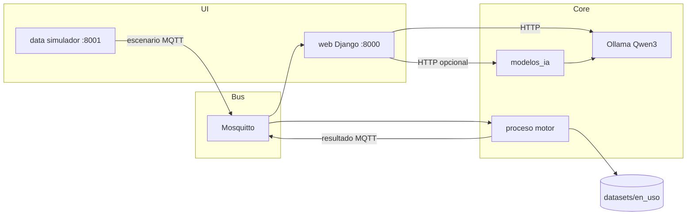

# 02 — Arquitectura técnica

## Vista de componentes

## Tecnologías (observadas)
| Capa | Tecnología |
|---|---|
| UI / API | Django 6, plantillas, JS |
| DATA | Django ligero + simuladores Python |
| PROCESO | Python + paho-mqtt |
| IA | servicio Python + Ollama |
| Runtime | Docker Compose proyecto `huc` |
| LLM | `qwen3:4b-instruct-2507-q4_K_M` |

## Organización del código
| Ruta raíz | Rol |
|---|---|
| `data/` | Fuentes del servicio Data |
| `proceso/` | Fuentes del motor/orquestación MQTT |
| `web/` | Fuentes de Visualización |
| `modelos_ia/` | Servicio de explicación |
| `datasets/` | Expedientes y motores por dataset |
| `HUC-1.0.0/` | Empaquetado Compose; `codigo/` es espejo rsync de la raíz |
| `archive/esp-datascience-lab/` | Laboratorio histórico archivado |

**Hecho:** hashes de archivos clave de `web/` y `HUC-1.0.0/codigo/web/` coinciden tras consolidación.  
**Pendiente operativo:** mantener `./instalar.sh` / rsync al cambiar código antes de rebuild.

## Dependencias entre módulos
DATA publica escenarios → PROCESO evalúa con dataset → VIZ consume resultados (MQTT y/o `evaluar_pozo` local) → asistente interpreta y opcionalmente llama a Ollama.
