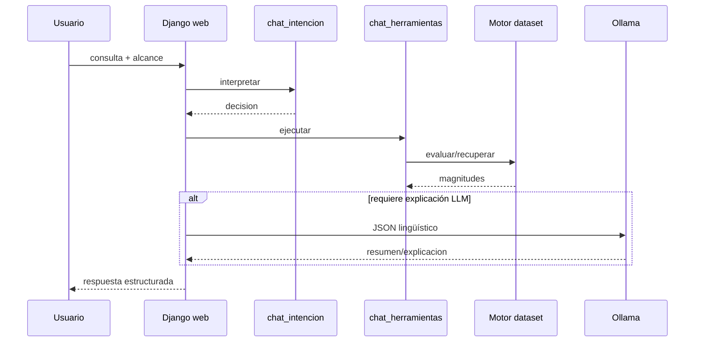

# 03 — Flujos operacionales

## Flujo A — Escenario desde simulador
1. Operador autentica en Data (`/api/acceder/`).
2. Ajusta controles; Data guarda **valores en uso** en memoria (`valores_en_uso.py`) sin escribir el Excel.
3. Publica escenario MQTT `huc/v1/data/{pozo}/escenario`.
4. Proceso evalúa y publica `huc/v1/proceso/{pozo}/resultado`.
5. Visualización actualiza consola/resultado.
6. `restaurar` vuelve a la base del expediente.

**Invariante:** simulación ≠ persistencia del dataset original.

## Flujo B — Consulta al asistente
1. POST/formulario en `/asistente/enviar/`.
2. `chat_intencion.interpretar` clasifica sin física.
3. `chat_herramientas.ejecutar` recupera resultado vivo o llama `evaluar_pozo`.
4. Se construyen hechos/contrato JSON v1.
5. Ollama puede aportar `resumen`/`explicacion` o omitirse (conceptual, aclarar, ciertos «por qué»).
6. Fusión/dedupe/validación; Django renderiza.

## Flujo C — Retorno a datos de hoja
`restaurar` (un pozo) y `cerrar-sesion` (todos los pozos con valores en uso) limpian los valores en uso y republican el escenario base (código Data). Regresión: `data/tests/test_cerrar_sesion.py`. Evidencia: `data/interfaces/simulador/views.py`, `escenarios.py`.
