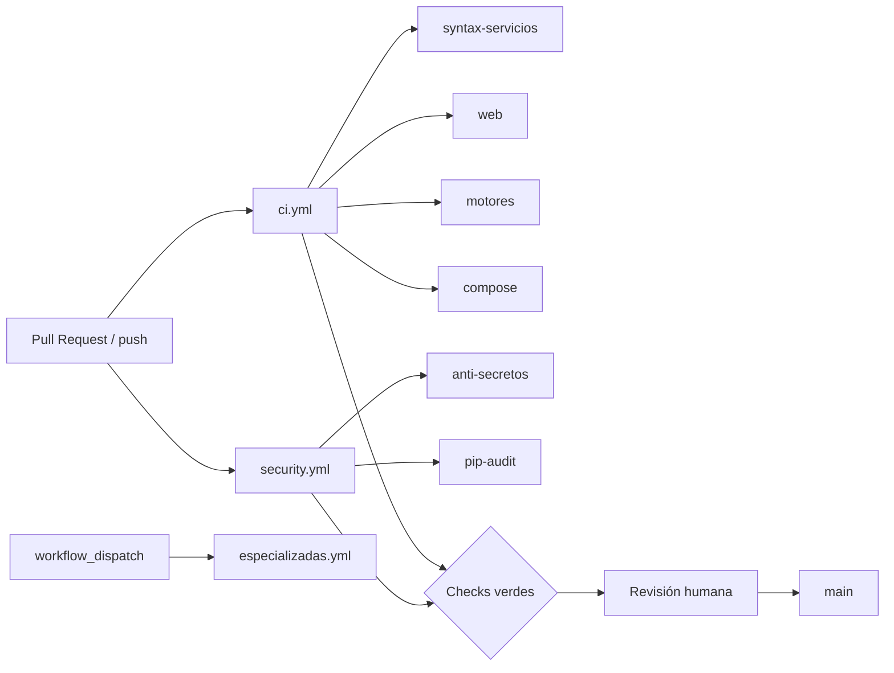

# 12 — Integración continua (GitHub Actions)

## Objetivo
Automatizar las verificaciones de categoría A (y controles de seguridad básicos) en cada cambio propuesto, sin alterar la lógica física ni depender de Ollama/MQTT reales en el gate de PR.

## Arquitectura

| Workflow | Archivo | Eventos | Contenido |
|---|---|---|---|
| CI HUC | `.github/workflows/ci.yml` | `pull_request`, `push` (main/infra), `workflow_dispatch` | syntax, WEB, DATA/PROCESO/IA, motores BES/RB, compose config |
| Seguridad | `.github/workflows/security.yml` | idem | `check-no-secrets.sh`, `pip-audit` |
| Especializadas | `.github/workflows/especializadas.yml` | solo manual | inventario categoría C / smoke compose |

## Scripts
- `scripts/ci/run-suites.sh` — orquestación reproducible de suites.
- `scripts/ci/check-no-secrets.sh` — archivos `.env`/claves y patrones de alto riesgo en el árbol rastreado.
- `requirements-ci.txt` — dependencias mínimas para runners (Python **3.14**).

## Categorías de prueba

| Cat. | Suites | En CI estándar |
|---|---|---|
| A | WEB, BES, RB-1521, RB-IA, PROCESO, DATA, MODELOS_IA (mocks), compose config, compileall | Sí |
| B | Stack Compose con Mosquitto (sin Ollama pesado) | Condicionado / manual smoke |
| C | Ollama real, E2E MQTT simulación, holdouts lingüísticos locales, archive lab | No (especializadas / local) |

## Criterios de aceptación para integrar
1. Jobs de `CI HUC` en verde.
2. Jobs de `Seguridad HUC` en verde (o hallazgo documentado con ADR).
3. Sin modificación de datasets originales ni fórmulas físicas no autorizadas.
4. Cambio funcional trazable a spec SDD cuando aplique (`specs/NNN-...`).
5. Revisión humana según constitución.

## Permisos
Workflows usan `permissions: contents: read`. No inyectan secretos del repositorio en PRs de forks.

## Limitaciones verificadas
- `gh` CLI puede no estar autenticado aunque SSH permita `git push`; la consulta de runs y la creación de PR vía API requieren `gh auth login` o un `GH_TOKEN`.
- La obligatoriedad de checks en merge depende de **branch protection / rulesets** (Fase 6 administrativa).
- Las vulnerabilidades reportadas por `pip-audit` deben tratarse como hallazgos reales; no silenciar el job sin justificación.

## Relación SDD
Ver `docs/plataforma/11_flujo_sdd_cursor.md` (paso CI) y constitución principio V.
