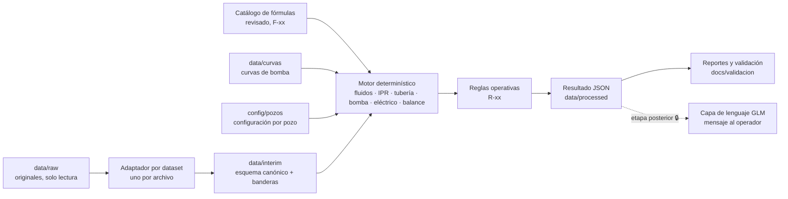
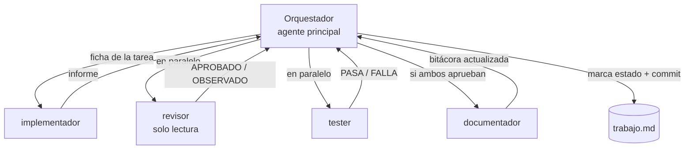

# trabajo.md — Modelo determinístico ESP y asesor para operadores

**Proyecto:** asesor-esp · **Versión del plan:** 1.0 · **Fecha:** 17-oct-2026

> **Fuente única de verdad del proyecto.** Solo el orquestador edita el tablero ([§9](#9-tablero-de-estado)), las preguntas abiertas ([§10](#10-preguntas-abiertas)) y el registro de cambios ([§13](#13-registro-de-cambios-del-plan)). El resto del archivo cambia solo con tu aprobación.

---

## 0. Guía rápida

1. Copia los archivos originales a `data/raw/` (lista y hashes en `data/raw/README.md`).
2. Abre la carpeta del proyecto en Cursor. En el chat de Agent escribe `/siguiente-tarea`: el agente principal actuará como orquestador ([§7](#7-sistema-multiagente-en-cursor)).
3. Sigue el avance en el tablero ([§9](#9-tablero-de-estado)) y en `docs/bitacora.md`. En cada puerta de fase ([§7.7](#77-puertas-de-fase)) el orquestador se detiene y te pide aprobación.
4. Para un resumen sin cambiar nada, escribe `/estado`.

---

## 1. Contexto, objetivo y alcance

### 1.1 Qué se construye

Un **modelo determinístico general** para pozos con bombeo electrosumergible (ESP, también llamado BES): un conjunto de reglas físicas y operativas construido a partir de las fórmulas de los documentos entregados, **revisadas una por una**, y probado con **cada dataset por separado**.

Ese modelo es la base de un **asesor para operadores**. En una etapa posterior, un modelo de lenguaje sencillo (candidato: GLM) traducirá los resultados a lenguaje natural y dará sugerencias sobre cómo actuar ante variaciones de la bomba. En esta etapa esa capa **solo se diseña**.

### 1.2 Respuestas del remitente que fijan el alcance

| # | Respuesta | Efecto en el plan |
|---|---|---|
| R-1 | El objetivo es aprender cómo funciona una ESP y usar las fórmulas físicas para llegar a un conjunto de reglas o modelo determinístico. | Fase 1 (fundamentos) y Fase 2 (revisión de fórmulas) antes de programar el motor. |
| R-2 | No hay que trabajar con todo a la vez: partir por el primer Excel, revisar cada fórmula y armar el modelo; después probarlo con los demás. | Orden de trabajo uno a uno ([§5.2](#52-orden-de-trabajo-uno-a-uno)). |
| R-3 | Cada Excel se procesa por separado. | Un adaptador por dataset; un solo motor para todos ([§5](#5-procesos)). |
| R-4 | La capa de lenguaje (p. ej., GLM) viene después; ahora solo se plantea cómo desarrollarla. | Fase 7: diseño ahora; implementación bloqueada (🔒) hasta la puerta G4. |
| R-5 | Dónde se ejecuta el modelo de lenguaje (nube o local): por consultar. | Pregunta abierta P-05. |

### 1.3 Dentro y fuera de alcance

- **Dentro:** fundamentos (incluida la BEP), catálogo y revisión de fórmulas, ingesta y limpieza de datos, motor determinístico con pruebas, reglas operativas, salidas estructuradas listas para un modelo de lenguaje, diseño de la capa de lenguaje.
- **Fuera (etapa posterior 🔒):** instalar y evaluar el modelo de lenguaje, datos en tiempo real, integración con SCADA o con el controlador del pozo, cambios automáticos de consignas.

---

## 2. Principios de diseño

1. **El modelo de lenguaje no calcula.** Recibe los resultados del motor y los explica. Todo número que vea un operador sale del motor y es trazable a una fórmula (F-xx) y a un dato.
2. **Originales intocables.** `data/raw/` es de solo lectura; todo lo derivado se regenera con código.
3. **Fórmula revisada antes de programarla.** Unidades, física y fuente verificadas, y con su prueba.
4. **SI dentro, unidades de campo fuera.** El motor trabaja en Pa, m³/s, m y W; psi, bpd, ft y hp aparecen solo en entradas y reportes, siempre rotulados.
5. **Un adaptador por dataset, un solo motor.** Entre pozos cambia la configuración, no el código.
6. **Nada inventado.** Si falta un dato: supuesto registrado (S-xx) con su efecto en la confianza, o tarea bloqueada (⏸️) con una pregunta (P-xx).
7. **Quien hace no verifica.** Toda tarea pasa por revisor y tester antes de marcarse ✅, y queda en la bitácora.
8. **Sugerencias, no órdenes.** Las reglas sugieren qué evaluar; ninguna acción sobre el pozo es automática.

---

## 3. Conceptos mínimos

Desarrollo completo en `docs/conceptos/esp_101.md` (tarea T1.1).

| Concepto | Qué es | Por qué importa |
|---|---|---|
| ESP / BES | Bomba centrífuga multietapa en el fondo del pozo, accionada por un motor eléctrico alimentado por cable desde superficie, con variador de frecuencia (VSD). | La energía recorre red → variador → transformador → cable → motor → sello → bomba → fluido, con pérdidas en cada eslabón. |
| Curvas de la bomba | Head (H), potencia al freno (BHP) y eficiencia (η) en función del caudal, por etapa o para N etapas, a una frecuencia de referencia. | Son la "huella" de la bomba; el modelo del documento E1 las necesita. |
| BEP | *Best Efficiency Point*: caudal en que la eficiencia es máxima. | Operar cerca de la BEP reduce desgaste y consumo. |
| Rango operativo | Franja de caudal recomendada alrededor de la BEP (Qmin–Qmax). | A la izquierda: empuje descendente, recirculación y calentamiento. A la derecha: empuje ascendente y desgaste. |
| Leyes de afinidad | Al cambiar la velocidad: Q ∝ N, H ∝ N², BHP ∝ N³. | Explican qué pasa al subir o bajar Hz y cómo se desplaza la BEP. |
| TDH | Carga dinámica total que la bomba debe vencer: nivel + fricción + presión en cabeza. | Define cuántas etapas se necesitan. |
| PIP | Presión en la admisión de la bomba. | Indica cuánta columna de fluido hay sobre la bomba; es la salida principal del modelo sensorless. |
| Sumergencia / nivel dinámico | Columna de fluido sobre la admisión / profundidad del nivel en el anular. | Baja sumergencia: riesgo de gas, cavitación o *pump-off*. |
| IPR | Relación entre caudal y presión de fondo fluyente (IP lineal, Vogel, compuesto). | Es el lado "yacimiento" del punto de operación. |
| Análisis nodal | El punto de operación está donde lo que entrega el yacimiento coincide con lo que la bomba y la tubería pueden mover. | Une yacimiento, bomba y superficie en un solo cálculo. |

---

## 4. Entradas

### 4.1 Archivos entregados

| ID | Archivo | Tipo | Contenido | Uso en el plan | MD5 |
|---|---|---|---|---|---|
| D1 | `RB-1521-PY-121120.xls` | Dataset, serie diaria | 129 días (2-may a 7-sep-2020), 32 columnas, un pozo, bomba S11000N, sensor de fondo | **Primer dataset:** construir y validar el motor | `a2dcc88b6b1ee8a82db9fdad29b5affa` |
| D2 | `RB-IA-2191-Data.xlsx` | Dataset, serie diaria | 28 días (2 al 29-may-2020), 25 columnas; un punto de operación repetido y columnas heredadas de D1 (H-01) | Segundo dataset: prueba de generalización, con limitaciones | `8c82a502b1e10d8db9e69b7f6f6918b4` |
| E1 | `Modelo_Sensorless_PIP_ESP_Set_Ecuaciones.docx` | Especificación | Modelo algebraico MVP (Q desde la potencia, PIP desde THP), observador EKF/MHE, guardrails y reivindicaciones | Fuente principal del modelo sensorless | `e39d771a6887be370e08f0bdcff6d93b` |
| E1b | `Modelo_Sensorless_PIP_ESP_Set_Ecuaciones__1_.docx` | Duplicado | Idéntico a E1 (mismo MD5) | No se usa; queda registrado (H-21) | `e39d771a6887be370e08f0bdcff6d93b` |
| X1 | `Copia_de_Copia_de_Ecuaciones___.xlsm` | Prototipo Excel | 5 hojas (Hoja1, METODO, Metodo Ordenado, Hoja2, Prueba Sesnorless), macro VBA de IPR, cuadros de texto con ecuaciones e imagen de la curva REDA SN2600 | Fuente de fórmulas y casos de prueba (modo réplica y modo corregido) | `4c4bcb0b286875276ecfbd8b2399dc63` |
| A1 | `paper_sensorless_-_v2.docx` | Artículo (borrador) | SensorLess híbrido (física + ML por pozo) en el campo Caño Sur; métricas contra sensor de fondo y Echometer | Contexto, métricas de referencia y fuente documental | `d88056c6c2276fa63d12834f44118d9f` |
| R1 | `004-ESPdesign.pdf` | Guía de referencia | Diseño de una ESP en 8 pasos con ejemplo resuelto (bomba DX-3000, 50 Hz) | Fundamentos, caso dorado y curva DX-3000 | `886d6f65af4868f5ec25a5ece5fb8860` |

### 4.2 Variables por dataset

Resumen; el detalle queda en `docs/datos/diccionario.md` (T3.1).

| Origen | D1 · RB-1521 | D2 · RB-IA-2191 |
|---|---|---|
| Medidas (promedio diario) | HZ, AMPs, P-sensor | HZ, Amp_m, Volt_m, P_Sensor (constantes los 28 días) |
| Pruebas de pozo (valor retenido entre pruebas) | Q-fluidos, Q-water, Q-oil, BSW, Q-test, HZ-test, PWf-test, Nivel-test | BFPD, BWPD, BOPD, BSW |
| Derivadas (se recalculan; no son "verdad") | PWf, Nivel, IP, P-SUT, VOLT (nominal) | PWF, PIP, H y las heredadas de D1: Sum, P_SUT, Pbomba, Eff_b, Porc_Load, Eff_m |
| Estáticas / configuración | API, T-Yac, GEP-Water, P-cas, Vel-fluidos (= viscosidad, H-07), T-tub (= THP, S-05), D-tub, N-sellos, Z-intake, Z-sensor, Z-perf, L-cable, P-Yac, Pburbuja, Marca-Bomba | API, T_Yac, GE_W, P_cas, Visco_f, THP, FP |

### 4.3 Insumos que faltan

| Insumo | Para qué | Mientras tanto |
|---|---|---|
| Curvas H-Q-η-BHP y número de etapas de la S11000N (D1) y de la bomba de D2 | Método B (documento E1), BEP y rango operativo reales | Curvas DX-3000 y SN2600 para probar el algoritmo; curva genérica escalada (S-07) |
| Potencia real (kW) y factor de potencia | Entrada principal del modelo sensorless | Potencia reconstruida con FP supuesto (S-01) |
| Placa del motor (HP, V, A, tipo, polos) y datos del cable | Pérdidas, carga del motor y velocidad real | Supuestos S-09 y S-12 |
| Datos horarios o por minuto | Separar paradas y transitorios | Banderas de parada en datos diarios (S-03) |
| Diámetro interno del tubing y desviación del pozo (D1) | Fricción y columna hidrostática | Supuestos S-08 y S-10 |

---

## 5. Procesos

### 5.1 Flujo general



### 5.2 Orden de trabajo (uno a uno)

1. **Fundamentos** (F1): conceptos, glosario, curvas disponibles y ejercicio de BEP.
2. **Fórmulas** (F2): catálogo completo y revisión una por una; tú apruebas las correcciones (puerta G1).
3. **Datos, un archivo a la vez** (F3): primero D1, luego D2, más los casos puntuales de X1 y R1 (puerta G2).
4. **Motor, módulo a módulo** (F4): cada módulo con sus pruebas, usando primero los casos de X1 y R1.
5. **Validación por dataset** (F5): casos dorados → D1 (Método A, luego B) → D2 → otros datasets si llegan → generalización (puerta G3).
6. **Salidas para el asesor** (F6): contrato JSON, reportes, escenarios "qué pasa si".
7. **Diseño de la capa de lenguaje** (F7): arquitectura, selección del modelo y guía de estilo (puerta G4). La implementación queda 🔒.
8. **Cierre** (F8).

### 5.3 Reglas de limpieza por dataset

**D1 · RB-1521**

1. Leer con `xlrd` (formato .xls). Verificar 129 filas y fechas diarias continuas.
2. Renombrar al esquema canónico y clasificar cada columna por origen ([§4.2](#42-variables-por-dataset)).
3. Convertir a SI conservando el valor original para trazabilidad.
4. Banderas:
   - `fraccion_operacion = HZ / HZ_nominal`, con HZ_nominal = moda de HZ (44 Hz); `dia_con_parada = fraccion_operacion < 0,98` (S-03); `variacion_menor` si HZ está entre ese umbral y el nominal.
   - `q_retenido` (igual al día anterior) y `dias_desde_prueba`.
   - `volt_nominal` (VOLT no sigue a la frecuencia, H-04) y `p_sut_congelado` (H-05).
   - `pwf_gradiente_variable` (H-06).
5. No imputar ni borrar filas. Las filas marcadas se conservan y cada tarea decide si las excluye.
6. Recalcular las columnas derivadas con fórmulas revisadas (PWf, nivel, potencia) y comparar con las del archivo.
7. Salidas: `data/interim/d1_rb1521/serie_diaria.csv` y `docs/datos/calidad_d1_rb1521.md`.

**D2 · RB-IA-2191**

1. Leer con `openpyxl`/pandas. Verificar 28 filas; la columna D es fórmula (BOPD = BFPD − BWPD).
2. Clasificar columnas: propias (constantes), heredadas de D1 (P_SUT, Sum y las que dependen de ellas: Pbomba, Eff_b, Porc_Load, Eff_m) y dudosas (THP pasa de 150 a 166; 166 coincide con D1).
3. Excluir del modelado las columnas heredadas hasta resolver P-04; se conservan con bandera `heredada_d1`.
4. Colapsar a puntos de operación únicos (esperado: 1) con el conteo de días.
5. Salidas: `data/interim/d2_rb2191/puntos_operacion.csv` y `docs/datos/calidad_d2_rb2191.md`.

**Casos puntuales (X1 y R1)**

- Transcribir entradas y resultados a YAML con referencia exacta (hoja!celda o página): `data/casos/r1_dx3000.yaml`, `data/casos/x1_hoja1_libro.yaml`, `data/casos/x1_232hst_gn4000.yaml`.
- Cada caso guarda dos juegos de valores esperados: `replica` (lo que da el archivo, con sus errores) y `corregido` (lo que da el motor revisado), más la explicación de cada diferencia.

### 5.4 Organización de carpetas

```
asesor-esp/
├── trabajo.md                 ← este plan (fuente de verdad)
├── AGENTS.md                  ← reglas comunes para todos los agentes
├── requirements.txt · pyproject.toml · .gitignore
├── .cursor/
│   ├── agents/                ← implementador, revisor, tester, documentador
│   ├── rules/                 ← orquestador, datos, modelo-fisico, documentacion, lenguaje (.mdc)
│   └── commands/              ← siguiente-tarea, estado, cerrar-fase
├── data/
│   ├── raw/                   ← originales, solo lectura (excluidos de git)
│   ├── interim/               ← datasets en esquema canónico, con banderas
│   ├── processed/             ← resultados del motor por pozo y fecha
│   ├── curvas/                ← curvas de bomba digitalizadas
│   ├── casos/                 ← casos puntuales de X1 y R1 (YAML)
│   └── escenarios/            ← escenarios para evaluar el futuro asesor
├── config/pozos/              ← configuración por pozo (YAML)
├── src/asesor_esp/
│   ├── unidades.py
│   ├── datos/                 ← esquema, adaptadores, calidad
│   ├── modelo/                ← fluidos, ipr, tuberia, bomba, electrico, balance,
│   │                            sensorless, diseno, guardrails, nodal
│   ├── reglas/                ← reglas.yaml, motor_reglas.py
│   ├── salida/                ← contrato, reportes, plantillas
│   └── cli.py
├── tests/                     ← datos/, modelo/, reglas/, casos_dorados/
├── scripts/                   ← utilidades (inventario, digitalización)
├── notebooks/                 ← ejercicios guiados (opcional)
└── docs/
    ├── bitacora.md · decisiones.md · contrato_salida.md
    ├── conceptos/             ← esp_101.md, glosario.md, figuras/
    ├── formulas/              ← catalogo.md, cobertura.md
    ├── datos/                 ← inventario.md, diccionario.md, calidad_*.md
    ├── verificaciones/        ← Txx-revisor.md, Txx-tester.md
    ├── validacion/            ← informes por dataset y del modelo general
    ├── reportes/              ← reportes por pozo y fecha
    └── lenguaje/              ← diseño de la capa de lenguaje (etapa posterior)
```

### 5.5 Supuestos de trabajo

Cada supuesto se cita por su ID en el código y en los reportes. Se levanta cuando se responde la pregunta indicada.

| ID | Supuesto | Dónde aplica | Efecto si es falso | Se levanta con |
|---|---|---|---|---|
| S-01 | FP = 0,80 en D1 (el mismo que usa P-SUT del archivo); FP = 0,93 en D2 (dato del archivo) | Potencia de entrada | Error de potencia casi proporcional: ±0,05 de FP ≈ ±6 % | P-03 |
| S-02 | V e I de D1 corresponden al lado de alta tensión en superficie (después del transformador elevador) | Cadena de pérdidas | Pérdidas del transformador mal asignadas | P-03 |
| S-03 | Día con frecuencia promedio bajo 98 % de la nominal = día con parada; se excluye de calibración y validación | Limpieza | Se pierden días válidos o entran días contaminados | P-03 (datos horarios) |
| S-04 | El caudal diario es el de la última prueba (retenido) y solo es confiable en días estables | Método A, validación | Error de Q en días lejanos a la prueba | P-07 |
| S-05 | T-tub = THP = 166 psi constante en D1 | Balance de presiones | 1 psi de error en THP = 1 psi de error en PIP | P-06 |
| S-06 | Densidad de mezcla ponderada por BSW (SG agua = GEP-Water; SG crudo por °API). Con BSW sobre 0,7 la viscosidad efectiva es la de la fase continua agua, con advertencia de posible emulsión | Fluidos y fricción | Error en gradiente y fricción | Revisión de ingeniería |
| S-07 | Sin curva real, se usa una curva genérica adimensional escalada a la BEP nominal de la bomba, con número de etapas calibrado; resultados con confianza baja | Método B en D1 | Head y eficiencia sesgados | P-02 |
| S-08 | ID del tubing de 3½" = 2,992" | Fricción | La fricción es muy sensible al diámetro | P-06 |
| S-09 | Motor de inducción con deslizamiento de 3 % si no se informa | N = 120·f/p·(1 − s) | H ∝ N²: 1 % de error en N ≈ 2 % en H | P-02 |
| S-10 | Las profundidades informadas son verticales (TVD) | Columna hidrostática | Sobrestima ρ·g·Δz si el pozo es desviado | P-06 |
| S-11 | Sin gas libre en la admisión de D1 (PIP ≈ 700 psi, muy sobre Pb = 80 psi), por lo que k_g = 0 | Corrección por gas | Head sobrestimado si hubiera gas | Verificación con datos |
| S-12 | Sin placa del motor, la carga se evalúa contra la mediana histórica de corriente del pozo | Reglas R-05 y R-06 | Alertas relativas, no absolutas | P-02 |

---

## 6. Salidas

| Salida | Ruta | Formato | Quién la usa y para qué |
|---|---|---|---|
| Inventario de originales | `docs/datos/inventario.md` | MD | Trazabilidad e integridad |
| Diccionario de datos | `docs/datos/diccionario.md` | MD | Todos: significado, unidad y origen de cada columna |
| Datasets limpios con banderas | `data/interim/<dataset>/` | CSV | Motor determinístico |
| Reportes de calidad | `docs/datos/calidad_<dataset>.md` | MD + PNG | Tú: qué datos sirven y cuáles no |
| Conceptos y glosario | `docs/conceptos/` | MD | Aprendizaje; después, vocabulario del modelo de lenguaje |
| Curvas digitalizadas | `data/curvas/` | CSV + YAML | Motor (bomba, BEP, afinidad) |
| Catálogo de fórmulas revisado | `docs/formulas/catalogo.md`, `data/formulas.yaml` | MD + YAML | Motor, revisor y, a futuro, explicaciones del asesor |
| Motor determinístico | `src/asesor_esp/` | Python | PIP, punto de operación y diagnóstico |
| Catálogo de reglas operativas | `src/asesor_esp/reglas/reglas.yaml` | YAML | Motor y asesor: condiciones, severidad y sugerencias |
| Suite de pruebas | `tests/` | pytest | Calidad y regresión |
| Informes de validación | `docs/validacion/` | MD + PNG | Tú: precisión y límites del modelo por dataset |
| Contrato de salida y ejemplos | `docs/contrato_salida.md`, `data/processed/` | JSON Schema + JSON | Entrada del futuro modelo de lenguaje |
| Biblioteca de escenarios | `data/escenarios/` | JSON | Evaluación del futuro asesor |
| Diseño de la capa de lenguaje | `docs/lenguaje/` | MD | Etapa posterior |
| Bitácora, verificaciones y decisiones | `docs/bitacora.md`, `docs/verificaciones/`, `docs/decisiones.md` | MD | Trazabilidad de cada paso |
| Informe final y guía de uso | `docs/informe_final.md`, `docs/guia_uso.md` | MD | Entrega |

---

## 7. Sistema multiagente en Cursor

### 7.1 Roles

Los subagentes de Cursor arrancan con contexto limpio y no se comunican entre sí; por eso este archivo es la memoria compartida y el orquestador es el único que coordina.

| Rol | Dónde se define | Hace | Puede escribir en | Nunca |
|---|---|---|---|---|
| **Orquestador** | Agente principal (chat de Agent) + `.cursor/rules/orquestador.mdc` | Elige la tarea, delega, consolida veredictos, actualiza el tablero y hace commit | `trabajo.md` (§9, §10, §13) | Implementar tareas por su cuenta |
| **implementador** | `.cursor/agents/implementador.md` | Ejecuta la ficha de la tarea: código, pruebas o documento | `src/`, `tests/`, `docs/`, `scripts/`, `notebooks/`, `config/`, `data/` salvo `data/raw/` | Tocar `data/raw/` o `trabajo.md` |
| **revisor** | `.cursor/agents/revisor.md` (solo lectura) | Revisión estática: ficha, unidades, física, trazabilidad | Nada (devuelve un informe) | Modificar archivos |
| **tester** | `.cursor/agents/tester.md` | Ejecuta pruebas, comprueba el criterio de aceptación y agrega pruebas de borde | `tests/`, `docs/verificaciones/` | Tocar `src/` o `data/raw/` |
| **documentador** | `.cursor/agents/documentador.md` | Bitácora, informes del revisor, catálogo, diccionario y decisiones | `docs/` | Tocar `src/`, `tests/` o `data/` |
| **Tú** | — | Respondes preguntas, apruebas puertas y decides las correcciones de fórmulas | Todo | — |



### 7.2 Estados del tablero

| Estado | Significado |
|---|---|
| ⬜ | Pendiente |
| 🔄 | En curso (implementador trabajando) |
| 🧪 | En verificación (revisor y tester) |
| ✅ | Verificada: revisada, probada y registrada |
| ❌ | Rechazada: vuelve al implementador con los hallazgos |
| ⏸️ | Bloqueada: espera una respuesta (P-xx) o un insumo |
| 🔒 | Etapa posterior: no se inicia sin la puerta correspondiente |

### 7.3 Ciclo de una tarea

1. El orquestador lee el tablero (§9) y elige la **primera tarea ⬜ cuyas dependencias estén cumplidas**:
   - una tarea dependiente está cumplida si está ✅;
   - una pregunta P-xx está cumplida si figura como respondida en §10, o si la ficha de la tarea define un plan alternativo;
   - una puerta Gx está cumplida si su aprobación figura en §13.
   Nunca elige tareas 🔒 ni ⏸️.
2. La marca 🔄 y entrega al implementador la **ficha completa** (§8) más el contexto necesario: los subagentes no ven el historial del chat.
3. Recibe el informe del implementador y marca 🧪.
4. Lanza **en paralelo** al revisor y al tester. Ninguno modifica `src/`, así que no chocan.
5. Si el revisor da **APROBADO** y el tester **PASA**:
   - el documentador agrega la entrada en `docs/bitacora.md` y guarda el informe del revisor en `docs/verificaciones/Txx-revisor.md`;
   - el orquestador marca ✅, anota la evidencia (fecha, entrada de bitácora y hash del commit) y ejecuta `git add -A && git commit -m "Txx: título"`.
6. Si alguno da **OBSERVADO** o **FALLA**: el orquestador marca ❌ con el motivo y devuelve los hallazgos al implementador. Tras 3 intentos fallidos marca ⏸️ y te consulta.
7. Si aparece una decisión que te corresponde: el orquestador registra una P-xx nueva en §10, marca ⏸️ y sigue con otra tarea independiente.
8. Si la tarea cierra una fase con puerta, se detiene y te presenta un resumen (§7.7).

Por defecto, `/siguiente-tarea` ejecuta **una** tarea y se detiene. Para avanzar en continuo, pide: *"Ejecuta tareas hasta la próxima puerta de fase"*.

Paralelismo: solo entre tareas independientes. Si dos subagentes van a editar archivos al mismo tiempo, el orquestador pide entornos aislados (worktrees). Correr agentes en paralelo multiplica el consumo de tokens.

### 7.4 Reglas para editar trabajo.md

- Solo el orquestador lo edita, y solo en §9 (estado y evidencia), §10 (preguntas) y §13 (registro de cambios y aprobaciones de puertas).
- No se borran tareas. Si una tarea cambia, se anota en §13. Las tareas nuevas reciben un ID nuevo (p. ej., T4.15) y se agregan al final de su fase y del tablero.
- La evidencia de una tarea ✅ incluye siempre: fecha, enlace a la entrada de bitácora y hash del commit.
- Cualquier otro cambio a este archivo requiere tu aprobación explícita.

### 7.5 Definición de terminado (aplica a toda tarea)

- Las salidas de la ficha existen en las rutas indicadas.
- El código tiene docstrings en español con unidades y referencias F-xx / S-xx, sin números sin explicar.
- `pytest -q` y `ruff check .` pasan sin errores.
- El revisor dio APROBADO y el tester PASA, con informes en `docs/verificaciones/`.
- La tarea tiene su entrada en `docs/bitacora.md`.

### 7.6 Comandos y prompt de arranque

| Comando | Qué hace |
|---|---|
| `/siguiente-tarea` | Ciclo completo (§7.3) para la próxima tarea disponible |
| `/estado` | Resumen de avance por fase, bloqueos, preguntas pendientes y próximas tareas, sin modificar nada |
| `/cerrar-fase` | Resumen de la fase para tu aprobación en la puerta correspondiente |

Si los comandos no aparecen en tu versión de Cursor, pega esto en Agent:

> Actúa como orquestador del proyecto según la sección 7 de trabajo.md y la regla .cursor/rules/orquestador.mdc. Elige la siguiente tarea disponible del tablero, delégala al subagente implementador, verifica con los subagentes revisor y tester en paralelo, registra con el documentador y actualiza el tablero. Ejecuta una sola tarea y muéstrame el resumen.

Si tu plan de Cursor no permite subagentes, abre un chat por rol y pega en cada uno el contenido del archivo del subagente correspondiente. `trabajo.md` sigue siendo la memoria compartida y tú haces de orquestador.

### 7.7 Puertas de fase

Una puerta aprobada se registra en §13. Las tareas que dependen de una puerta esperan esa aprobación.

| Puerta | Se abre al completar | Qué apruebas |
|---|---|---|
| G1 | F2 (T2.1 a T2.5) | La versión a implementar de cada fórmula y sus decisiones (`docs/decisiones.md`) |
| G2 | F3 (T3.1 a T3.5) | Datasets limpios y banderas de calidad |
| G3 | F5 (T5.1, T5.2, T5.3, T5.5 y T5.7; T5.4 y T5.6 no bloquean) | Validación y límites del modelo general |
| G4 | F7 diseño (T7.1 a T7.3) | El paso a implementar la capa de lenguaje (desbloquea las tareas 🔒) |

---

## 8. Fases y fichas de tareas

Cada ficha define **entradas, proceso, salidas y criterio de aceptación**. Salvo que la ficha diga otra cosa, la ejecuta el implementador y la verifican el revisor y el tester. Las dependencias y el estado viven en el tablero (§9).

### F0 · Preparación

#### T0.1 · Estructura del repositorio y entorno Python
- **Entradas:** kit de inicio (este archivo, `AGENTS.md`, `.cursor/`, `requirements.txt`, `.gitignore`, `docs/`).
- **Proceso:** crear `src/asesor_esp/` con los subpaquetes `datos`, `modelo`, `reglas` y `salida`, más `tests/` y `scripts/` según §5.4. Crear `pyproject.toml` (layout src, Python ≥ 3.11, configuración de pytest y ruff), el entorno virtual, `git init` y el primer commit.
- **Salidas:** estructura de carpetas, `pyproject.toml`, `tests/test_humo.py` (importa el paquete).
- **Criterio:** `pip install -e .` funciona; `pytest -q` y `ruff check .` pasan; `git log` muestra el commit inicial.

#### T0.2 · Integridad e inventario de originales
- **Entradas:** `data/raw/` y los MD5 esperados de `data/raw/README.md`.
- **Proceso:** `scripts/inventario.py` calcula los MD5 y lista hojas, filas, columnas, rango de fechas, fórmulas y macros de cada archivo, sin modificar nada.
- **Salidas:** `scripts/inventario.py`, `docs/datos/inventario.md`.
- **Criterio:** los 7 MD5 coinciden; E1 y E1b aparecen como duplicados; se reproducen los conteos de §4.1 (129 y 28 filas; 32 y 25 columnas; 5 hojas en X1).

#### T0.3 · Auditoría del ciclo multiagente
- **Ejecuta:** orquestador. **Verifica:** revisor.
- **Entradas:** `.cursor/agents/`, `.cursor/rules/`, `.cursor/commands/`, historial de T0.1 y T0.2.
- **Proceso:** confirmar que Cursor reconoce los 4 subagentes, las reglas y los comandos; comprobar que T0.1 y T0.2 siguieron el ciclo de §7.3 y corregir el protocolo si algo falló.
- **Salidas:** entrada en la bitácora con el resultado de la auditoría.
- **Criterio:** T0.1 y T0.2 tienen informes de revisor y tester, entrada en la bitácora y evidencia en el tablero; el orquestador no editó nada fuera de §9, §10 y §13.

### F1 · Fundamentos: cómo funciona una ESP

#### T1.1 · Documento "ESP 101"
- **Entradas:** R1, E1, A1, cuadros de texto de X1, §3.
- **Proceso:** explicar, con ejemplos tomados de los propios archivos: componentes y cadena energética; curvas H-Q-BHP-η; BEP y rango operativo; leyes de afinidad; TDH; PIP, sumergencia y nivel dinámico; IPR y análisis nodal; síntomas operativos (gas, baja sumergencia, sobrecarga y subcarga, paradas). Cada afirmación técnica cita su fuente.
- **Salidas:** `docs/conceptos/esp_101.md`.
- **Criterio:** cubre todos los conceptos de §3; cada sección cita al menos una fuente de los archivos (archivo y página, sección u hoja!celda); toda fórmula mencionada usa su ID del Anexo A.

#### T1.2 · Glosario técnico–operador
- **Entradas:** T1.1, Anexo A.
- **Proceso:** por cada término: español, inglés, símbolo, unidad, definición técnica (1 línea) y explicación para operador (1 línea, sin jerga).
- **Salidas:** `docs/conceptos/glosario.md`.
- **Criterio:** al menos 40 términos; incluye todos los símbolos del Anexo A; la columna "para operador" no usa siglas sin explicar.

#### T1.3 · Digitalizar las curvas de bomba disponibles
- **Entradas:** R1 p. 4 (DX-3000, 50 Hz, por etapa; m³/d, m, hp, %) e imagen 1 de X1 (REDA SN2600, 60 Hz, 100 etapas; bbl/d, ft, hp, %).
- **Proceso:** extraer al menos 12 puntos por curva de H, BHP y η; registrar frecuencia, etapas, unidades, fuente, método de digitalización e incertidumbre estimada.
- **Salidas:** `data/curvas/dx3000_50hz.csv`, `data/curvas/sn2600_60hz.csv`, `data/curvas/README.md`.
- **Criterio:** la BEP digitalizada de la DX-3000 queda dentro de la franja verde del PDF, cerca de 350 m³/d; la de la SN2600, cerca de 2.600 bbl/d (línea "Operating"); los valores que da el PDF a 340 m³/d (4,4 m/etapa y 0,36 hp/etapa) se reproducen con error menor a 3 %.

#### T1.4 · Ejercicio guiado: BEP, rango operativo y frecuencia
- **Entradas:** T1.3.
- **Proceso:** graficar las curvas y marcar BEP y rango; mostrar cómo se desplazan con ±10 Hz aplicando afinidad (cálculo simple, todavía sin el motor); explicar qué significa operar a la izquierda o a la derecha de la BEP.
- **Salidas:** `notebooks/01_bep_y_afinidad.ipynb` (o script equivalente), figuras en `docs/conceptos/figuras/` y una sección "Ejercicio BEP" en `esp_101.md`.
- **Criterio:** las figuras se regeneran con un comando; el texto responde qué es la BEP, por qué importa y qué pasa al cambiar Hz.

### F2 · Catálogo y revisión de fórmulas (una por una)

#### T2.1 · Catálogo de fórmulas
- **Entradas:** Anexo A, E1, X1 (celdas, cuadros de texto y VBA), R1, A1.
- **Proceso:** una ficha por fórmula con: ID F-xx, nombre, ecuación (texto y LaTeX), variables con unidades, fuente exacta, supuestos, rango de validez y estado de revisión (pendiente, revisada, corregida o descartada). Si aparecen fórmulas no listadas, se agregan con ID nuevo.
- **Salidas:** `docs/formulas/catalogo.md` y `data/formulas.yaml` (la misma información, legible por máquina).
- **Criterio:** las 47 fórmulas del Anexo A tienen ficha; cada fuente es verificable; el YAML es válido.

#### T2.2 · Revisión dimensional
- **Entradas:** T2.1.
- **Proceso:** análisis de unidades de cada fórmula y verificación de constantes (62,4; 0,433; 144; 2,31; 5,615; 135.770; 1.360; 745,7; 6,7197×10⁻⁴; 34,3; 2,083).
- **Salidas:** sección "Revisión dimensional" en cada ficha; hallazgos nuevos como H-xx en el Anexo B (los registra el documentador).
- **Criterio:** todas las fichas tienen veredicto dimensional; cada inconsistencia trae explicación y propuesta.

#### T2.3 · Revisión física
- **Entradas:** T2.2, Anexo B.
- **Proceso:** validez de cada fórmula (régimen de flujo, tipo de fluido, rango), signos de los balances y supuestos ocultos; confirmar o descartar los hallazgos H-08 a H-20.
- **Salidas:** sección "Revisión física" en cada ficha.
- **Criterio:** cada H-xx relacionado con fórmulas queda confirmado o descartado con argumento.

#### T2.4 · Versión a implementar y decisiones
- **Entradas:** T2.2, T2.3.
- **Proceso:** proponer qué versión de cada fórmula se implementa (original, corregida o descartada) y registrar las decisiones relevantes como ADR. Las fórmulas con error conocido se implementarán con un "modo réplica" que reproduce el archivo original y un "modo corregido".
- **Salidas:** estado final en el catálogo y ADR en `docs/decisiones.md`.
- **Criterio:** ninguna ficha queda pendiente; cada corrección tiene su ADR.

#### T2.5 · Matriz de cobertura fórmula ↔ datos
- **Entradas:** T2.1, `docs/datos/inventario.md`.
- **Proceso:** para cada dataset y caso, indicar qué fórmulas se pueden evaluar con sus columnas, cuáles necesitan supuestos y cuáles no se pueden evaluar por falta de insumos.
- **Salidas:** `docs/formulas/cobertura.md`.
- **Criterio:** matriz completa para D1, D2 y los casos de X1 y R1; cada "no evaluable" apunta a una P-xx o S-xx. Cierra F2 → **puerta G1**.

### F3 · Datos: ingesta, limpieza y organización (un archivo a la vez)

#### T3.1 · Esquema canónico y diccionario de datos
- **Entradas:** inventario, §4.2, §5.3.
- **Proceso:** definir las variables canónicas (nombre, unidad SI, origen: medida, prueba, derivada, estática o supuesta; banderas de calidad) con pydantic o dataclasses.
- **Salidas:** `src/asesor_esp/datos/esquema.py`, `docs/datos/diccionario.md` (columna original → canónica, unidad, origen y notas).
- **Criterio:** todas las columnas de D1 y D2 quedan mapeadas o descartadas con motivo; el esquema tiene pruebas de validación.

#### T3.2 · D1 (RB-1521): adaptador y limpieza
- **Entradas:** `data/raw/RB-1521-PY-121120.xls`, T3.1, reglas de §5.3.
- **Proceso:** lector, mapeo, conversión de unidades, banderas, recálculo de derivadas y comparación con las del archivo.
- **Salidas:** `src/asesor_esp/datos/adaptador_d1.py`, `data/interim/d1_rb1521/serie_diaria.csv`, `docs/datos/calidad_d1_rb1521.md` con gráficos.
- **Criterio:** 129 filas; con el umbral de S-03 quedan marcados como parada el 2020-09-02 y el 2020-09-03, y otros 5 días como variación menor; se detectan 17 tramos de caudal retenido; el reporte cuantifica H-02 a H-07.

#### T3.3 · D2 (RB-IA-2191): adaptador y limpieza
- **Entradas:** `data/raw/RB-IA-2191-Data.xlsx`, T3.1, T3.2, reglas de §5.3.
- **Proceso:** igual que T3.2, más la detección de columnas heredadas de D1 por comparación directa por fecha.
- **Salidas:** `src/asesor_esp/datos/adaptador_d2.py`, `data/interim/d2_rb2191/puntos_operacion.csv`, `docs/datos/calidad_d2_rb2191.md`.
- **Criterio:** se demuestra con código que P_SUT(D2) = P-SUT(D1) y que Sum(D2) = Z-intake(D1) − Nivel-test(D1); resultado: 1 punto de operación propio.

#### T3.4 · Casos puntuales a YAML
- **Entradas:** X1 (Hoja1, METODO, Metodo Ordenado, Prueba Sesnorless y macro VBA), R1.
- **Proceso:** transcribir entradas y resultados con referencia hoja!celda o página; marcar los valores escritos a mano o por la macro (p. ej., Pwf = 735,42 psi que escribe la macro en J21).
- **Salidas:** `data/casos/r1_dx3000.yaml`, `data/casos/x1_hoja1_libro.yaml`, `data/casos/x1_232hst_gn4000.yaml`.
- **Criterio:** cada valor tiene referencia verificable; los valores `replica` coinciden con el archivo a 4 cifras significativas.

#### T3.5 · Soporte multipozo y verificación de "varios pozos"
- **Entradas:** D1, D2, P-12.
- **Proceso:** detector de pozos por columna identificadora o por cambios en la configuración estática (bomba, profundidades); si un archivo trae varios pozos, separarlos por `pozo_id`.
- **Salidas:** función en `src/asesor_esp/datos/`; nota en `docs/datos/inventario.md` con el resultado por archivo.
- **Criterio:** D1 → 1 pozo; D2 → 1 pozo; un archivo sintético con 2 pozos se separa correctamente. Cierra F3 → **puerta G2**.

### F4 · Motor determinístico (módulo a módulo)

Todos los módulos implementan solo fórmulas aprobadas en G1, citan sus F-xx y traen pruebas. Donde la fórmula original tiene un error conocido, el módulo ofrece `modo="replica"` y `modo="corregido"`.

#### T4.1 · `unidades.py`
- **Proceso:** conversiones psi↔Pa, bpd↔m³/s, ft↔m, hp↔W, cP↔Pa·s, °F↔K, kg/cm²↔Pa y °API→SG; constante g = 9,80665 m/s².
- **Salidas:** `src/asesor_esp/unidades.py`, `tests/test_unidades.py`.
- **Criterio:** las conversiones de ida y vuelta son exactas (tolerancia relativa 1e-12); los factores coinciden con referencias (1 bbl = 0,158987 m³; 1 psi = 6.894,757 Pa; 1 hp = 745,6999 W).

#### T4.2 · `modelo/fluidos.py`
- **Fórmulas:** F-01 a F-05.
- **Criterio:** SG(13,8 °API) = 0,97385; ρ = 60,768 lb/ft³; gradiente de mezcla según S-06, con advertencia de emulsión cuando corresponda.

#### T4.3 · `modelo/ipr.py`
- **Fórmulas:** F-07 a F-12.
- **Proceso:** IP lineal, Vogel y compuesto (corrigiendo H-13), en forma directa (Pwf → Q) e inversa (Q → Pwf).
- **Criterio:** caso 232HST de X1: IP = 12,036 bpd/psi; Qb = 11.914,8 bpd; Qmax = 12.784,0 bpd; Pwf(4.628 bpd) = 735,42 psi; la curva es continua en Pwf = Pb.

#### T4.4 · `modelo/tuberia.py`
- **Fórmulas:** F-14 a F-21.
- **Proceso:** velocidad, Reynolds, factor de fricción por régimen (laminar 64/Re; turbulento Swamee-Jain o Colebrook; transición interpolada), Hazen-Williams (modo R1) y k_f·Q² (modo E1).
- **Criterio:** Hazen-Williams del PDF da 40,5 ft/1000 ft (±0,5 %); en modo réplica de X1, f = 0,18369 y gradiente de fricción = 0,15402 psi/ft; en modo corregido, con Re = 10.342 se usa el factor turbulento, no 64/Re.

#### T4.5 · `modelo/bomba.py`
- **Fórmulas:** F-22 a F-28.
- **Proceso:** ajuste polinómico de curvas (grado 3 a 5, con error de ajuste reportado), BEP, rango operativo, afinidad (Q ∝ N, H ∝ N², BHP ∝ N³), número de etapas y corrección por gas k_g.
- **Criterio:** a la frecuencia base se reproducen los puntos digitalizados con error menor a 2 %; el escalamiento por afinidad es exacto; la BEP se desplaza en proporción a N.

#### T4.6 · `modelo/electrico.py`
- **Fórmulas:** F-31 a F-35.
- **Proceso:** potencia √3·V·I·FP, caída en el cable, pérdidas de motor y sellos, cadena de pérdidas en modo réplica y corregido; velocidad desde la frecuencia con deslizamiento (S-09).
- **Criterio:** réplica de "Prueba Sesnorless": 160,53 hp en superficie; 159,17 hp tras el cable; 119,38 hp tras el motor; 111,38 hp tras los sellos; 69,05 hp hidráulicos.

#### T4.7 · `modelo/balance.py`
- **Fórmulas:** F-12, F-13, F-19, F-38.
- **Proceso:** presión de descarga, ΔP de la bomba, PIP, sumergencia, nivel dinámico y Pwf desde PIP (profundidades verticales, S-10).
- **Criterio:** réplica de Hoja1 de X1: Pd = 2.699,41 psi; PIP = 415,39 psi; ΔP bomba = 2.284,02 psi; head = 5.498,54 ft. En modo corregido la presión de descarga incluye el THP (H-10).

#### T4.8 · Método A: caudal conocido → PIP desde la potencia
- **Fórmulas:** F-29, F-34 y F-41 (réplica), más la versión corregida.
- **Proceso:** potencia de entrada → potencia hidráulica → head → ΔP de la bomba → PIP = Pd − ΔP bomba.
- **Criterio:** réplica de "Prueba Sesnorless": PIP inferido = 670,78 psi, sumergencia = 1.588,38 ft, Pwf = 757,22 psi; el resultado en modo corregido queda documentado junto con la causa de la diferencia.

#### T4.9 · Método B: caudal desde la potencia (documento E1)
- **Fórmulas:** F-26 a F-28 y F-36 a F-39.
- **Proceso:** resolver F(Q) = 0 con bisección o Brent dentro del rango operativo; detectar raíces múltiples y mala condición numérica (sensibilidad dQ/dP_in); calcular PIP y la confianza.
- **Criterio:** prueba de ida y vuelta con DX-3000 y SN2600: se simula un punto (Q, PIP) con el modelo directo, se invierte y se recuperan Q y PIP con error menor a 1 %; se reporta cuánto error de Q produce un error de 3 % en la potencia.

#### T4.10 · `modelo/diseno.py`: flujo de 8 pasos del PDF
- **Fórmulas:** F-06, F-20, F-22, F-24, F-25, F-32, F-33.
- **Criterio:** caso R1: Q ≈ 340 m³/d; Pcf ≈ 70 m; Pbdp = 100 m; TDH = 1.720 m; 386 etapas con 1.700 m (como el PDF) y 391 con 1.720 m (H-23); ≈ 138 HP; 2.203 V en superficie; ≈ 171 kVA.

#### T4.11 · `modelo/guardrails.py` y confianza
- **Proceso:** rangos físicos (PIP ≥ 0, Q dentro del rango, 0 ≤ k_g ≤ 0,4, eficiencias entre 0 y 1), monotonicidad y un score de confianza que combine consistencia del método, calidad del dato y supuestos activos.
- **Criterio:** pruebas de propiedades (hypothesis): ninguna salida viola un rango sin quedar marcada; la confianza baja cuando hay banderas de calidad o supuestos como S-01 o S-07.

#### T4.12 · `modelo/nodal.py`: análisis nodal simplificado (recomendada)
- **Proceso:** intersectar la IPR con la curva de bomba más sistema para obtener el punto de operación; comparar el PIP del lado yacimiento (IPR) con el del lado bomba (Método A).
- **Criterio:** en el caso 232HST se reportan ambos (648,98 psi por IPR y 670,78 psi por potencia, en réplica) con la explicación de la diferencia, incluida la distinta profundidad de referencia (sensor y admisión).

#### T4.13 · Motor de reglas operativas
- **Entradas:** guardrails, T1.1, catálogo de fórmulas.
- **Proceso:** reglas en YAML, cada una con condición cuantitativa, umbrales configurables, severidad, explicación técnica, sugerencia para el operador y fuente. Los umbrales los propone el implementador con su fuente, marcados SUPUESTO, y los apruebas tú (P-10). Reglas iniciales:

  | ID | Condición | Sugerencia (qué evaluar) |
  |---|---|---|
  | R-01 | Q/Q_BEP(f) bajo el límite inferior del rango | Operación a la izquierda: empuje descendente, recirculación, calentamiento. Evaluar subir Hz o revisar restricciones. |
  | R-02 | Q/Q_BEP(f) sobre el límite superior del rango | Operación a la derecha: empuje ascendente y desgaste. Evaluar bajar Hz o ajustar el estrangulamiento. |
  | R-03 | Sumergencia bajo el mínimo | Riesgo de *pump-off* o ingreso de gas. Evaluar bajar Hz gradualmente y vigilar la corriente. |
  | R-04 | PIP < presión de burbuja | Gas libre en la admisión. Evaluar aumentar la sumergencia y revisar el separador de gas. |
  | R-05 | Corriente sobre la referencia (placa o S-12) | Sobrecarga. Evaluar bajar Hz y revisar el fluido (emulsión, sólidos). |
  | R-06 | Corriente bajo una fracción de la referencia | Subcarga: posible bloqueo por gas o *pump-off*. Verificar nivel y producción. |
  | R-07 | Inconsistencia entre potencia medida y predicha | Confianza baja: posible desgaste, gas o cambio de fluido. Revisar datos. |
  | R-08 | Dato poco confiable (parada, caudal retenido muchos días, FP supuesto) | Interpretar con cautela y confirmar con prueba de pozo. |
  | R-09 | Diferencia sostenida entre sensor y estimado | Posible deriva del sensor o cambio de condición. Programar verificación (Echometer). |
  | R-10 | PIP alta, Q en o bajo la BEP y margen de carga del motor | Hay margen para evaluar más producción (subir Hz) con seguimiento. |
  | R-11 | Cambio brusco día a día en PIP, corriente o frecuencia | Posible evento (parada, gas, cambio de estrangulamiento). Revisar el registro operativo. |

- **Salidas:** `src/asesor_esp/reglas/reglas.yaml`, `src/asesor_esp/reglas/motor_reglas.py`, pruebas por regla.
- **Criterio:** cada regla tiene una prueba en la que se activa y otra en la que no; ninguna regla ordena acciones, solo sugiere qué evaluar.

#### T4.14 · API del motor y CLI
- **Proceso:** `evaluar_pozo(estado, config_pozo) -> Resultado`, que encadena fluidos → balance → métodos A/B → guardrails → reglas y devuelve todo con unidades, fórmulas usadas, supuestos y confianza; CLI `python -m asesor_esp evaluar --dataset d1 --fecha 2020-06-01`.
- **Criterio:** corre sobre cualquier fila de D1 y D2; la salida JSON sigue la estructura del ejemplo de T6.1.

### F5 · Validación dataset por dataset y generalización

#### T5.1 · Casos dorados (R1 y X1)
- **Proceso:** suite que corre los YAML de `data/casos/` en modo réplica y en modo corregido.
- **Salidas:** `tests/casos_dorados/`, `docs/validacion/casos_dorados.md` (tabla réplica vs. corregido con la causa de cada diferencia).
- **Criterio:** el modo réplica coincide con el archivo a 4 cifras significativas; cada diferencia del modo corregido se explica con un H-xx.

#### T5.2 · D1: Método A contra el sensor de fondo
- **Proceso:** correr sobre los días válidos (sin parada); comparar a la misma profundidad (el sensor está 24,8 ft bajo la admisión); calibrar con los primeros 30 días válidos y validar con el resto; analizar la sensibilidad a FP (±0,05), eficiencias (±5 puntos), densidad, THP y deslizamiento.
- **Salidas:** `docs/validacion/d1_metodo_a.md` con métricas (error absoluto medio en psi, error mediano en %, sesgo) y gráficos.
- **Criterio:** métricas separadas para calibración y validación; gráfico de sensibilidad tipo tornado; la mediana de 4,3 % del artículo A1 se usa solo como comparación, sin umbral obligatorio (P-09).

#### T5.3 · D1: Método B con curva genérica (S-07)
- **Proceso:** igual que T5.2, con el Método B, la curva genérica escalada y el número de etapas calibrado.
- **Salidas:** `docs/validacion/d1_metodo_b_generica.md`.
- **Criterio:** resultados marcados con confianza baja; comparación A vs. B; se documenta qué cambiaría con la curva real.

#### T5.4 · D1: Método B con curva real
- **Requiere:** respuesta a P-02.
- **Salidas:** `docs/validacion/d1_metodo_b_real.md`.
- **Criterio:** igual que T5.3 con la curva real, más la comparación con T5.3.

#### T5.5 · D2 por separado
- **Proceso:** evaluar el punto de operación propio con los métodos disponibles y chequeos de consistencia, sin usar columnas heredadas.
- **Salidas:** `docs/validacion/d2.md`.
- **Criterio:** documenta qué se pudo validar, qué no y por qué.

#### T5.6 · Siguientes datasets
- **Requiere:** respuesta a P-12 o la llegada de archivos nuevos.
- **Proceso:** para cada archivo nuevo: inventario (como T0.2) → adaptador (como T3.2) → validación (como T5.2) → informe.
- **Criterio:** el motor no cambia; solo se agregan el adaptador y la configuración del pozo.

#### T5.7 · Generalización y límites del modelo
- **Proceso:** separar parámetros generales y parámetros por pozo (`config/pozos/<id>.yaml`); informe comparativo entre datasets; límites de validez (qué datos exige, dónde falla, cuánta confianza ofrece).
- **Salidas:** `config/pozos/`, `docs/validacion/modelo_general.md`.
- **Criterio:** evaluar un pozo nuevo requiere solo su YAML y su adaptador. Cierra F5 → **puerta G3**.

### F6 · Salidas del motor (insumo del futuro asesor)

#### T6.1 · Contrato de salida (JSON Schema)
- **Proceso:** definir y versionar el esquema del resultado; generar ejemplos reales de D1 y D2.
- **Salidas:** `docs/contrato_salida.md`, `src/asesor_esp/salida/contrato.py`, `data/processed/<pozo>/ejemplos/*.json`.
- **Criterio:** todos los ejemplos validan contra el esquema; cada valor numérico trae unidad, método y fórmulas.
- **Estructura de referencia** (los `null` los completa el motor; las entradas son datos reales de D1 del 2020-06-01):

```json
{
  "version_contrato": "1.0",
  "pozo_id": "RB-1521",
  "fecha": "2020-06-01",
  "calidad_dato": {"dia_con_parada": false, "q_retenido": true, "dias_desde_prueba": null, "fp_supuesto": true},
  "entradas": {
    "frecuencia": {"valor": 44.0, "unidad": "Hz", "origen": "medida"},
    "corriente": {"valor": 68.41, "unidad": "A", "origen": "medida"},
    "caudal": {"valor": 9003.96, "unidad": "bpd", "origen": "prueba_retenida"}
  },
  "resultados": {
    "pip": {"valor": null, "unidad": "psi", "metodo": "A", "formulas": ["F-31", "F-34", "F-29", "F-38"], "supuestos": ["S-01", "S-05"]},
    "posicion_bep": {"q_rel_bep": null, "zona": null},
    "carga_motor": {"valor": null, "unidad": "%"}
  },
  "referencia": {"pip_sensor": {"valor": 715.27, "unidad": "psi"}, "error_rel": {"valor": null, "unidad": "%"}},
  "reglas_activadas": [
    {"id": "R-08", "severidad": "baja", "mensaje_tecnico": null, "sugerencia": null}
  ],
  "confianza": {"score": null, "motivos": ["FP supuesto (S-01)"]}
}
```

#### T6.2 · Reporte por pozo y fecha
- **Salidas:** `src/asesor_esp/salida/reportes.py`, `docs/reportes/` (Markdown con tabla y gráficos).
- **Criterio:** un comando genera el reporte de cualquier fecha; un ingeniero entiende el estado del pozo sin abrir el código.

#### T6.3 · Escenarios "qué pasa si"
- **Proceso:** variar frecuencia (±1 a ±5 Hz), THP, IP y BSW; reportar Q, PIP, carga del motor, posición respecto de la BEP y reglas activadas.
- **Criterio:** respuestas monótonas y físicamente coherentes (con lo demás constante, más Hz da más Q y menos PIP); cada escenario queda en JSON.

#### T6.4 · Biblioteca de escenarios para evaluar el asesor
- **Proceso:** al menos 30 escenarios, reales (D1, D2) y variaciones sintéticas: gas libre, baja sumergencia, sobrecarga, subcarga, operación fuera de rango, día con parada y dato retenido. Cada uno con su JSON del motor y los puntos clave que un buen mensaje al operador debería mencionar.
- **Salidas:** `data/escenarios/*.json`, `docs/lenguaje/escenarios.md`.
- **Criterio:** cada regla R-xx aparece en al menos 2 escenarios; tú revisas los puntos clave.

### F7 · Capa de lenguaje con GLM (diseñar ahora, implementar después)

#### T7.1 · Arquitectura de la capa de lenguaje
- **Proceso:** documentar el flujo motor → JSON → modelo de lenguaje → mensaje. El modelo solo redacta, no calcula. Comparar dos integraciones: plantilla + modelo que reescribe, o modelo con herramientas que llama al motor. Incluir recuperación de contexto (glosario, reglas, documentos) y dónde se ejecuta (P-05).
- **Salidas:** `docs/lenguaje/arquitectura.md` con diagrama.
- **Criterio:** responde qué entra, qué sale, qué está prohibido y cómo se verifica cada mensaje.

#### T7.2 · Criterios y plan de selección del modelo
- **Requiere:** T7.1 y respuesta a P-05.
- **Proceso:** criterios ponderados: calidad en español técnico, ejecución local o en la nube, hardware necesario, licencia y capacidad de respetar un formato. Candidatos: familia GLM (versión vigente al momento de la fase) y al menos dos alternativas. Plan de prueba con los escenarios de T6.4.
- **Salidas:** `docs/lenguaje/seleccion_modelo.md`.
- **Criterio:** tabla comparativa y plan de prueba reproducible.

#### T7.3 · Guía de estilo y plantillas para el operador
- **Proceso:** estructura de cada mensaje: qué está pasando, por qué, qué sugerimos evaluar, qué vigilar y nivel de confianza. Definir tono, largo y vocabulario (glosario de T1.2). Las plantillas sin modelo de lenguaje sirven de respaldo y de línea base de comparación.
- **Salidas:** `docs/lenguaje/guia_estilo.md`, plantillas en `src/asesor_esp/salida/plantillas/`.
- **Criterio:** 5 escenarios de T6.4 redactados con plantilla y revisados por ti. Cierra el diseño → **puerta G4**.

#### T7.4 🔒 · Validador de mensajes
- **Proceso:** comprobar que todo número del texto exista en el JSON (con tolerancia de redondeo), que las reglas citadas existan y que no haya sugerencias fuera de límites; si falla, se usa la plantilla.
- **Criterio:** detecta el 100 % de los números alterados en un set de prueba.

#### T7.5 🔒 · Prototipo con GLM
- **Proceso:** instalar el modelo elegido, generar mensajes para los escenarios de T6.4 y evaluar fidelidad numérica, cobertura de puntos clave, claridad y seguridad, comparando con las plantillas.
- **Criterio:** informe con métricas, ejemplos y la decisión de seguir o ajustar.

#### T7.6 🔒 · Prueba con operadores
- **Proceso:** sesión con operadores reales para medir comprensión y utilidad; ajustar la guía y las reglas.
- **Criterio:** informe de la prueba y cambios propuestos.

### F8 · Cierre

#### T8.1 · Informe técnico final
- **Salidas:** `docs/informe_final.md`: cómo funciona la ESP, fórmulas revisadas, motor, validación por dataset, limitaciones y hoja de ruta de la capa de lenguaje.
- **Criterio:** cada conclusión enlaza a su evidencia (informe de validación, prueba o decisión).

#### T8.2 · Guía de uso
- **Salidas:** `docs/guia_uso.md`: instalación, CLI y cómo agregar un dataset, un pozo y una regla.
- **Criterio:** una persona nueva agrega un pozo de prueba siguiendo solo la guía.

#### T8.3 · Retrospectiva y backlog
- **Salidas:** sección final en `docs/informe_final.md` con lecciones aprendidas y tareas pendientes priorizadas.
- **Criterio:** cada pendiente tiene responsable sugerido y dependencia.

---

## 9. Tablero de estado

Leyenda en [§7.2](#72-estados-del-tablero). En "Depende de", Gx es una puerta aprobada (§13) y P-xx una pregunta respondida (§10). Evidencia de ✅: fecha · entrada de bitácora · commit.

| ID | Tarea | Depende de | Estado | Evidencia |
|---|---|---|---|---|
| **F0** | **Preparación** | | | |
| T0.1 | Estructura del repositorio y entorno Python | — | ⬜ | |
| T0.2 | Integridad e inventario de originales | T0.1 | ⬜ | |
| T0.3 | Auditoría del ciclo multiagente | T0.2 | ⬜ | |
| **F1** | **Fundamentos** | | | |
| T1.1 | Documento "ESP 101" | T0.3 | ⬜ | |
| T1.2 | Glosario técnico–operador | T1.1 | ⬜ | |
| T1.3 | Digitalizar curvas DX-3000 y SN2600 | T0.3 | ⬜ | |
| T1.4 | Ejercicio guiado: BEP, rango y frecuencia | T1.3 | ⬜ | |
| **F2** | **Fórmulas** | | | |
| T2.1 | Catálogo de fórmulas | T0.3 | ⬜ | |
| T2.2 | Revisión dimensional | T2.1 | ⬜ | |
| T2.3 | Revisión física | T2.2 | ⬜ | |
| T2.4 | Versión a implementar y decisiones | T2.3 | ⬜ | |
| T2.5 | Matriz de cobertura fórmula ↔ datos | T2.1, T0.2 | ⬜ | |
| **F3** | **Datos** | | | |
| T3.1 | Esquema canónico y diccionario | T0.2 | ⬜ | |
| T3.2 | D1 (RB-1521): adaptador y limpieza | T3.1 | ⬜ | |
| T3.3 | D2 (RB-IA-2191): adaptador y limpieza | T3.2 | ⬜ | |
| T3.4 | Casos puntuales a YAML (X1, R1) | T2.1 | ⬜ | |
| T3.5 | Soporte multipozo y "varios pozos" | T3.2, T3.3 | ⬜ | |
| **F4** | **Motor determinístico** | | | |
| T4.1 | `unidades.py` | T0.3 | ⬜ | |
| T4.2 | `fluidos.py` | T4.1, G1 | ⬜ | |
| T4.3 | `ipr.py` | T4.1, G1 | ⬜ | |
| T4.4 | `tuberia.py` | T4.2 | ⬜ | |
| T4.5 | `bomba.py` | T4.1, T1.3, G1 | ⬜ | |
| T4.6 | `electrico.py` | T4.1, G1 | ⬜ | |
| T4.7 | `balance.py` | T4.2, T4.4 | ⬜ | |
| T4.8 | Método A (Q conocido → PIP) | T4.6, T4.7, T3.4 | ⬜ | |
| T4.9 | Método B (Q desde la potencia) | T4.5, T4.6, T4.7 | ⬜ | |
| T4.10 | `diseno.py` (8 pasos del PDF) | T4.4, T4.5, T4.6, T3.4 | ⬜ | |
| T4.11 | `guardrails.py` y confianza | T4.8, T4.9 | ⬜ | |
| T4.12 | `nodal.py` (recomendada) | T4.3, T4.5, T4.7 | ⬜ | |
| T4.13 | Motor de reglas operativas | T4.11 | ⬜ | |
| T4.14 | API del motor y CLI | T4.13, G2 | ⬜ | |
| **F5** | **Validación** | | | |
| T5.1 | Casos dorados (R1, X1) | T4.3, T4.8, T4.10 | ⬜ | |
| T5.2 | D1: Método A vs. sensor | T5.1, T4.14 | ⬜ | |
| T5.3 | D1: Método B con curva genérica | T5.2, T4.9 | ⬜ | |
| T5.4 | D1: Método B con curva real | T5.3, P-02 | ⏸️ | Espera P-02 |
| T5.5 | D2 por separado | T5.2, T3.3 | ⬜ | |
| T5.6 | Siguientes datasets | T5.5, P-12 | ⏸️ | Espera P-12 |
| T5.7 | Generalización y límites | T5.3, T5.5 | ⬜ | |
| **F6** | **Salidas del motor** | | | |
| T6.1 | Contrato de salida (JSON Schema) | G3 | ⬜ | |
| T6.2 | Reporte por pozo y fecha | T6.1 | ⬜ | |
| T6.3 | Escenarios "qué pasa si" | T6.1 | ⬜ | |
| T6.4 | Biblioteca de escenarios | T6.3, T4.13 | ⬜ | |
| **F7** | **Capa de lenguaje (diseño)** | | | |
| T7.1 | Arquitectura de la capa de lenguaje | T6.1 | ⬜ | |
| T7.2 | Criterios y selección del modelo | T7.1, P-05 | ⬜ | |
| T7.3 | Guía de estilo y plantillas | T7.1, T1.2, T6.4 | ⬜ | |
| T7.4 | Validador de mensajes | G4 | 🔒 | |
| T7.5 | Prototipo con GLM | T7.4, T7.2 | 🔒 | |
| T7.6 | Prueba con operadores | T7.5 | 🔒 | |
| **F8** | **Cierre** | | | |
| T8.1 | Informe técnico final | T6.4, T7.3 | ⬜ | |
| T8.2 | Guía de uso | T6.2 | ⬜ | |
| T8.3 | Retrospectiva y backlog | T8.1 | ⬜ | |

---

## 10. Preguntas abiertas

| ID | Pregunta | Para | Afecta a | Estado |
|---|---|---|---|---|
| P-01 | Alcance del trabajo y modelo de referencia | Remitente | Todo el plan | ✅ Respondida (R-1 a R-4) |
| P-02 | Curvas H-Q-η-BHP y número de etapas de cada bomba (S11000N en D1, la de D2, GN4000 en X1); placa del motor (HP, V, A, tipo, polos) y datos del cable | Remitente | T5.4; precisión de T5.3 (S-07), R-05 y R-06 (S-12) | Abierta |
| P-03 | ¿El variador registra kW y factor de potencia? ¿Dónde se miden V e I? ¿Hay datos horarios o por minuto? | Remitente | Precisión de F5 (S-01 a S-03); no bloquea | Abierta |
| P-04 | ¿D2 es un pozo real? Si lo es, ¿pueden enviar su serie completa sin columnas heredadas de D1? | Remitente | Alcance de T5.5 | Abierta |
| P-05 | Modelo de lenguaje: ¿se refieren a la familia GLM? ¿Puede ejecutarse en la nube o debe ser local por confidencialidad (datos del operador y documentos con solicitudes de patente)? | Remitente / tú | T7.2 | Abierta |
| P-06 | Diccionario de D1: ¿T-tub es el THP? ¿Vel-fluidos es la viscosidad? ¿Cómo se calcula Nivel? ¿D-tub es diámetro externo? ¿El pozo es vertical o desviado? | Remitente | S-05, S-08, S-10 | Abierta |
| P-07 | ¿El gradiente variable de PWf y el caudal retenido entre pruebas son intencionales? ¿Hay un medidor de caudal continuo? | Remitente | S-04 | Abierta |
| P-08 | ¿Las eficiencias de "Prueba Sesnorless" se ajustaron para calzar con el PIP medido (672 psi)? | Remitente | Interpretación de T4.8 | Abierta |
| P-09 | Criterio de aceptación del estimador. Propuesta: reportar métricas sin umbral obligatorio, con la mediana de 4,3 % de A1 como referencia | Tú | T5.2 a T5.4 | Propuesta |
| P-10 | Umbrales de las reglas operativas (sumergencia mínima, carga del motor, límites del rango) validados con operación | Remitente / operadores | T4.13 | Abierta |
| P-11 | ¿Cuál es la tesis de grado que menciona el instructivo? ¿X1 forma parte de ella? | Remitente | Contexto | Abierta |
| P-12 | Se indicó que el primer Excel es de varios pozos, pero D1 contiene un solo pozo (misma bomba, profundidades y completación en las 129 filas, sin identificador). ¿Falta un archivo? | Remitente | T5.6 | Abierta |
| P-13 | En D2, ¿qué representan H, PIP (704 psi) frente a P_Sensor (677 psi), Pbomba, Eff_b, Porc_Load y Eff_m? | Remitente | T3.3 (no bloquea) | Abierta |

---

## 11. Anexo A · Inventario inicial de fórmulas

Punto de partida de T2.1. Las notas remiten a hallazgos del Anexo B. Fuentes: E1 por sección; X1 por hoja y celda (si no se indica hoja, es "Prueba Sesnorless", con el mismo esquema en METODO y Metodo Ordenado); R1 por página.

| ID | Fórmula | Fuente | Nota |
|---|---|---|---|
| | **Fluidos** | | |
| F-01 | γo = 141,5 / (131,5 + °API) | X1 J4 (todas las hojas); cuadros de texto | |
| F-02 | ρo [lb/ft³] = γo · 62,4 | X1 J7 | |
| F-03 | Gradiente [psi/ft] = γ · 0,433 | X1 J9 | X1 usa γ del crudo aunque BSW = 96,6 % |
| F-04 | μ [lbm/(ft·s)] = μ [cP] · 6,7197×10⁻⁴ | X1 Q11 | En D1, "Vel-fluidos" = 0,24661 = 367 cP (H-07) |
| F-05 | γmix = BSW·γw + (1 − BSW)·γo | X1 imagen 5 ("SGmix"); forma propuesta | |
| F-06 | P [m de columna] = p [kg/cm²] · 10 / ρ [g/cm³] | R1 p. 2 | |
| | **Yacimiento (IPR)** | | |
| F-07 | IP = Q / (Pr − Pwf) | X1 METODO J2; macro VBA | |
| F-08 | Q = IP · (Pr − Pwf) | X1 Hoja1 J15; cuadros de texto | |
| F-09 | Q/Qmax = 1 − 0,2·(Pwf/Pr) − 0,8·(Pwf/Pr)² (Vogel) | X1 J17; macro VBA; imágenes 3 y 4 | |
| F-10 | Qb = IP·(Pr − Pb); Qmax = Qb + IP·Pb/1,8; con Pwf < Pb: Q = Qb + (Qmax − Qb)·[1 − 0,2·(Pwf/Pb) − 0,8·(Pwf/Pb)²] | Macro VBA (incompleta); forma completa propuesta | H-13 |
| F-11 | IP compuesto agua–petróleo (fracciones Fo y Fw) | X1 imagen 2 | |
| F-12 | Pwf = PIP + (Zperf − Zref)·Gf, equivalente a PIP = Pwf − 0,433·γmix·(Zperf − Zbomba) | X1 J23, J64; imagen 5 | Profundidades verticales (S-10) |
| F-13 | Sumergencia = (PIP − Pcas)/Gf; Nivel = Zintake − Sumergencia | X1 J25, J27 | |
| | **Tubería** | | |
| F-14 | V = Q·5,615/86.400 / (π·D²/4) | X1 J29 | X1 usa el Q de prueba, no el Q actual |
| F-15 | Re = D·V·ρ/μ | X1 J31 | |
| F-16 | f = 64/Re (laminar); turbulento: Swamee-Jain o Colebrook (propuesta) | X1 J33 | H-08 |
| F-17 | (ΔP/ΔL)fric = f·ρ·V² / (2·g·D) / 144 | X1 J35 | H-09 |
| F-18 | (ΔP/ΔL)grav = ρ/144 | X1 J37 | |
| F-19 | ΔP tubería = [(ΔP/ΔL)grav + (ΔP/ΔL)fric] · Prof. bomba; Pd = THP + ΔP tubería | X1 J41; X1 METODO J31; cuadros de texto | H-10 |
| F-20 | Hazen-Williams: F [ft/1000 ft] = 2,083·(100/C)^1,85·(Q/34,3)^1,85 / ID^4,8655 | R1 p. 2 | Válida para agua a ~20 °C (H-23) |
| F-21 | ΔP_tub = k_f · Q² | E1 §4.6 | |
| | **Bomba** | | |
| F-22 | TDH = Pbdp + Pcf + Nd | R1 p. 2; X1 D77 | |
| F-23 | H [ft] = P [psi] · 2,31 / γ | X1 D71, D75 | |
| F-24 | N° de etapas = TDH / head por etapa | R1 p. 5; X1 Hoja1 J43 | H-23 |
| F-25 | HP = HP por etapa · N° de etapas (· γ) | R1 p. 5; X1 Hoja1 J45; X1 D79 | |
| F-26 | λ = N/N0; Q* = Q/λ; H = λ²·H0(Q*); η = η0(Q*); BHP = λ³·BHP0(Q*) | E1 §4.2 (BHP por extensión estándar) | |
| F-27 | H = H_ideal·(1 − k_g); η = η_base·(1 − β·k_g)·η_shift | E1 §4.3 | H-17 |
| F-28 | ΔP_pump = ρ·g·H; P_hyd = ρ·g·Q·H | E1 §4.4 | |
| F-29 | HHP = Q [bpd] · H [ft] · γ / 135.770 | Forma estándar; X1 L55 usa 136.000 sin γ | H-12 |
| F-30 | η_bomba = TDH·Q·ρ / (1.360·BHP) | X1 D69; cuadro de texto | Celda rota (H-11) |
| | **Eléctrico** | | |
| F-31 | P = √3·V·I·FP | X1 L45; D1 (P-SUT con FP 0,8) | Un cuadro de texto la escribe mal (H-16) |
| F-32 | kVA = V·I·1,732/1000 | R1 p. 6 | |
| F-33 | ΔV cable = L · (V por 1000 ft); V superficie = Σ V motores + ΔV cable | R1 p. 6; X1 L47 | |
| F-34 | Cadena de pérdidas: superficie → cable → motor (η_m) → sellos (4 hp c/u) → bomba (η_b) | X1 I45 a J55 | |
| F-35 | N = 120·f/p, multiplicado por (1 − s) si el motor es de inducción | E1 §4.1 | H-20 |
| | **Modelo sensorless** | | |
| F-36 | P_in,pred = P_hyd / (η_p·η_em) + P_loss(N) | E1 §4.5 | |
| F-37 | P_loss(N) = a0 + a1·N + a2·N² | E1 §4.5 | H-18 |
| F-38 | PIP = THP + ρ·g·Δz + ΔP_tub(Q) − ΔP_pump(Q, N) | E1 §4.7 | |
| F-39 | F(Q) = P_in − P_in,pred(Q, N) = 0, resuelta por bisección en [Qmin, Qmax] | E1 §4.8 | H-19 |
| F-40 | Observador EKF/MHE: x = [Q, PIP, k_f, k_g, η_shift], x(k+1) = x(k) + w(k); mediciones y = [P_in, THP] | E1 §5 | Opcional, posterior |
| F-41 | PIP inferido (X1) = (TDH_ft − H_ft) · 0,433 | X1 J58 | H-10 |
| F-42 | ε = \|PIP_est − PIP_ref\| / PIP_ref · 100 | A1 (metodología) | Métrica de error |
| | **Columnas derivadas detectadas en los datasets** | | |
| F-43 | PWf (D1) = P-sensor + (Z-perf − Z-sensor) · g(t) | D1 | g(t) variable (H-06) |
| F-44 | P-SUT (D1) = V·I·√3·0,8 / 746 [hp] | D1 | Congelado al final (H-05) |
| F-45 | Q-water = Q·BSW; Q-oil = Q − Q-water | D1, D2 | |
| F-46 | IP (D1) = Q-test / (P-Yac − PWf-test) | D1 | |
| F-47 | Q actual = Q prueba · f2/f1 | X1 J12 | Aproximación (H-14) |

---

## 12. Anexo B · Hallazgos conocidos

Detectados en el análisis inicial. Las tareas T2.2, T2.3, T3.2 y T3.3 los confirman o descartan; los nuevos se agregan con ID correlativo.

| ID | Hallazgo | Evidencia | Tratamiento |
|---|---|---|---|
| H-01 | D2 hereda columnas de D1 | P_SUT(D2) es idéntica a P-SUT(D1); Sum(D2) = Z-intake(D1) − Nivel-test(D1), incluido el valor atípico del 17-may; con V, I y FP propios la potencia daría ~91 hp, no 169,6 | Bandera `heredada_d1`; excluir del modelado (T3.3); P-04 |
| H-02 | Promedios diarios con paradas | D1, 2020-09-03: HZ, AMPs y P-sensor caen a ≈ 54 % de lo normal; 2020-09-02, ≈ 73–75 % | Bandera de parada (S-03) |
| H-03 | Caudal retenido entre pruebas | 17 tramos de Q constante (~7,6 días); Q no cambia ni cuando baja la frecuencia | Bandera; S-04 |
| H-04 | VOLT nominal | 1332 V incluso a 23,8 Hz; en dos filas aparece escalado como 1332·HZ/44 | No usar como medida |
| H-05 | P-SUT derivado y congelado | FP implícito 0,80; vale 169,43 constante en las últimas filas aunque cambie el amperaje | Recalcular con F-31 |
| H-06 | PWf con gradiente variable | El gradiente implícito pasa un mes en 0,400 psi/ft y luego sube linealmente hasta 0,431 | Recalcular con F-12 |
| H-07 | Nombre engañoso | "Vel-fluidos" = 0,24661 lbm/(ft·s) = 367 cP, es decir, viscosidad | Renombrar en el esquema |
| H-08 | f = 64/Re en todos los casos | X1 Hoja1: Re = 10.342 (turbulento) y aun así f = 0,0062 | Corregir F-16, con modo réplica |
| H-09 | Viscosidad del crudo con 96,6 % de agua | X1: 367 cP → Re = 348 → 0,154 psi/ft, ≈ 403 psi de fricción en 2.620 ft | Viscosidad efectiva (S-06) |
| H-10 | PIP inferido sin THP y con gradientes mezclados | X1 J41 = gradiente × profundidad (sin THP); J58 mezcla 0,4217 y 0,433 psi/ft | Corregir F-19 y F-41 |
| H-11 | Celdas con errores | X1 D69 ("Eff Bomba") = 2.385,7 y 1.960,8 en Metodo Ordenado; N58 usa 13.600 en vez de 136.000; J60 resta 1 psi en lugar de la presión de casing (0,1 psi) | Descartar o corregir |
| H-12 | HHP sin gravedad específica | X1 L55 = potencia · 136.000 / Q | Usar F-29 |
| H-13 | IPR compuesto incompleto | Macro VBA: con Q > Qb usa Vogel con Pr en lugar del IPR compuesto; la búsqueda en pasos de 0,5 psi deja un sesgo de 0,5 psi | Corregir F-10 |
| H-14 | Caudal escalado por afinidad | X1 J12: Q actual = Q prueba · 65/60 | Documentar como aproximación |
| H-15 | Datos distintos entre hojas | Perforados a 2.601,7 ft (METODO) y 2.862,6 ft (Prueba Sesnorless); IP escrito 15,8 vs. 15,08 calculado | Un caso por hoja (T3.4) |
| H-16 | Ecuación de potencia mal escrita | Cuadro de texto: V·I/10.000·Eff·FP (sin √3 y con factor 10.000) | Usar F-31 |
| H-17 | η_shift sin definir | E1 lo usa en §4.3 y §5.1, pero §2.3 no lo define | Definir en el catálogo |
| H-18 | Darcy-Weisbach propuesto para P_loss(N) | Reivindicación dependiente de E1 | Aclarar: Darcy-Weisbach corresponde a la fricción del tubing |
| H-19 | Caudal no único desde la potencia | La curva de BHP es casi plana o tiene un máximo (DX-3000 en R1) | Restringir al rango y medir la condición numérica (T4.9) |
| H-20 | Deslizamiento ignorado | E1 §4.1: N = 120·f/p | S-09 |
| H-21 | Archivo duplicado | E1 y E1b tienen el mismo MD5 | Usar solo E1 |
| H-22 | Inconsistencias en A1 | Resumen: "128 pozos" y "26 pozos"; cuerpo: 128 eventos en 53 pozos y 26 eventos en 19 pozos | Citar el cuerpo |
| H-23 | Redondeos del PDF | TDH = 1.720 m, pero las etapas se calculan con 1.700 m (386 en vez de 391); Hazen-Williams es para agua a 20 °C | Caso dorado con ambas variantes |
| H-24 | "Varios pozos" frente a un pozo | D1 tiene configuración constante y no trae identificador de pozo | P-12 |

---

## 13. Registro de cambios del plan

Aquí se anotan los cambios al plan y las aprobaciones de puertas (G1 a G4), con fecha y quién aprueba.

| Fecha | Versión | Cambio | Aprobó |
|---|---|---|---|
| 2026-10-17 | 1.0 | Plan inicial a partir del análisis de los 7 archivos y de las respuestas R-1 a R-5 | — |
